> **v4.8.1 stable release.** Browse more GameBanana categories, sort across pages, and switch pages with less delay. See the [4.8.1 notes](docs/releases/v4.8.1.md). **4.8.0:** Every page is redesigned, and five problems in 4.7.3 and earlier that could delete the wrong files or leave broken links are fixed; see the [4.8.0 notes](docs/releases/v4.8.0.md). **4.7:** preset pictures and pick by picture, overlay looks, click-through and automatic contrast, sharing a preset without Mod files, a language and game choice on first install, a Default slot for every Mod, and batch actions; 4.7.1–4.7.3 brought a .NET 8 updater, more reliable online character lists and a Russian interface. See the [4.7.0 notes](docs/releases/v4.7.0.md).

<div align="center">
  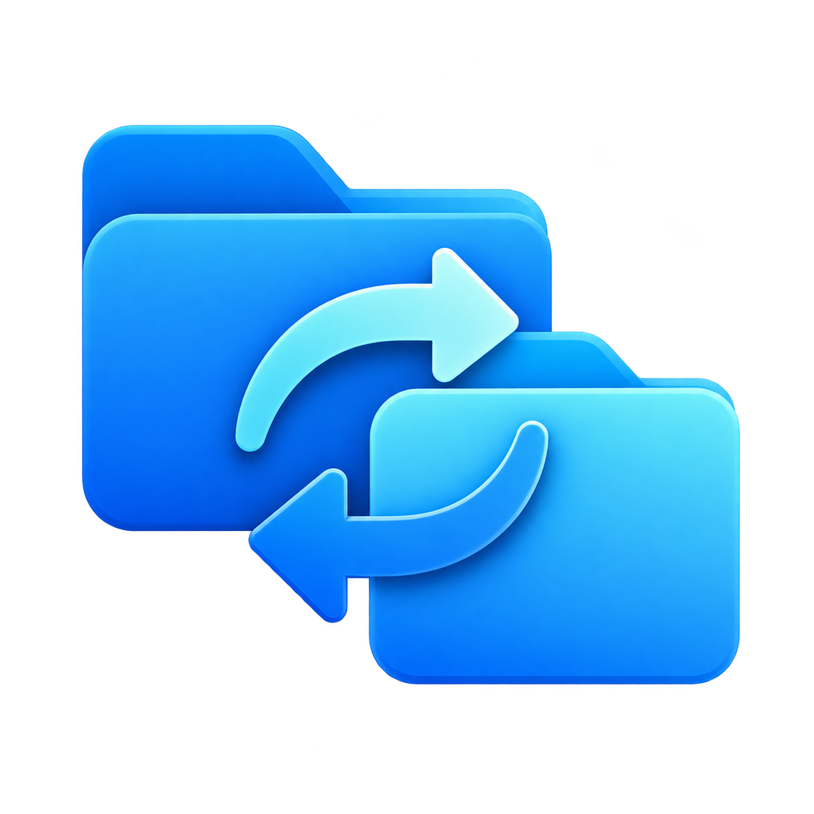
  <h1>Integrated Mod Manager</h1>
  <p>A WinUI 3 app for organizing, switching, browsing, and updating mods on Windows 10/11</p>

  [](https://github.com/uyujkk/Integrated_Mod_Manager/actions/workflows/build-and-test.yml)
  [](https://github.com/uyujkk/Integrated_Mod_Manager/releases/latest)
  [](./LICENSE)
  [](#requirements)
  [](https://ko-fi.com/uyujkk)
  [](https://discord.gg/G9nszEQgrV)

  [中文](./docs/README.zh-CN.md) · **English**

  [Download Latest](https://github.com/uyujkk/Integrated_Mod_Manager/releases/latest) ·
  [Quick Start](./docs/guides/en/Quick-Start.md) ·
  [Full Guide](./docs/guides/en/User-Guide.md) ·
  [Changelog](./docs/releases/CHANGELOG.md) ·
  [Screenshots](#interface-preview) ·
  [Report an Issue](https://github.com/uyujkk/Integrated_Mod_Manager/issues/new/choose) ·
  [Discord](https://discord.gg/G9nszEQgrV)
</div>

> [!IMPORTANT]
> This is an unofficial fan-made tool. It is not affiliated with, endorsed by, authorized by, or sponsored by XXMI, any game publisher, or any related developer. Follow the rules of the relevant game, platform, and mod author.

## Overview

**Current stable version: [v4.8.1](https://github.com/uyujkk/Integrated_Mod_Manager/releases/tag/v4.8.1).** 4.8 redesigns every page (a navigation pane with title-bar search, card-based Dashboard and Settings, a Mod workspace with a command bar and resizable columns, an Online page with a details drawer, and clearer dialogs) and fixes five data-safety problems; 4.7 added preset pictures, overlay looks, preset sharing and other games. Characters in a repository show avatars, a character can keep several Mods enabled, each Mod can keep named state slots, and the always-on-top overlay can save presets (sending F10 first), switch slots in game and refresh after Mod changes. The shortcut panel, integrated Endfield launch, browsing and downloading, library tools and combination presets remain. See the [4.8.0 release notes](./docs/releases/v4.8.0.md), the [shortcut panel guide](./docs/guides/en/Shortcut-Panel.md) and the [launch and risk guide](./docs/guides/en/Endfield-Launch.md).

Integrated Mod Manager organizes different games or mod environments into independent repositories. It copies or removes complete mod folders between a local library and the target directory read by the game, while keeping preview images, source links, shortcut notes, online downloads, update records, profiles, and installation backups in one application.

The application, launcher, and updater use version **4.8.1** (`4.8.1.0`). The tool is maintained by `uyujkk`. The Bandizip extraction fallback was contributed by [CaramelizedCUDA](https://github.com/CaramelizedCUDA). The earlier [4.0-beta](https://github.com/uyujkk/Integrated_Mod_Manager/releases/tag/v4.0-beta) remains archived separately.

## Interface Preview

Screenshots come from an isolated copy of a 4.8.0 build with the repository's synthetic test data: a sample character with two test Mods, sample tracked Mods and download history, and the Online page in its offline sample mode (sample characters and Mods with generated pictures; nothing is requested from the network). No game, loader, real Mod or online content is shown. See [how they were captured](./docs/assets/screenshots/README.md).

**Mod workspace** — characters on the left; the character's Mods with size and deploy state, filtered by All Mods / Deployed only / Not deployed, under a command bar; the details show the preview, source link, folder, tags and size, with the red Remove from target button.

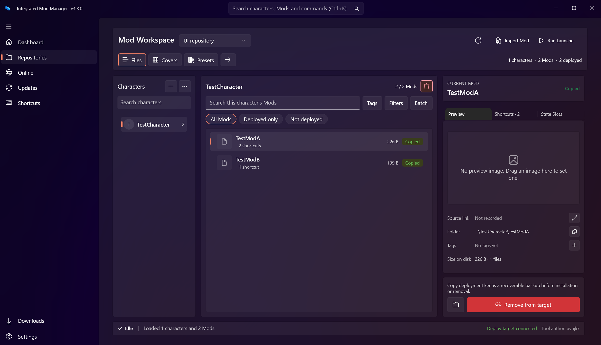

**Dashboard** — the current repository (click its name to switch), quick actions as cards, the paths in one section, the characters and all repositories.

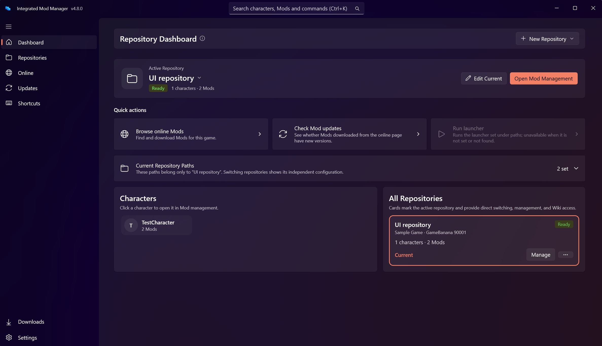

**Online** — browse by character, search, sort and filter; each card shows the picture, character, author and counts, with buttons for the source page and download.

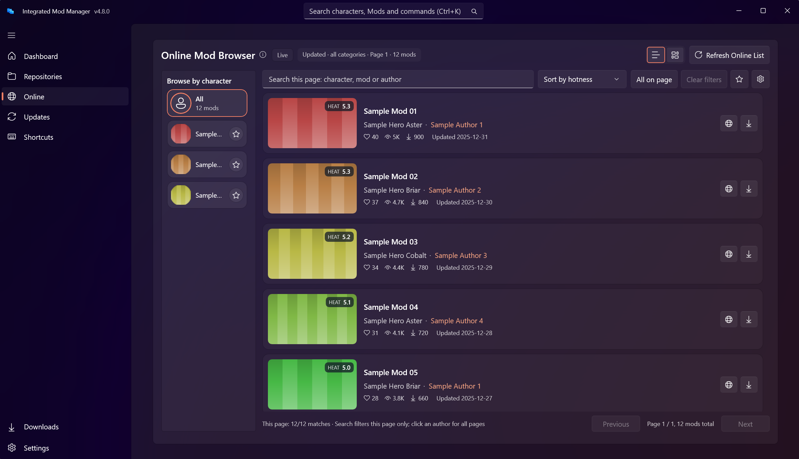

<p align="center">
  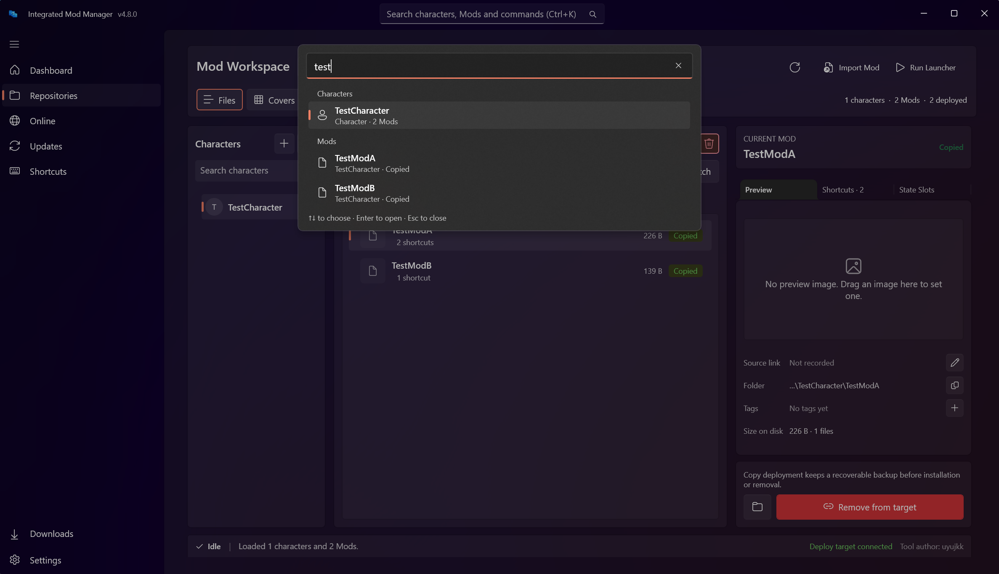
  &nbsp;
  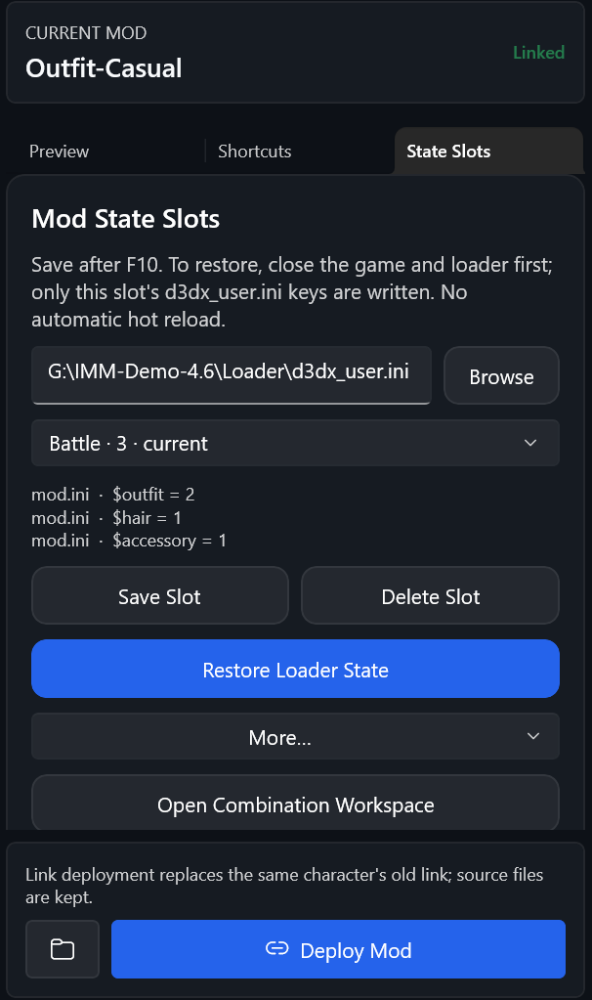
</p>

**Command palette (Ctrl+K)** — one search over the pages, commands and the current repository's characters and Mods, grouped by type. **State slots (4.5, 4.6 screenshot)** — save a Mod's persistent values as named slots; More… updates or renames a slot, writes it as the Mod's defaults (with backups), imports a variant file and snapshots the whole `d3dx_user.ini`.

**Mod shortcut panel** — one column of cards: the Mod, the target window and input, a status bar, the Mod's key bindings as key caps with Send, then the overlay and its settings.

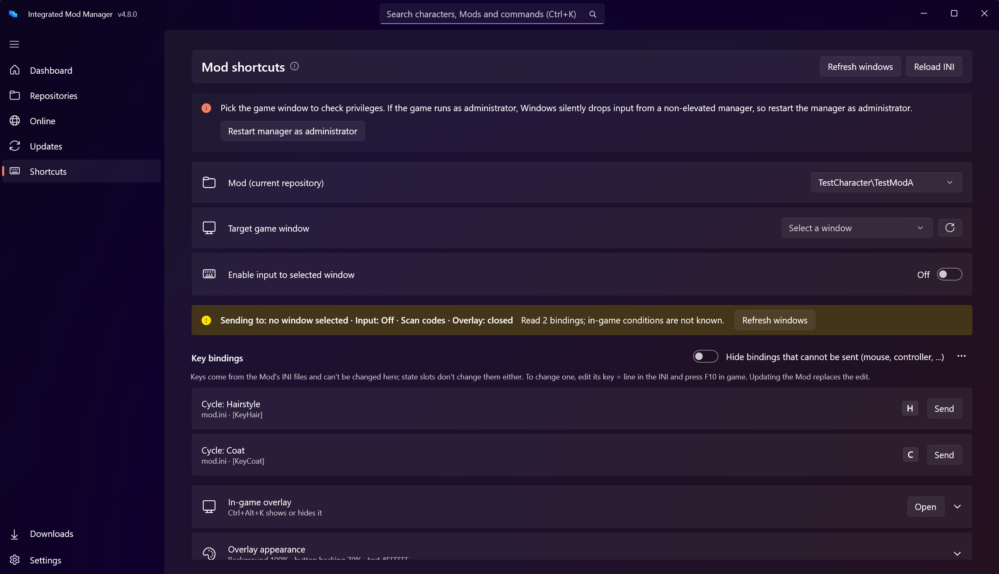

<p align="center">
  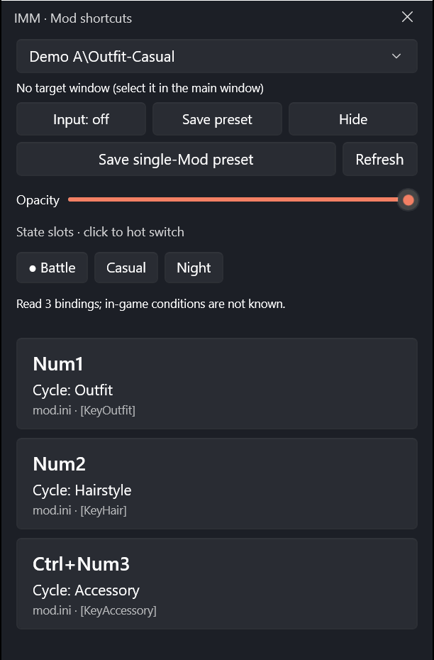
</p>

**Overlay (4.5 screenshot)** — over the game, switch enabled Mods, hot-switch slots (experimental), save a combination or a named single-Mod preset (F10 is sent first), and refresh after Mod changes.

<details>
<summary>Updates and Settings</summary>

The Updates page has a status area with Check now and three views: Mod updates, Download history, and Install and recovery.

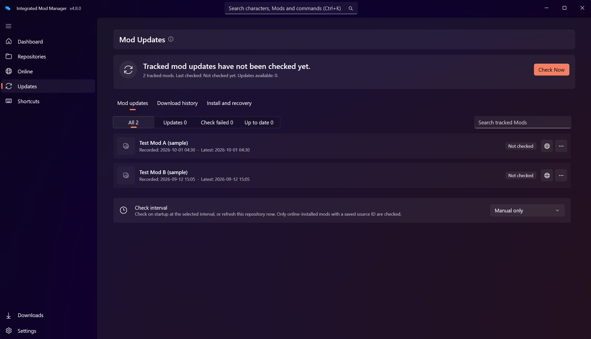

Settings uses cards, in two columns on wide windows: appearance and language on the left; app updates, project links and diagnostics on the right. The picture is cropped below the diagnostics.

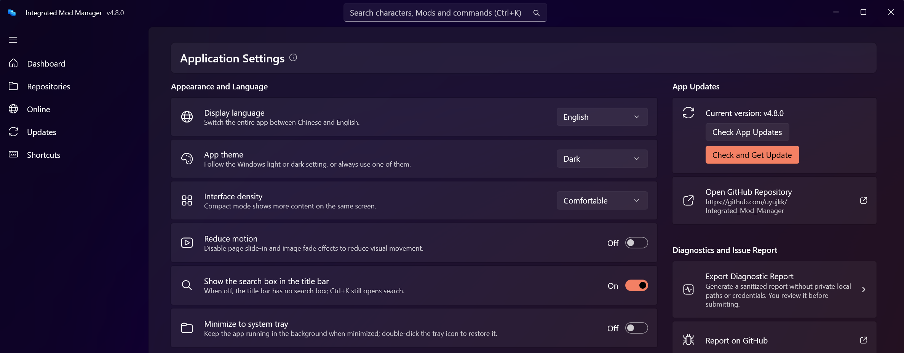

Combination presets (4.1 screenshot): save a Mod set with persistent values, review its members, and export or install a combination bundle.

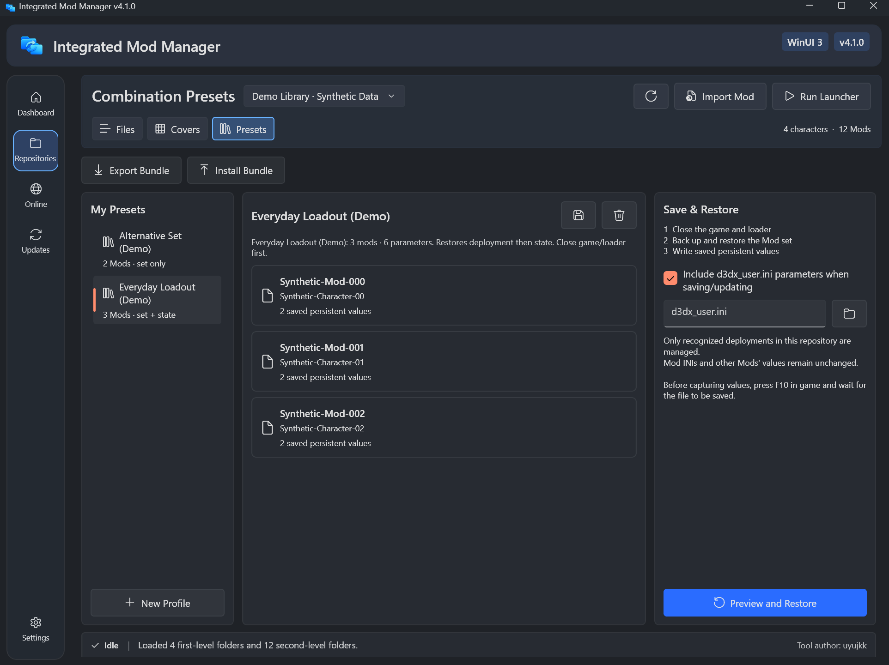

</details>

Guides: [user guide](./docs/guides/en/User-Guide.md) · [shortcut panel and overlay](./docs/guides/en/Shortcut-Panel.md) · [state slots](./docs/guides/en/State-Slots.md) · [combination presets](./docs/guides/en/Combination-Presets.md)

## What's New in 4.8

- **A new interface:** a navigation pane with a search box in the title bar (Ctrl+K), the Dashboard and Settings as cards, a Mod workspace with a command bar, resizable columns and a details drawer, an Online page with a wider drawer and clear loading, empty and error states, an Updates page in three views, Shortcuts as one column of cards, and dialogs whose buttons name their action, with red buttons for destructive ones.
- **Data safety:** fixes for turning a single Mod on or off when the source and target overlap, the preset picture cleanup at startup following a link, deleting a Mod while the loader folder is unavailable, copy-mode preset restores deleting a same-named folder, and a character rename leaving links and saved paths behind. All five are in 4.7.3 and earlier.
- **Faster start:** four pages are created when first opened, so the app starts about 80–120 ms faster.

[4.8.1 release notes](./docs/releases/v4.8.1.md) · [Verification scope](./docs/verification/v4.8.1.md)

## What's New in 4.7

- **Preset pictures:** optional screenshots when saving from the overlay, thumbnails for slots and combination presets, framing a character, and switching slots by picture.
- **Overlay:** element backing and text shadow, compact view, click-through, Clear, Balanced and Minimal looks, and optional automatic contrast.
- **Share a preset** as a small file without Mod files; importing applies only the Mods the other person has.
- **Other games:** a first install picks the language and the game; Genshin Impact, Honkai: Star Rail and Zenless Zone Zero start through XXMI.
- **Default slots** for every Mod, slot saves that leave out menu state, a loader auto-save setting, and **batch actions** (add to a preset, copy, export as a bundle, delete).

- **4.7.1:** the updater is built with .NET 8, so antivirus engines no longer flag it.
- **4.7.2:** online character lists retry stalled requests and fall back to the game's wiki.
- **4.7.3:** the interface is available in Russian (Settings → Language).

[4.7.0 release notes](./docs/releases/v4.7.0.md) · [4.7.1](./docs/releases/v4.7.1.md) · [4.7.2](./docs/releases/v4.7.2.md) · [4.7.3](./docs/releases/v4.7.3.md) · [Verification scope](./docs/verification/v4.7.3.md)

## What's New in 4.6

- **Every page redesigned:** a collapsible navigation, a Ctrl+K command palette over pages, characters and Mods, and downloads at the foot of the navigation.
- **Mod repository:** rows with thumbnails, tags, key counts, size and deploy state, state filters, an editable details table, and setup steps for a new repository.
- **Online, shortcuts and settings:** one card style with a details drawer; key-cap bindings with collapsible modules; a two-column settings overview with a follow-Windows theme.
- **Updates:** the page fills the window; tracked Mods and download history are compact lists with filters and search.
- **4.6.1:** new Mods get a Default slot; the overlay can save from an unchanged file; Settings lists the feedback QQ group 1041384622; layout fixes.
- Local preview builds no longer turn off app update checks. Coming from one? See [getting update checks back](./docs/releases/v4.6.0.md#getting-update-checks-back-after-a-local-preview).

[4.6.1 release notes](./docs/releases/v4.6.1.md) · [4.6.0](./docs/releases/v4.6.0.md) · [Verification scope](./docs/verification/v4.6.1.md)

## What's New in 4.5

- **Character avatars:** an `.imm_avatar.*` or `avatar.*` image in the character folder, a bound character, or the catalog character with the same name. New characters reach the list within a day.
- **Several Mods per character:** one Mod per character by default; turn on multi-select per character.
- **Single-Mod state slots:** several named value sets per Mod; write a slot as the Mod's defaults (with backups), import a variant file (unverified), or snapshot the whole `d3dx_user.ini`.
- **F10 hot apply (experimental):** restore a slot while the game runs, or switch slots from the overlay.
- **4.5.1:** name and save a single-Mod preset from the overlay.
- **4.5.2:** the overlay sends F10 before saving and saves only once the loader has written; a Refresh button and automatic refresh after Mod changes; faster Mods with many bindings; directory links, loader state restore and combination presets are no longer experimental.
- The game window is selected automatically; restoring a maximized window shrinks it to 80% of the screen.

[4.5.2 release notes](./docs/releases/v4.5.2.md) · [4.5.1](./docs/releases/v4.5.1.md) · [4.5.0](./docs/releases/v4.5.0.md)

## Earlier Versions

- **4.4** — Mod shortcut panel and overlay, following the active character, long-path updates. [Notes](./docs/releases/v4.4.0.md)
- **4.3** — integrated Endfield launch, INI conflict warnings, Mod update notifications. [Notes](./docs/releases/v4.3.1.md)
- **4.2** — download task center, saved authors, batch tags and saved filters. [Notes](./docs/releases/v4.2.0.md)
- **4.1** — portable combination bundles, faster repository scanning. [Notes](./docs/releases/v4.1.0.md)
- **3.9** — redesigned interface, Bandizip fallback contributed by [CaramelizedCUDA](https://github.com/CaramelizedCUDA) ([PR #4](https://github.com/uyujkk/Integrated_Mod_Manager/pull/4)), standalone Developer Tools. [Notes](./docs/releases/v3.9.5.md)

Full history: [Changelog](./docs/releases/CHANGELOG.md).

## Core Features

| Feature | Description |
| --- | --- |
| Navigation and command palette | A collapsible navigation; Ctrl+K searches the pages and the current repository's characters and Mods; download progress at the foot of the navigation |
| Multiple repositories | Keep separate paths and online categories for different games or XXMI setups |
| Local mod switching | Browse, search, copy, remove, create, rename, and delete two-level mod folders |
| Character avatars | Show an avatar for each character folder; use your own image or bind the folder to a catalog character |
| Several Mods per character | Keep one Mod enabled per character by default, or allow several for chosen characters |
| Single-Mod state slots | Save named sets of a Mod's persistent values; restore them, write them as Mod defaults, or snapshot `d3dx_user.ini` |
| Mod shortcut panel | Click a Mod's INI key bindings to send them to the game, from the main window or an always-on-top overlay that can follow the active character, save presets and hot-switch slots (experimental) |
| Directory junctions | Let the loader and library share one mod directory; with single selection, enabling a Mod replaces the previous link for that character |
| Archive import | Import ZIP, 7Z, RAR, ZIPX, CAB, TAR, and common compressed stream formats |
| Previews and notes | Store an image, source link, shortcut keys, and action descriptions for each mod |
| Repository workspace | Switch between a file list and cover gallery; rows show thumbnails, tags, key counts, size and deploy state, with state filters, an editable details table and setup steps for a new repository |
| Combination and state presets | Save enabled Mod sets with numeric persistent values; restore the set, then matching `d3dx_user.ini` values |
| Portable combination bundles | Export selected saved presets with Mod files; validate, preview, install and optionally restore them in another repository |
| Online mod browser | Browse GameBanana entries, filter by character, view details, and download and extract mods |
| Configuration profiles | Save and apply complete enabled-mod setups without touching unknown target folders |
| Installation safety | Detect file conflicts and create restorable backups for copy, remove, and profile operations |
| Download task center | Monitor downloads from the navigation; filter the download history by outcome, retry failures and open output folders |
| Updates and diagnostics | Check mod and app updates (tracked Mods filter by status), roll back failed updates, and export sanitized diagnostics |
| Accessibility | Chinese/English, light/dark or follow Windows, high contrast, keyboard navigation, and display scaling |

## Download and Run

1. Open the [latest GitHub Release](https://github.com/uyujkk/Integrated_Mod_Manager/releases/latest).
2. Download `Integrated_Mod_Manager-vX.X.X.zip` and its matching `.sha256` file.
3. **Fully extract** the ZIP into a writable folder. Do not run it inside the archive.
4. Run `IntegratedModManager.exe` from the extracted root folder.
5. Create or select a repository, then configure the mod storage folder, target folder, and optional launcher.

`IntegratedModManager.exe` is the official launcher. The package temporarily retains `ModFolderCopier.exe` as a compatibility entry point for in-place updates from v3.8.5. The WinUI runtime is located at `WinUI3/ModFolderCopier.WinUI.exe`. Keep the release directory structure intact.

### SmartScreen Notice

The executable is not signed with a commercial code-signing certificate, so Windows SmartScreen may report an unknown publisher. Download only from this repository's Releases page, and do not disable Microsoft Defender to run the app. The source, build scripts, automated tests, and package verification flow are public in this repository.

## Quick Start

1. Create or select a repository on the Dashboard.
2. Set the Mod Storage Folder on the Dashboard to the root of a two-level mod directory.
3. Set the Target Folder to the Mods directory read by the game or mod loader.
4. Open the Repositories page (a **Get started** card lists any setup step still missing), select a first-level category, then select a second-level mod.
5. Double-click the mod or use the deployment action in Details to toggle it. Selecting a Mod or switching views does not deploy it.

If the target does not contain a folder with the same name, the app copies the complete mod. If it already exists, running the action again removes it from the target. Deleting the source mod from the repository is a separate action and requires confirmation.

### Recommended Folder Layout

```text
Mod Storage Folder
├─ Character or Category A
│  ├─ Mod A1
│  └─ Mod A2
└─ Character or Category B
   └─ Mod B1
```

The first level is a character, purpose, or other category. The second level contains the complete mod folders managed by the app.

## Documentation

| Document | Chinese | English |
| --- | --- | --- |
| Quick start | [快速上手](./docs/guides/zh-CN/快速上手.md) | [Quick Start](./docs/guides/en/Quick-Start.md) |
| Complete guide | [用户手册](./docs/guides/zh-CN/用户手册.md) | [User Guide](./docs/guides/en/User-Guide.md) |
| Shortcut panel and overlay | [快捷键面板与置顶浮窗](./docs/guides/zh-CN/快捷键与浮窗.md) | [Shortcut Panel and Overlay](./docs/guides/en/Shortcut-Panel.md) |
| State slots | [单 Mod 状态槽位](./docs/guides/zh-CN/状态槽位.md) | [Single-Mod State Slots](./docs/guides/en/State-Slots.md) |
| Combination presets | [组合预设与组合包](./docs/guides/zh-CN/组合预设.md) | [Combination Presets and Bundles](./docs/guides/en/Combination-Presets.md) |
| Browse and download | [浏览与下载](./docs/guides/zh-CN/浏览与下载.md) | [Browse and Download](./docs/guides/en/Browse-and-Download.md) |
| Endfield launch | [内置终末地启动](./docs/guides/zh-CN/终末地启动.md) | [Integrated Endfield Launch](./docs/guides/en/Endfield-Launch.md) |
| Older upgrade notes (archive) | [归档](./docs/guides/archive/) | [Archive](./docs/guides/archive/) |
| Release history | [Bilingual Changelog](./docs/releases/CHANGELOG.md) | [Bilingual Changelog](./docs/releases/CHANGELOG.md) |
| Cross-mod state experiments | [Current conclusions](./docs/research/跨Mod状态保存试验结论.md) | [Current conclusions](./docs/research/跨Mod状态保存试验结论.md) |
| Software structure | [软件结构](./docs/development/Software-Structure.md) | [Software Structure](./docs/development/Software-Structure.md) |
| Tests and builds | [Testing Guide](./docs/development/TESTING.md) | [Testing Guide](./docs/development/TESTING.md) |
| 4.1 source optimization | [源码优化记录](./docs/development/Source-Optimization-v4.1.md) | [Source Optimization Record](./docs/development/Source-Optimization-v4.1.md) |
| Contributions | [Contributing](./.github/CONTRIBUTING.md) | [Contributing](./.github/CONTRIBUTING.md) |
| Security | [Security Policy](./.github/SECURITY.md) | [Security Policy](./.github/SECURITY.md) |

## Requirements

- Windows 10 version 1809 or later; Windows 11 is recommended.
- 64-bit Windows (`x64`).
- Online browsing, translation, and update checks require a network connection.
- The release bundles the Windows App SDK but requires the .NET 8 x64 runtime. Regular users do not need the .NET SDK or Visual Studio.
- 7Z, RAR, ZIPX, and CAB prefer bundled or installed 7-Zip. If unavailable, the app uses an installed Bandizip's `bz.exe`, with Windows `tar.exe` checking paths and links before extraction.

## Build from Source

Development requires Windows 10/11 x64, the .NET 8 SDK, Visual Studio 2022 or Build Tools 2022, MSBuild, Windows App SDK, and Windows SDK.

```powershell
cmd /c scripts\build_winui.bat
```

Run the complete test, coverage, WinUI x64 build, and package verification flow:

```powershell
powershell -NoProfile -ExecutionPolicy Bypass -File .\scripts\test-all.ps1
```

GitHub Actions runs the same four-suite verification flow on pushes to `main`, pull requests, and manual dispatches. Test dependencies are centralized without removing safety cases. See the [Testing Guide](./docs/development/TESTING.md) and [4.5.2 verification record](./docs/verification/v4.5.2.md) for current results and testing boundaries.

## Data and Security

- Repository paths, interface settings, and online caches remain on the local computer and are not automatically uploaded by this project.
- Diagnostic reports exclude access credentials and sanitize user paths, but users should still review them before submitting.
- The app does not bypass payments, subscriptions, permissions, CAPTCHAs, or restrictions set by mod authors.
- Do not disclose local configuration files, personal paths, access tokens, or other sensitive information in issues, screenshots, or archives.
- Follow [SECURITY.md](./.github/SECURITY.md) when reporting a security issue.

## License and Notices

Source files are available under the [MIT License](./LICENSE), copyright `uyujkk`, except the integrated Endfield launch component in [`IntegratedModManager.EndfieldLaunch/`](./src/IntegratedModManager.EndfieldLaunch/), which is **AGPL-3.0-only** (derived from EndfieldBridge, endfield-nolauncher and Better-Endfield; see its [NOTICE](./src/IntegratedModManager.EndfieldLaunch/NOTICE.md)). Because the application includes that component, **release packages from v4.3.0 on are distributed as a whole under AGPL-3.0-only**; v4.2.0 and earlier remain MIT. See [LICENSING.md](./docs/LICENSING.md). Third-party components retain their own licenses; bundled 7-Zip files include their license text.

The tool does not include game files or mod content. Rights related to games, characters, images, mods, and third-party services belong to their respective owners.
