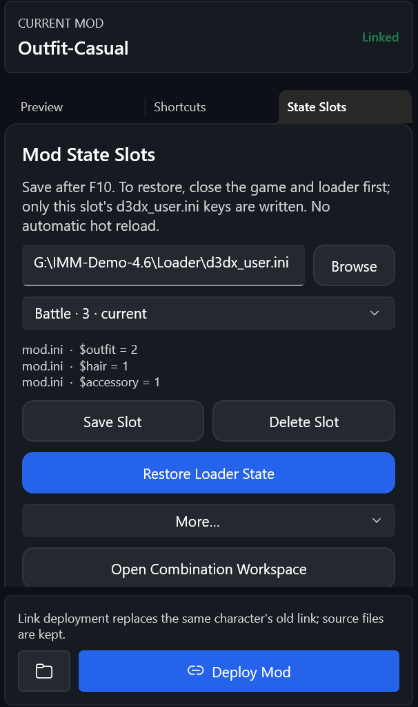
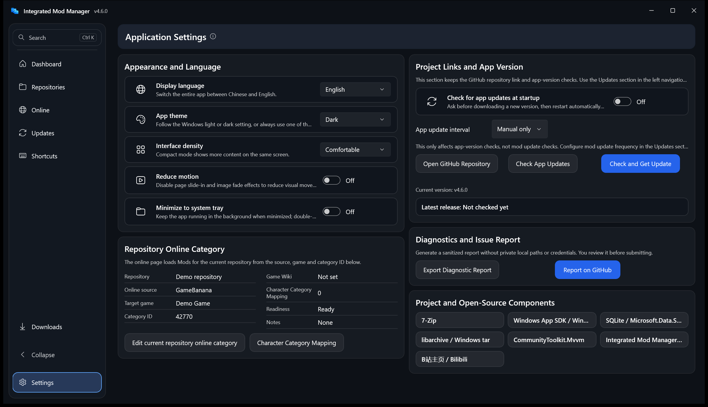
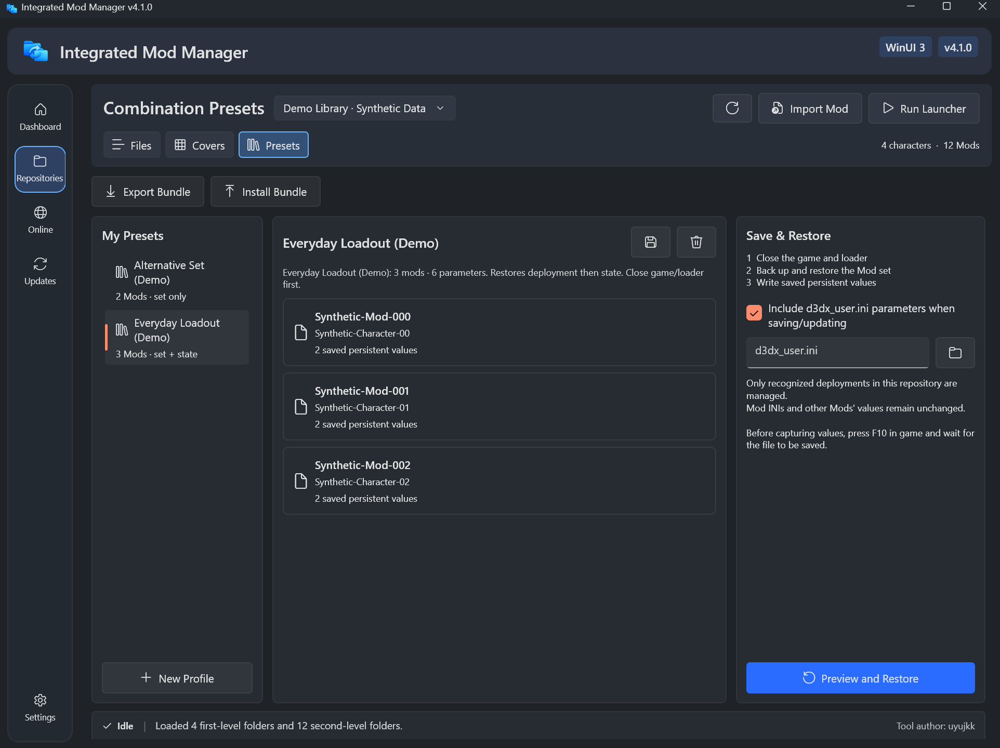

> **v4.6.0 正式版。** 全部页面重新设计：可折叠导航与 Ctrl+K 命令面板、信息更全的 Mod 列表与详情、在线详情抽屉，以及铺满窗口的更新页。本地预览版不再关闭更新检查。见 [4.6.0 发布说明](releases/v4.6.0.md)。

<div align="center">
  
  <h1>集成化 Mod 管理器</h1>
  <p>面向 Windows 10/11 的 WinUI 3 Mod 整理、切换、浏览与更新工具</p>

  [](https://github.com/uyujkk/Integrated_Mod_Manager/actions/workflows/build-and-test.yml)
  [](https://github.com/uyujkk/Integrated_Mod_Manager/releases/latest)
  [](../LICENSE)
  [](#系统要求)
  [](https://ko-fi.com/uyujkk)

  **中文** · [English](../README.md)

  [下载最新版](https://github.com/uyujkk/Integrated_Mod_Manager/releases/latest) ·
  [快速手册](./guides/zh-CN/快速上手.md) ·
  [完整手册](./guides/zh-CN/用户手册.md) ·
  [更新日志](./releases/CHANGELOG.md) ·
  [界面预览](#界面预览) ·
  [提交问题](https://github.com/uyujkk/Integrated_Mod_Manager/issues/new/choose)
</div>

> [!IMPORTANT]
> 本项目是非官方的爱好者工具，与 XXMI、任何游戏发行商及相关开发者均无隶属、授权、认可或赞助关系。使用 Mod 前，请遵守对应游戏、平台和 Mod 作者的规则。

## 项目简介

**当前正式版：[v4.6.0](https://github.com/uyujkk/Integrated_Mod_Manager/releases/tag/v4.6.0)。**4.6 重新设计了全部页面，下面的功能用法与 4.5 相同。仓库里的角色显示头像，一个角色可以同时启用多个 Mod，每个 Mod 可以保存多个命名状态槽位，置顶浮窗可以保存预设（先发送 F10）、在游戏中切换槽位，并在 Mod 变化后刷新。快捷键面板、内置终末地启动、浏览下载、旧库整理和组合预设继续保留。使用前请阅读 [4.6.0 发布说明](./releases/v4.6.0.md)、[快捷键面板说明](./guides/zh-CN/快捷键与浮窗.md)及[内置启动与账号风险说明](./guides/zh-CN/终末地启动.md)。

集成化 Mod 管理器以独立“仓库”管理不同游戏或不同 Mod 环境。它可以在本地仓库和游戏实际读取的目标目录之间复制或移除完整 Mod 文件夹，并集中管理预览图、来源链接、快捷键说明、在线下载、更新记录、配置方案和安装备份。

主程序、启动器和更新器统一为 **4.6.0**（`4.6.0.0`）。工具维护者为 `uyujkk`，既有 Bandizip 备用解压功能由 [CaramelizedCUDA](https://github.com/CaramelizedCUDA) 贡献；此前的 [4.0-beta](https://github.com/uyujkk/Integrated_Mod_Manager/releases/tag/v4.0-beta) 继续独立保留。

## 界面预览

截图来自 4.6.0 发布包的独立副本和模拟演示仓库：占位角色、生成的头像和预览图、演示 Mod，不含游戏、加载器、真实 Mod 或在线内容。截图方法见[截图说明](./assets/screenshots/README.md)。截图为英文界面，应用也支持中文。

**Mod 仓库工作台**：左侧是带头像的角色；Mod 列表显示缩略图、标签、大小和部署状态，可按“全部 / 已部署 / 未部署”筛选；右侧详情显示预览图，以及来源链接、文件夹、标签和大小的信息表。


**仪表板**：当前仓库的状态和数量、路径、可直接打开角色 Mod 的角色一览、仓库卡片和常用操作。


<p align="center">
  
  &nbsp;
  
</p>

**命令面板（Ctrl+K）**：一个搜索框覆盖各页面、命令和当前仓库的角色与 Mod。**状态槽位（4.5）**：把 Mod 的持久参数保存为命名槽位；“更多…”里可以更新、重命名、写入 Mod 默认值（自动备份）、导入变体文件，以及保存整份 `d3dx_user.ini` 快照。

**Mod 快捷键面板**：选择 Mod 后，INI 中的按键绑定以键帽样式列出，点击即可发送到游戏；游戏内浮窗、角色跟随和发送方式是右侧可折叠的模块。


<p align="center">
  
</p>

**置顶浮窗**：在游戏画面上切换已启用的 Mod、热切换槽位（实验）、保存组合预设或命名的单 Mod 预设（保存前先发送 F10），Mod 变化后可刷新。

<details>
<summary>更新页与设置页</summary>

更新页铺满窗口：已追踪 Mod 和下载历史是可筛选的紧凑列表，旁边是安装安全和安装备份。


设置页为两栏总览：界面与语言、软件更新、仓库在线分类、诊断和开源组件。



组合预设（4.1 截图）：保存 Mod 组合及持久参数，查看预设成员，导出或安装组合包。



</details>

使用说明：[用户手册](./guides/zh-CN/用户手册.md) · [快捷键面板与置顶浮窗](./guides/zh-CN/快捷键与浮窗.md) · [状态槽位](./guides/zh-CN/状态槽位.md) · [组合预设](./guides/zh-CN/组合预设.md)

## 4.6 更新

- **全部页面重新设计**：导航可以折叠；Ctrl+K 命令面板可以搜索页面、角色和 Mod；下载入口固定在侧栏底部。
- **Mod 仓库**：列表显示缩略图、标签、按键数量、大小和部署状态，可以按状态筛选；详情信息表可以直接编辑；新仓库显示设置步骤。
- **在线、快捷键与设置**：在线卡片统一样式，详情在抽屉中打开；按键以键帽样式显示，功能分成可折叠模块；设置为两栏总览，主题可以跟随系统。
- **更新**：页面铺满窗口；已追踪 Mod 和下载历史改为可筛选、可搜索的紧凑列表。
- 本地预览版不再关闭软件更新检查。从预览版换回正式版，见[恢复更新检查](./releases/v4.6.0.md#从本地预览版恢复更新检查)。

[4.6.0 发布说明](./releases/v4.6.0.md) · [验证范围](./verification/v4.6.0.md)

## 4.5 更新

- **角色头像**：依次使用角色文件夹里的 `.imm_avatar.*` 或 `avatar.*` 图片、手动绑定的角色、与文件夹同名的目录角色。新角色一天内进入角色列表。
- **每个角色启用多个 Mod**：默认每个角色只启用一个，可按角色打开多选。
- **单 Mod 状态槽位**：每个 Mod 保存多套命名参数；可写入 Mod 默认值（自动备份）、导入变体文件（待验证）、保存整份 `d3dx_user.ini` 快照。
- **F10 热应用（实验）**：游戏运行时恢复槽位，或在浮窗中切换槽位。
- **4.5.1**：在浮窗中命名并保存单 Mod 预设。
- **4.5.2**：浮窗保存前发送 F10，等加载器写入后再保存；新增刷新按钮，Mod 变化后自动刷新；多按键 Mod 更快；目录联接、恢复到加载器和组合预设不再标为实验功能。
- 自动识别游戏窗口；最大化后还原时窗口缩到屏幕的 80%。

[4.5.2 发布说明](./releases/v4.5.2.md) · [4.5.1](./releases/v4.5.1.md) · [4.5.0](./releases/v4.5.0.md)

## 早期版本

- **4.4**：Mod 快捷键面板与置顶浮窗、跟随出场角色、更新器支持超长路径。[说明](./releases/v4.4.0.md)
- **4.3**：内置终末地启动、INI 冲突提示、Mod 更新提醒。[说明](./releases/v4.3.1.md)
- **4.2**：下载任务中心、作者收藏、批量标签与保存筛选。[说明](./releases/v4.2.0.md)
- **4.1**：组合包导出与安装、仓库扫描提速。[说明](./releases/v4.1.0.md)
- **3.9**：界面重构、由 [CaramelizedCUDA](https://github.com/CaramelizedCUDA) 贡献的 Bandizip 备用解压（[PR #4](https://github.com/uyujkk/Integrated_Mod_Manager/pull/4)）、独立开发者工具。[说明](./releases/v3.9.5.md)

完整历史见[更新日志](./releases/CHANGELOG.md)。

## 核心功能

| 功能 | 说明 |
| --- | --- |
| 导航与命令面板 | 导航可以收起；Ctrl+K 搜索页面、当前仓库的角色和 Mod；下载进度显示在导航底部 |
| 多仓库管理 | 为不同游戏、角色或 XXMI 配置保存独立路径与在线分类 |
| 本地 Mod 切换 | 使用两层目录浏览、搜索、复制、移除、创建、重命名和删除 Mod |
| 角色头像 | 为每个角色文件夹显示头像；可使用自己的图片，或绑定到目录中的角色 |
| 每个角色多个 Mod | 默认每个角色只启用一个 Mod，也可以为指定角色允许多个 |
| 单 Mod 状态槽位 | 保存 Mod 持久参数的多套命名组合；可恢复、写入 Mod 默认值或保存 `d3dx_user.ini` 快照 |
| Mod 快捷键面板 | 点击 Mod INI 中的按键绑定即可发送到游戏；可在主窗口或置顶浮窗中使用，能跟随出场角色、保存预设和热切换槽位（实验） |
| 目录联接 | 让加载器与仓库使用同一份 Mod 目录；单选时，启用新 Mod 会替换同角色的旧联接 |
| 压缩包导入 | 支持 ZIP、7Z、RAR、ZIPX、CAB、TAR 及常见压缩流格式 |
| 预览与说明 | 为每个 Mod 保存预览图、来源链接、快捷键和功能描述 |
| 仓库工作台 | 文件列表与封面视图可切换；列表显示缩略图、标签、快捷键数量、大小和部署状态，可按状态筛选；详情信息表可直接编辑；新仓库显示设置步骤 |
| 组合与状态预设 | 保存已启用 Mod 组合和数值型持久参数，先恢复组合，再回写对应的 `d3dx_user.ini` 参数 |
| 组合包迁移 | 导出所选预设及 Mod 文件；校验、预览、安装后可选择恢复组合和状态 |
| 在线 Mod 浏览 | 浏览 GameBanana 条目，按角色筛选，查看图片与说明并下载解压 |
| 配置方案 | 保存并应用整套已启用 Mod，不影响无法识别的目标目录 |
| 安装安全 | 安装前检测冲突，为复制、移除和方案切换创建可恢复备份 |
| 下载任务中心 | 从导航查看下载进度；下载历史按结果筛选，可重试失败任务、打开输出目录 |
| 更新与诊断 | 检查 Mod 和软件更新（已追踪 Mod 可按状态筛选），回滚失败更新，导出脱敏诊断报告 |
| 辅助功能 | 中文/English、浅色/深色或跟随系统、高对比度、键盘导航和缩放适配 |

## 下载与运行

1. 打开 [Releases 最新版本](https://github.com/uyujkk/Integrated_Mod_Manager/releases/latest)。
2. 下载 `Integrated_Mod_Manager-vX.X.X.zip` 和对应的 `.sha256` 校验文件。
3. 将 ZIP **完整解压**到一个可写文件夹，不要直接在压缩包内运行。
4. 双击根目录中的 `IntegratedModManager.exe`。
5. 创建或选择仓库，设置 Mod 存储文件夹、目标文件夹和可选启动器。

`IntegratedModManager.exe` 是正式启动入口。发布包暂时保留 `ModFolderCopier.exe` 作为从 v3.8.5 自动更新时的兼容入口；WinUI 运行文件位于 `WinUI3/ModFolderCopier.WinUI.exe`。请保留发布包原有目录结构。

### SmartScreen 提示

当前可执行文件没有商业代码签名证书，Windows SmartScreen 可能显示“发布者未知”。请只从本仓库的 Releases 下载，不要为了运行本工具关闭 Microsoft Defender。源码、构建脚本、自动化测试和发布包校验流程均公开在本仓库中。

## 快速开始

1. 在“仪表板”创建或选择仓库。
2. 在仪表板将“Mod 仓库”设置为两层 Mod 目录的根目录。
3. 将“目标文件夹”设置为游戏或 Mod 加载器实际读取的 Mods 目录。
4. 打开“仓库”页（如果还有未完成的设置，“开始使用”卡片会列出），选择第一层分类，再选择第二层 Mod。
5. 双击第二层 Mod 或使用详情里的部署操作完成切换。单击选择或切换视图不会部署 Mod。

目标文件夹中不存在同名目录时，程序复制整个 Mod；已经存在同名目录时，再次操作会将它从目标文件夹移除。删除仓库中的源 Mod 是另一项独立操作，并会在执行前要求确认。

### 推荐目录结构

```text
Mod 存储文件夹
├─ 角色或分类 A
│  ├─ Mod A1
│  └─ Mod A2
└─ 角色或分类 B
   └─ Mod B1
```

第一层是角色、用途或其他分类；第二层是程序实际复制、移除和记录信息的完整 Mod 文件夹。

## 文档导航

| 文档 | 中文 | English |
| --- | --- | --- |
| 快速上手 | [快速上手](./guides/zh-CN/快速上手.md) | [Quick Start](./guides/en/Quick-Start.md) |
| 完整用户手册 | [用户手册](./guides/zh-CN/用户手册.md) | [User Guide](./guides/en/User-Guide.md) |
| 快捷键与浮窗 | [快捷键面板与置顶浮窗](./guides/zh-CN/快捷键与浮窗.md) | [Shortcut Panel and Overlay](./guides/en/Shortcut-Panel.md) |
| 状态槽位 | [单 Mod 状态槽位](./guides/zh-CN/状态槽位.md) | [Single-Mod State Slots](./guides/en/State-Slots.md) |
| 组合预设 | [组合预设与组合包](./guides/zh-CN/组合预设.md) | [Combination Presets and Bundles](./guides/en/Combination-Presets.md) |
| 浏览与下载 | [浏览与下载](./guides/zh-CN/浏览与下载.md) | [Browse and Download](./guides/en/Browse-and-Download.md) |
| 终末地启动 | [内置终末地启动](./guides/zh-CN/终末地启动.md) | [Integrated Endfield Launch](./guides/en/Endfield-Launch.md) |
| 旧版升级说明（归档） | [归档](./guides/archive/) | [Archive](./guides/archive/) |
| 更新历史 | [双语更新日志](./releases/CHANGELOG.md) | [Bilingual Changelog](./releases/CHANGELOG.md) |
| 跨 Mod 状态试验 | [试验路线与当前结论](./research/跨Mod状态保存试验结论.md) | [Current conclusions](./research/跨Mod状态保存试验结论.md) |
| 软件结构 | [软件结构](./development/Software-Structure.md) | [Software Structure](./development/Software-Structure.md) |
| 测试与构建 | [测试说明](./development/TESTING.md) | [Testing Guide](./development/TESTING.md) |
| 4.1 源码优化 | [源码优化记录](./development/Source-Optimization-v4.1.md) | [Source Optimization Record](./development/Source-Optimization-v4.1.md) |
| 参与项目 | [贡献指南](../.github/CONTRIBUTING.md) | [Contributing](../.github/CONTRIBUTING.md) |
| 安全问题 | [安全策略](../.github/SECURITY.md) | [Security Policy](../.github/SECURITY.md) |

## 系统要求

- Windows 10 1809 或更高版本，推荐 Windows 11。
- 64 位 Windows（`x64`）。
- 在线浏览、翻译和更新检查需要网络连接。
- 发布包包含 Windows App SDK，但需要 .NET 8 x64 运行时；普通用户不需要 .NET SDK 或 Visual Studio。
- 7Z、RAR、ZIPX 和 CAB 优先使用发布包内或已安装的 7-Zip；找不到时自动使用已安装 Bandizip 的 `bz.exe`，并由 Windows `tar.exe` 在解压前检查路径和链接。

## 从源码构建

开发环境需要 Windows 10/11 x64、.NET 8 SDK、Visual Studio 2022 或 Build Tools 2022、MSBuild、Windows App SDK 和 Windows SDK。

```powershell
cmd /c scripts\build_winui.bat
```

运行完整测试、覆盖率检查、WinUI x64 构建和发布包验证：

```powershell
powershell -NoProfile -ExecutionPolicy Bypass -File .\scripts\test-all.ps1
```

GitHub Actions 会在推送到 `main`、Pull Request 和手动触发时执行统一四组验证。测试依赖集中管理，未删除安全用例。当前结果及验证边界见[测试说明](./development/TESTING.md)与[4.5.2 验证记录](./verification/v4.5.2.md)。

## 数据与安全

- 仓库路径、界面设置和在线缓存保存在本机，不会由本项目自动上传。
- 诊断报告会排除访问凭据并脱敏用户路径，但提交前仍应由用户检查内容。
- 本工具不会绕过付费、订阅、权限验证、验证码或 Mod 作者的访问限制。
- 不要在 Issue、截图或压缩包中公开本地配置、个人目录、访问令牌或其他敏感信息。
- 安全问题请按照 [SECURITY.md](../.github/SECURITY.md) 的方式报告。

## 许可证与声明

源码文件以 [MIT License](../LICENSE) 发布，版权所有 `uyujkk`；内置终末地启动组件 [`IntegratedModManager.EndfieldLaunch/`](../src/IntegratedModManager.EndfieldLaunch/) 除外，它以 **AGPL-3.0-only** 授权（源自 EndfieldBridge、endfield-nolauncher 与 Better-Endfield，见其 [NOTICE](../src/IntegratedModManager.EndfieldLaunch/NOTICE.md)）。由于程序包含该组件，**自 v4.3.0 起，发布包整体按 AGPL-3.0-only 分发**；v4.2.0 及之前的版本仍为 MIT。详见 [LICENSING.md](./LICENSING.md)。第三方组件保留各自许可证；发布包中的 7-Zip 文件附带其许可证文本。

本工具不包含游戏文件或 Mod 内容。游戏、角色、图片、Mod 和第三方服务的相关权利归各自权利人所有。
