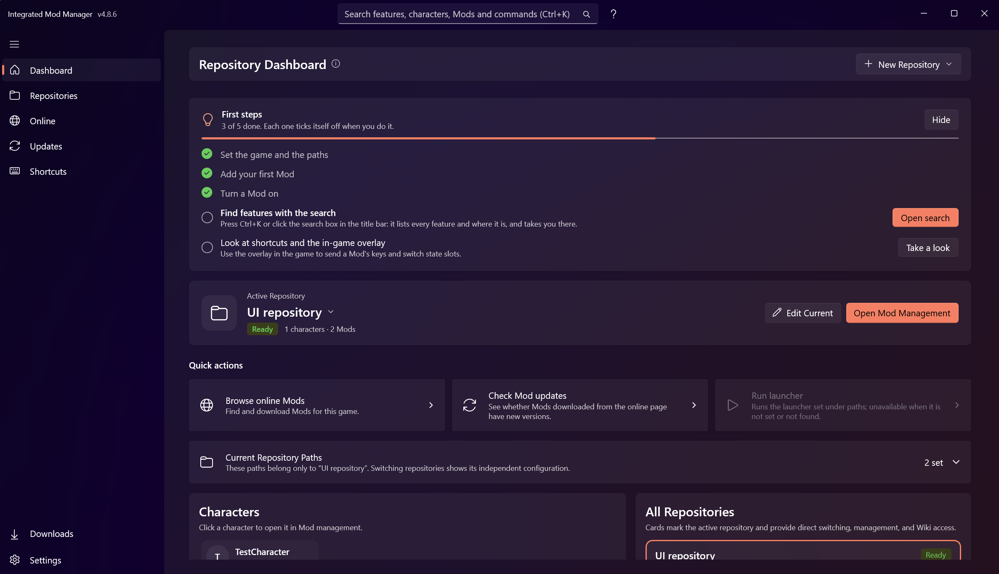
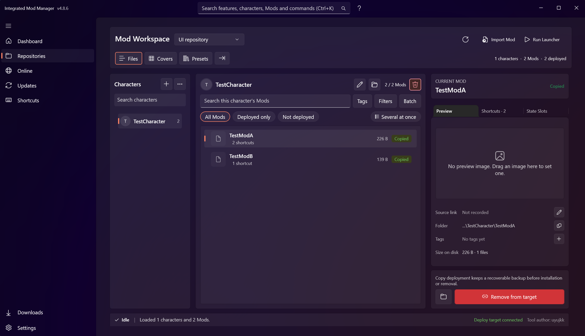
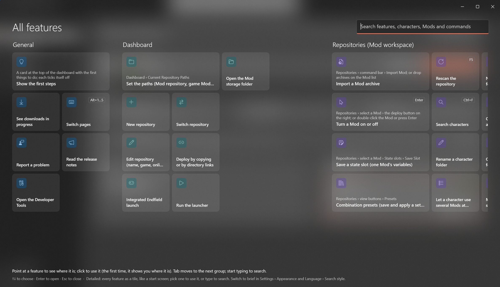
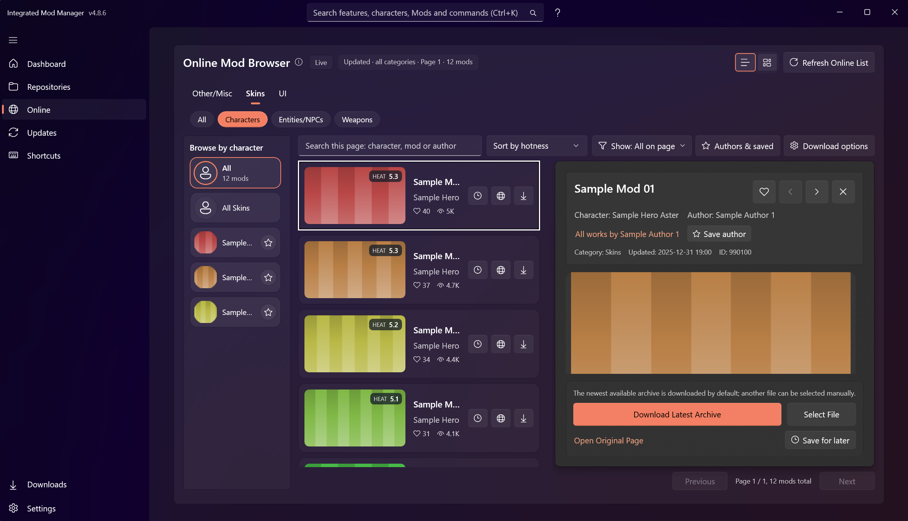
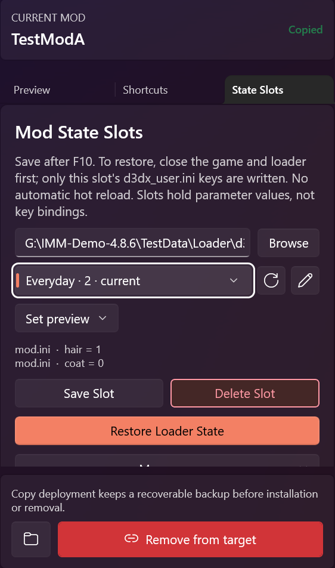
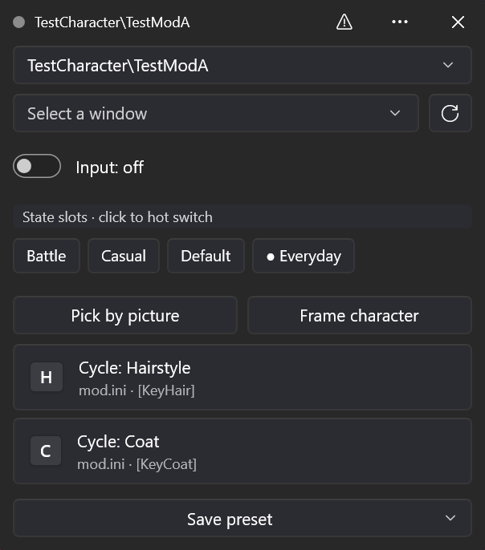
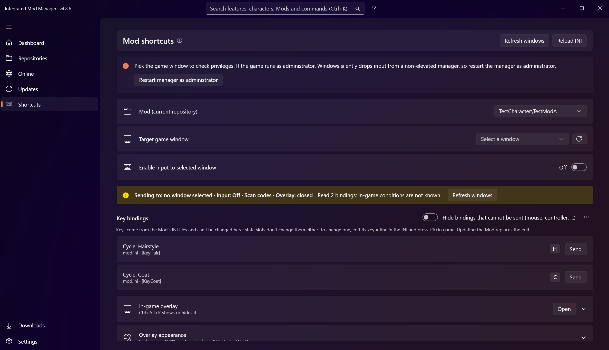
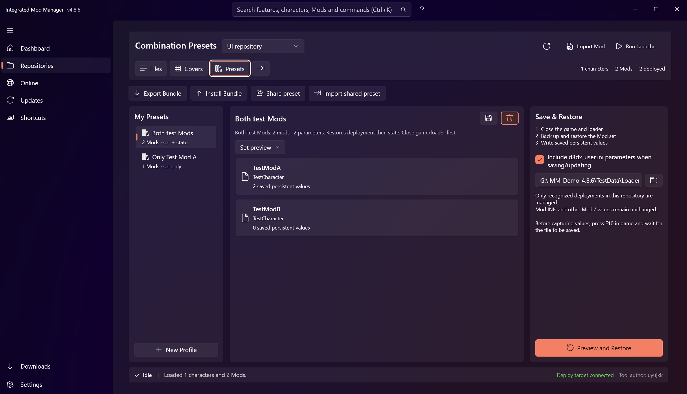
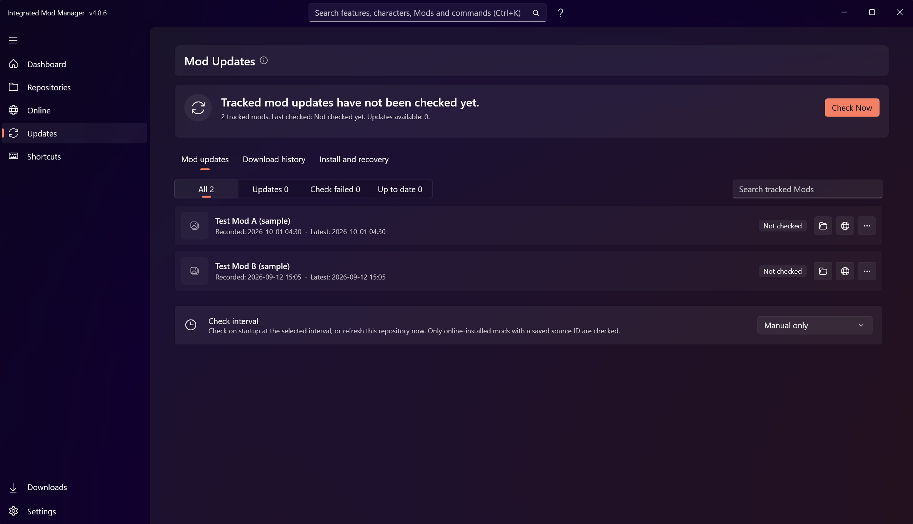
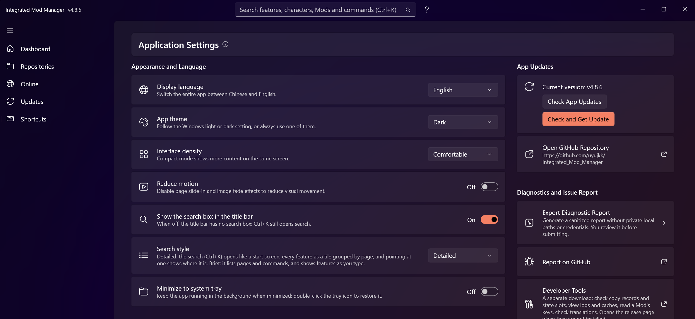

> **v4.8.7 正式版。** 功能搜索（Ctrl+K）保留开始屏幕式的磁贴，磁贴改成 Windows 11 卡片、背景模糊透明；从左下角弹出，磁贴一列一列出现；一个功能第一次选中时带你看位置，之后直接使用。见 [4.8.7 发布说明](releases/v4.8.7.md)。**4.8.6：** 功能更好找：右键操作有了按钮，搜索能列出全部功能，仪表板有“上手清单”，见 [4.8.6 发布说明](releases/v4.8.6.md)。**4.8.5：** 用目录联接部署的 Mod 可以正常关闭，见 [4.8.5 发布说明](releases/v4.8.5.md)。**4.8.4：** 在线页把正在起作用的筛选显示成可以逐个移除的标签，按钮写明用途，分类栏排版更清楚，见 [4.8.4 发布说明](releases/v4.8.4.md)。**4.8.3：** 启动更快（Mod 工作区和在线页改为第一次打开时才创建），开发者工具改为单独下载并可从设置和命令面板打开，内部结构整理并由新测试覆盖，见 [4.8.3 发布说明](releases/v4.8.3.md)。**4.8.2：** 游戏内浮窗重新设计并跟随应用主题，在线页可以在 GameBanana 上点赞，切页更快，见 [4.8.2 发布说明](releases/v4.8.2.md)。**4.8.1：** 在线页新增 GameBanana 分类浏览和跨页排序，见 [4.8.1 发布说明](releases/v4.8.1.md)。**4.8.0：** 全部页面重新设计，并修复 4.7.3 及更早版本中五处可能误删文件或留下失效链接的问题，见 [4.8.0 发布说明](releases/v4.8.0.md)。**4.7：** 预设图片与图片切换，浮窗外观、鼠标穿透和自动对比度，不含 Mod 文件的方案分享，首次安装选择语言和游戏，每个 Mod 的“默认”槽位，以及批量操作；4.7.1–4.7.3 带来 .NET 8 更新器、更稳定的在线角色列表和俄语界面。见 [4.7.0 发布说明](releases/v4.7.0.md)。

<div align="center">
  
  <h1>集成化 Mod 管理器</h1>
  <p>面向 Windows 10/11 的 WinUI 3 Mod 整理、切换、浏览与更新工具</p>

  [](https://github.com/uyujkk/Integrated_Mod_Manager/actions/workflows/build-and-test.yml)
  [](https://github.com/uyujkk/Integrated_Mod_Manager/releases/latest)
  [](https://github.com/uyujkk/Integrated_Mod_Manager/releases)
  [](../LICENSE)
  [](#系统要求)
  [](https://ko-fi.com/uyujkk)
  [](https://discord.gg/G9nszEQgrV)

  **中文** · [English](../README.md)

  [下载最新版](https://github.com/uyujkk/Integrated_Mod_Manager/releases/latest) ·
  [快速手册](./guides/zh-CN/快速上手.md) ·
  [完整手册](./guides/zh-CN/用户手册.md) ·
  [更新日志](./releases/CHANGELOG.md) ·
  [界面预览](#界面预览) ·
  [提交问题](https://github.com/uyujkk/Integrated_Mod_Manager/issues/new/choose) ·
  [Discord 社区](https://discord.gg/G9nszEQgrV)
</div>

> [!IMPORTANT]
> 本项目是非官方的爱好者工具，与 XXMI、任何游戏发行商及相关开发者均无隶属、授权、认可或赞助关系。使用 Mod 前，请遵守对应游戏、平台和 Mod 作者的规则。

## 项目简介

当前正式版：[v4.8.7](https://github.com/uyujkk/Integrated_Mod_Manager/releases/tag/v4.8.7)。4.8.7 让功能搜索用上从左下角弹出、可以直接使用的 Windows 11 磁贴；4.8.6 让全部功能更好找（看得见的按钮、能列出全部功能的搜索、上手清单）；4.8.5 修复了用目录联接部署的 Mod 无法关闭的问题；4.8.4 让在线页的筛选和按钮更清楚；4.8.3 启动更快，开发者工具改为单独下载；4.8 重新设计了全部页面（带标题栏搜索的导航栏、卡片式的仪表盘和设置、带命令栏和可调分栏的 Mod 工作区、带详情抽屉的在线页，以及更清楚的对话框），并修复五个数据安全问题；4.7 新增预设图片、浮窗外观、方案分享和其他游戏支持。仓库里的角色显示头像，一个角色可以同时启用多个 Mod，每个 Mod 可以保存多个命名状态槽位，置顶浮窗（4.8.2 重新设计，有自己的标题栏、目标窗口选择和发送开关）可以保存预设（先发送 F10）、在游戏中切换槽位，并在 Mod 变化后刷新。快捷键面板、内置终末地启动、浏览下载、旧库整理和组合预设继续保留。使用前请阅读 [4.8.0 发布说明](./releases/v4.8.0.md)、[快捷键面板说明](./guides/zh-CN/快捷键与浮窗.md)及[内置启动与账号风险说明](./guides/zh-CN/终末地启动.md)。

集成化 Mod 管理器以独立“仓库”管理不同游戏或不同 Mod 环境。它可以在本地仓库和游戏实际读取的目标目录之间复制或移除完整 Mod 文件夹，并集中管理预览图、来源链接、快捷键说明、在线下载、更新记录、配置方案和安装备份。

主程序、启动器、更新器和开发者工具统一为 **4.8.7**（`4.8.7.0`）。工具维护者为 `uyujkk`，既有 Bandizip 备用解压功能由 [CaramelizedCUDA](https://github.com/CaramelizedCUDA) 贡献；此前的 [4.0-beta](https://github.com/uyujkk/Integrated_Mod_Manager/releases/tag/v4.0-beta) 继续独立保留。

## 界面预览

截图来自 4.8.6 构建（搜索为 4.8.7）的独立副本和仓库自带的模拟测试数据：一个示例角色和两个测试 Mod、示例的状态槽位和组合预设、示例的已追踪 Mod 和下载记录，以及离线样例模式下的在线页（示例角色和 Mod，图片为生成图，不访问网络）。不含游戏、加载器、真实 Mod 或在线内容。截图方法见[截图说明](./assets/screenshots/README.md)。截图为英文界面，应用也支持中文和俄语。

**仪表板**：新安装后，顶部的“上手清单”会在你做完前几件事时自动打勾，每项都有带你过去的按钮；下面是当前仓库（点名称切换）、卡片式常用操作、路径分组、角色和全部仓库。



**Mod 工作区**：左侧是角色；选中角色后，标题旁有头像、重命名、打开文件夹和“可同时启用多个”；中间是该角色的 Mod，显示大小和部署状态，可按“全部 / 已部署 / 未部署”筛选，上方是命令栏；右侧详情显示预览图、来源链接、文件夹、标签和大小，以及红色的“从目标移除”按钮。



**搜索（Ctrl+K）**：默认像开始屏幕一样打开，每个功能一块磁贴，按页面分组，常用功能是宽磁贴并写明位置。打开时从左下角弹出，磁贴在模糊透明的背景上一列一列出现。指向磁贴会显示它在哪里；第一次选中会带你过去并框出位置，之后再选就直接使用。Tab 在分组之间切换。打字可以搜功能（也能用别的说法）、页面、角色和 Mod。



**在线**：按分类和角色浏览、搜索、排序和筛选；每张卡片显示图片、角色、作者和数据，并有“加入稍后下载”、来源页和下载按钮。详情抽屉里有“收藏作者”和“X 的全部作品”。



<p align="center">
  
  &nbsp;
  
</p>

**状态槽位**：把一个 Mod 的持久参数保存为命名槽位；列表旁的按钮可以更新或重命名槽位，“更多…”可以写入 Mod 默认值（带备份）、导入变体文件、保存整份 `d3dx_user.ini` 快照。**置顶浮窗（4.8.2）**：在游戏画面上方拖动标题栏移动（圆点表示是否正在发送），选择 Mod 和目标窗口并开启发送，点键帽发送按键，热切换槽位（实验），保存组合预设或单 Mod 预设（先发送 F10）。高度跟随内容，按显示器记住位置并贴边，跟随应用主题，紧凑模式、鼠标穿透和不透明度在 ⋯ 菜单里。

**Mod 快捷键面板**：一列卡片，依次是 Mod、目标窗口和输入开关、状态栏、以键帽显示并可发送的按键绑定，然后是浮窗及其设置。



<details>
<summary>组合预设、更新页和设置页</summary>

组合预设：保存启用的 Mod 组合和持久参数，查看成员，预览后恢复，不带 Mod 文件分享方案，或导出、安装组合包。



更新页顶部是检查状态和“手动检查更新”，下面分三个视图：Mod 更新（每行有打开文件夹、打开页面和更多）、下载记录、安装与恢复。



设置页使用卡片，宽窗口中分两栏：左侧是界面与语言（含搜索显示方式），右侧是软件更新、项目链接和诊断。截图裁到反馈卡片上方。



</details>

使用说明：[用户手册](./guides/zh-CN/用户手册.md) · [快捷键面板与置顶浮窗](./guides/zh-CN/快捷键与浮窗.md) · [状态槽位](./guides/zh-CN/状态槽位.md) · [组合预设](./guides/zh-CN/组合预设.md)

## 4.8 新增

- **4.8.7**：功能搜索保留开始屏幕式布局，磁贴改成 Windows 11 风格：半透明卡片、按页面着色的小图标，背景是一层较薄的亚克力。打开时从左下角展开，磁贴一列一列地滑入（合成线程动画，磁贴提前建好）。一个功能第一次选中时带你看位置，之后再选就直接使用（按下按钮、展开分组或列表、切换视图），会改动数据的功能只移焦点。Tab 在分组之间切换；指引框会等折叠分组展开完，并跟着页面移动。
- **4.8.6**：功能更好找。原来只能右键的操作有了按钮（选中角色后的头像、重命名、打开文件夹和“可同时启用多个”；在线页的“加入稍后下载”和“收藏作者”；更新页每行的“打开文件夹”）。搜索（Ctrl+K）知道 82 个功能和它们的位置，默认像开始屏幕一样按页面排成磁贴，选中一个就带你到那里并框出位置（“设置 › 搜索显示方式”可以改成简略列表）。仪表板的“上手清单”会自动打勾；每页第一次打开时有一条提示；标题栏的 ? 打开当前页的使用说明。
- **4.8.5**：用目录联接部署的 Mod 可以正常关闭：只删除联接本身，同名但指向别处的链接会先询问。仓库文件夹本身是联接或符号链接时，关闭 Mod、同角色切换 Mod 和组合预设都能认出管理器自己的链接。Windows App SDK 更新到 1.7.260224002。
- **4.8.4**：在线页只要有筛选在起作用，搜索框下方就显示一行标签（先是匹配数量，然后每个筛选一个带 ✕ 的标签，以及同时恢复分类和排序的“全部清除”）；筛选按钮显示“显示：本页全部 ▾”，筛选时变为强调色，☆ 和 ⚙ 按钮写明“作者与收藏”和“下载选项”，排序不是按热度时排序框上有小圆点；工具栏和翻页按钮都有提示文字和读屏名称；子分类显示为一排标签，第一个是“全部”，放不下时出现 ‹ › 箭头，窗口较窄时分类收进下拉菜单。
- **4.8.3**：Mod 工作区和在线页改为第一次打开时才创建，停在其他页面时启动更快（用测试数据停在仪表板时 1,030 → 900 毫秒）；第一次打开 Mod 工作区会多等约 80 毫秒。开发者工具随每次发布单独提供（`Integrated_Mod_Manager_Developer_Tools-v4.8.3.zip`），可以从“设置 → 诊断与问题报告”或命令面板打开。安装、下载、预设、状态槽位、快捷键、浮窗、更新和托盘从主窗口拆成独立的部分，数据格式不变，每一步都先用新的界面测试固定行为（现有 121 个，4.8.2 时为 79 个）。
- **4.8.2**：游戏内浮窗重新设计（带状态圆点的标题栏、在浮窗里选择目标窗口和开关发送、键帽、高度跟随内容、按显示器记住位置、贴边、⋯ 菜单、跟随应用主题）；Mod 详情里的爱心按钮在管理器里打开它的 GameBanana 页面点赞，设置里可以清除这份登录；设置页展开卡片时分组不再跳动；“新功能”和更新说明新增“加入 Discord 服务器”；切页更快（再次打开在线页的第一帧从 141–188 毫秒缩短到 53–73 毫秒）。
- **4.8.1**：在线页支持 GameBanana 一级分类和子分类，跨页按点赞、下载量和更新时间排序，并修复在线页重复加载和拖拽最大化黑屏。
- **新的界面**：带标题栏搜索框（Ctrl+K）的导航栏；卡片式的仪表盘和设置；带命令栏、可调分栏和详情抽屉的 Mod 工作区；详情抽屉更宽、加载中/无结果/加载失败都有清楚提示的在线页；分成三个视图的更新页；一列卡片的快捷键页；按钮写明动作、危险操作使用红色按钮的对话框。
- **数据安全**：修复源和目标重叠时开关单个 Mod、启动时清理预设图片进入链接、加载器文件夹不可用时删除 Mod、复制模式恢复组合预设删除同名文件夹，以及重命名角色后链接和保存的路径失效。这五个问题都存在于 4.7.3 及更早版本。
- **启动更快**：四个页面改为第一次打开时才创建，启动快约 80–120 毫秒。

[4.8.7 发布说明](./releases/v4.8.7.md) · [验证范围](./verification/v4.8.7.md) · [4.8.6 发布说明](./releases/v4.8.6.md) · [4.8.5 发布说明](./releases/v4.8.5.md) · [4.8.4 发布说明](./releases/v4.8.4.md) · [4.8.3 发布说明](./releases/v4.8.3.md) · [4.8.2 发布说明](./releases/v4.8.2.md) · [4.8.1 发布说明](./releases/v4.8.1.md)

## 4.7 新增

- **预设图片**：可选在浮窗保存时截图，槽位和组合预设显示缩略图，可以框选角色，并用图片切换槽位。
- **浮窗**：底板和文字阴影、紧凑布局、鼠标穿透、清晰/平衡/极简三档外观，以及可选的自动对比度。
- **分享方案**：导出不含 Mod 文件的小文件，对方导入时只应用他已有的 Mod。
- **其他游戏**：首次安装选择语言和游戏；原神、崩坏：星穹铁道、绝区零可通过 XXMI 启动。
- 每个 Mod 的 **“默认”槽位**；保存槽位时略过菜单状态；可调整加载器自动保存间隔；**批量操作**（加入预设、复制、导出组合包、删除）。

- **4.7.1**：更新器改用 .NET 8 构建，不再被杀毒软件误报。
- **4.7.2**：在线角色列表请求卡住时会重试，没填 Wiki 地址时改用游戏内置 Wiki。
- **4.7.3**：界面新增俄语（设置 → 语言）。

[4.7.0 发布说明](./releases/v4.7.0.md) · [4.7.1](./releases/v4.7.1.md) · [4.7.2](./releases/v4.7.2.md) · [4.7.3](./releases/v4.7.3.md) · [验证范围](./verification/v4.7.3.md)

## 4.6 更新

- **全部页面重新设计**：导航可以折叠；Ctrl+K 命令面板可以搜索页面、角色和 Mod；下载入口固定在侧栏底部。
- **Mod 仓库**：列表显示缩略图、标签、按键数量、大小和部署状态，可以按状态筛选；详情信息表可以直接编辑；新仓库显示设置步骤。
- **在线、快捷键与设置**：在线卡片统一样式，详情在抽屉中打开；按键以键帽样式显示，功能分成可折叠模块；设置为两栏总览，主题可以跟随系统。
- **更新**：页面铺满窗口；已追踪 Mod 和下载历史改为可筛选、可搜索的紧凑列表。
- **4.6.1**：新 Mod 自动建默认槽位；浮窗可以读取未变化的文件保存；设置页列出反馈 QQ 群 1041384622；修复排版问题。
- 本地预览版不再关闭软件更新检查。从预览版换回正式版，见[恢复更新检查](./releases/v4.6.0.md#从本地预览版恢复更新检查)。

[4.6.1 发布说明](./releases/v4.6.1.md) · [4.6.0](./releases/v4.6.0.md) · [验证范围](./verification/v4.6.1.md)

## 4.5 更新

- **角色头像**：依次使用角色文件夹里的 `.imm_avatar.*` 或 `avatar.*` 图片、手动绑定的角色、与文件夹同名的目录角色。新角色一天内进入角色列表。
- **每个角色启用多个 Mod**：默认每个角色只启用一个，可按角色打开多选。
- **单 Mod 状态槽位**：每个 Mod 保存多套命名参数；可写入 Mod 默认值（自动备份）、导入变体文件（待验证）、保存整份 `d3dx_user.ini` 快照。
- **F10 热应用（实验）**：游戏运行时恢复槽位，或在浮窗中切换槽位。
- **4.5.1**：在浮窗中命名并保存单 Mod 预设。
- **4.5.2**：浮窗保存前发送 F10，等加载器写入后再保存；新增刷新按钮，Mod 变化后自动刷新；多按键 Mod 更快；目录联接、恢复到加载器和组合预设不再标为实验功能。
- 自动识别游戏窗口；最大化后还原时窗口缩到屏幕的 80%。

[4.5.2 发布说明](./releases/v4.5.2.md) · [4.5.1](./releases/v4.5.1.md) · [4.5.0](./releases/v4.5.0.md)

## 早期版本

- **4.4**：Mod 快捷键面板与置顶浮窗、跟随出场角色、更新器支持超长路径。[说明](./releases/v4.4.0.md)
- **4.3**：内置终末地启动、INI 冲突提示、Mod 更新提醒。[说明](./releases/v4.3.1.md)
- **4.2**：下载任务中心、作者收藏、批量标签与保存筛选。[说明](./releases/v4.2.0.md)
- **4.1**：组合包导出与安装、仓库扫描提速。[说明](./releases/v4.1.0.md)
- **3.9**：界面重构、由 [CaramelizedCUDA](https://github.com/CaramelizedCUDA) 贡献的 Bandizip 备用解压（[PR #4](https://github.com/uyujkk/Integrated_Mod_Manager/pull/4)）、独立开发者工具。[说明](./releases/v3.9.5.md)

完整历史见[更新日志](./releases/CHANGELOG.md)。

## 核心功能

| 功能 | 说明 |
| --- | --- |
| 导航与命令面板 | 导航可以收起；Ctrl+K 搜索页面、当前仓库的角色和 Mod；下载进度显示在导航底部 |
| 多仓库管理 | 为不同游戏、角色或 XXMI 配置保存独立路径与在线分类 |
| 本地 Mod 切换 | 使用两层目录浏览、搜索、复制、移除、创建、重命名和删除 Mod |
| 角色头像 | 为每个角色文件夹显示头像；可使用自己的图片，或绑定到目录中的角色 |
| 每个角色多个 Mod | 默认每个角色只启用一个 Mod，也可以为指定角色允许多个 |
| 单 Mod 状态槽位 | 保存 Mod 持久参数的多套命名组合；可恢复、写入 Mod 默认值或保存 `d3dx_user.ini` 快照 |
| Mod 快捷键面板 | 点击 Mod INI 中的按键绑定即可发送到游戏；可在主窗口或置顶浮窗中使用，能跟随出场角色、保存预设和热切换槽位（实验） |
| 目录联接 | 让加载器与仓库使用同一份 Mod 目录；单选时，启用新 Mod 会替换同角色的旧联接 |
| 压缩包导入 | 支持 ZIP、7Z、RAR、ZIPX、CAB、TAR 及常见压缩流格式 |
| 预览与说明 | 为每个 Mod 保存预览图、来源链接、快捷键和功能描述 |
| 仓库工作台 | 文件列表与封面视图可切换；列表显示缩略图、标签、快捷键数量、大小和部署状态，可按状态筛选；详情信息表可直接编辑；新仓库显示设置步骤 |
| 组合与状态预设 | 保存已启用 Mod 组合和数值型持久参数，先恢复组合，再回写对应的 `d3dx_user.ini` 参数 |
| 组合包迁移 | 导出所选预设及 Mod 文件；校验、预览、安装后可选择恢复组合和状态 |
| 在线 Mod 浏览 | 浏览 GameBanana 条目，按角色筛选，查看图片与说明并下载解压 |
| 配置方案 | 保存并应用整套已启用 Mod，不影响无法识别的目标目录 |
| 安装安全 | 安装前检测冲突，为复制、移除和方案切换创建可恢复备份 |
| 下载任务中心 | 从导航查看下载进度；下载历史按结果筛选，可重试失败任务、打开输出目录 |
| 更新与诊断 | 检查 Mod 和软件更新（已追踪 Mod 可按状态筛选），回滚失败更新，导出脱敏诊断报告 |
| 辅助功能 | 中文/English、浅色/深色或跟随系统、高对比度、键盘导航和缩放适配 |

## 下载与运行

1. 打开 [Releases 最新版本](https://github.com/uyujkk/Integrated_Mod_Manager/releases/latest)。
2. 下载 `Integrated_Mod_Manager-vX.X.X.zip` 和对应的 `.sha256` 校验文件。
3. 将 ZIP **完整解压**到一个可写文件夹，不要直接在压缩包内运行。
4. 双击根目录中的 `IntegratedModManager.exe`。
5. 创建或选择仓库，设置 Mod 存储文件夹、目标文件夹和可选启动器。

`IntegratedModManager.exe` 是正式启动入口。发布包暂时保留 `ModFolderCopier.exe` 作为从 v3.8.5 自动更新时的兼容入口；WinUI 运行文件位于 `WinUI3/ModFolderCopier.WinUI.exe`。请保留发布包原有目录结构。

### SmartScreen 提示

当前可执行文件没有商业代码签名证书，Windows SmartScreen 可能显示“发布者未知”。请只从本仓库的 Releases 下载，不要为了运行本工具关闭 Microsoft Defender。源码、构建脚本、自动化测试和发布包校验流程均公开在本仓库中。

## 快速开始

1. 在“仪表板”创建或选择仓库。
2. 在仪表板将“Mod 仓库”设置为两层 Mod 目录的根目录。
3. 将“目标文件夹”设置为游戏或 Mod 加载器实际读取的 Mods 目录。
4. 打开“仓库”页（如果还有未完成的设置，“开始使用”卡片会列出），选择第一层分类，再选择第二层 Mod。
5. 双击第二层 Mod 或使用详情里的部署操作完成切换。单击选择或切换视图不会部署 Mod。

目标文件夹中不存在同名目录时，程序复制整个 Mod；已经存在同名目录时，再次操作会将它从目标文件夹移除。删除仓库中的源 Mod 是另一项独立操作，并会在执行前要求确认。

### 推荐目录结构

```text
Mod 存储文件夹
├─ 角色或分类 A
│  ├─ Mod A1
│  └─ Mod A2
└─ 角色或分类 B
   └─ Mod B1
```

第一层是角色、用途或其他分类；第二层是程序实际复制、移除和记录信息的完整 Mod 文件夹。

## 文档导航

| 文档 | 中文 | English |
| --- | --- | --- |
| 快速上手 | [快速上手](./guides/zh-CN/快速上手.md) | [Quick Start](./guides/en/Quick-Start.md) |
| 完整用户手册 | [用户手册](./guides/zh-CN/用户手册.md) | [User Guide](./guides/en/User-Guide.md) |
| 快捷键与浮窗 | [快捷键面板与置顶浮窗](./guides/zh-CN/快捷键与浮窗.md) | [Shortcut Panel and Overlay](./guides/en/Shortcut-Panel.md) |
| 状态槽位 | [单 Mod 状态槽位](./guides/zh-CN/状态槽位.md) | [Single-Mod State Slots](./guides/en/State-Slots.md) |
| 组合预设 | [组合预设与组合包](./guides/zh-CN/组合预设.md) | [Combination Presets and Bundles](./guides/en/Combination-Presets.md) |
| 浏览与下载 | [浏览与下载](./guides/zh-CN/浏览与下载.md) | [Browse and Download](./guides/en/Browse-and-Download.md) |
| 终末地启动 | [内置终末地启动](./guides/zh-CN/终末地启动.md) | [Integrated Endfield Launch](./guides/en/Endfield-Launch.md) |
| 旧版升级说明（归档） | [归档](./guides/archive/) | [Archive](./guides/archive/) |
| 更新历史 | [双语更新日志](./releases/CHANGELOG.md) | [Bilingual Changelog](./releases/CHANGELOG.md) |
| 跨 Mod 状态试验 | [试验路线与当前结论](./research/跨Mod状态保存试验结论.md) | [Current conclusions](./research/跨Mod状态保存试验结论.md) |
| 软件结构 | [软件结构](./development/Software-Structure.md) | [Software Structure](./development/Software-Structure.md) |
| 测试与构建 | [测试说明](./development/TESTING.md) | [Testing Guide](./development/TESTING.md) |
| 4.1 源码优化 | [源码优化记录](./development/Source-Optimization-v4.1.md) | [Source Optimization Record](./development/Source-Optimization-v4.1.md) |
| 参与项目 | [贡献指南](../.github/CONTRIBUTING.md) | [Contributing](../.github/CONTRIBUTING.md) |
| 安全问题 | [安全策略](../.github/SECURITY.md) | [Security Policy](../.github/SECURITY.md) |

## 系统要求

- Windows 10 1809 或更高版本，推荐 Windows 11。
- 64 位 Windows（`x64`）。
- 在线浏览、翻译和更新检查需要网络连接。
- 发布包包含 Windows App SDK，但需要 .NET 8 x64 运行时；普通用户不需要 .NET SDK 或 Visual Studio。
- 7Z、RAR、ZIPX 和 CAB 优先使用发布包内或已安装的 7-Zip；找不到时自动使用已安装 Bandizip 的 `bz.exe`，并由 Windows `tar.exe` 在解压前检查路径和链接。

## 给开发者

开发环境需要 Windows 10/11 x64、.NET 8 SDK、Visual Studio 2022 或 Build Tools 2022、MSBuild、Windows App SDK 和 Windows SDK。完整流程和 Pull Request 要求见 [CONTRIBUTING.md](../.github/CONTRIBUTING.md)。

```powershell
.\scripts\check-code-style.ps1      # .editorconfig 规则，在 test-all 之前运行
.\scripts\test-all.ps1             # 四组测试与覆盖率、WinUI x64 构建、打包
.\scripts\test-ui.ps1              # 用 test-all 准备的构建运行界面测试（需要解锁的桌面）
```

- **界面测试**用 `tests/TestData` 的合成数据启动构建好的程序；设置 `IMM_ONLINE_FIXTURES`（界面测试会自动设置）后，所有在线请求都由本地样例应答。见[测试说明](./development/TESTING.md)。
- **发布**由 `.github/workflows/release.yml` 从版本标签构建：测试、打包、从上一版升级并回滚、界面测试，然后创建带主程序压缩包和开发者工具压缩包的草稿 Release。项目、数据和流程见[软件结构](./development/Software-Structure.md)（含结构图）。
- **开发者工具**（`tools/DeveloperTools`）从 4.8.3 起随每次发布单独提供（更早的版本可用 `scripts\build-developer-tools.ps1` 构建）：检查复制记录、状态槽位和链接，查看日志，查看和清除缓存，读取 Mod 的按键，比较翻译，导出脱敏的诊断报告。把 `Integrated_Mod_Manager_Developer_Tools-vX.Y.Z.zip` 解压到主程序所在的文件夹，再从“设置 → 诊断与问题报告”或命令面板（Ctrl+K）打开。见[开发者工具说明](../tools/DeveloperTools/README.md)。

## 数据与安全

- 仓库路径、界面设置和在线缓存保存在本机，不会由本项目自动上传。
- 诊断报告会排除访问凭据并脱敏用户路径，但提交前仍应由用户检查内容。
- 本工具不会绕过付费、订阅、权限验证、验证码或 Mod 作者的访问限制。
- 不要在 Issue、截图或压缩包中公开本地配置、个人目录、访问令牌或其他敏感信息。
- 安全问题请按照 [SECURITY.md](../.github/SECURITY.md) 的方式报告。

## 许可证与声明

源码文件以 [MIT License](../LICENSE) 发布，版权所有 `uyujkk`；内置终末地启动组件 [`IntegratedModManager.EndfieldLaunch/`](../src/IntegratedModManager.EndfieldLaunch/) 除外，它以 **AGPL-3.0-only** 授权（源自 EndfieldBridge、endfield-nolauncher 与 Better-Endfield，见其 [NOTICE](../src/IntegratedModManager.EndfieldLaunch/NOTICE.md)）。由于程序包含该组件，**自 v4.3.0 起，发布包整体按 AGPL-3.0-only 分发**；v4.2.0 及之前的版本仍为 MIT。详见 [LICENSING.md](./LICENSING.md)。第三方组件保留各自许可证；发布包中的 7-Zip 文件附带其许可证文本。

本工具不包含游戏文件或 Mod 内容。游戏、角色、图片、Mod 和第三方服务的相关权利归各自权利人所有。
