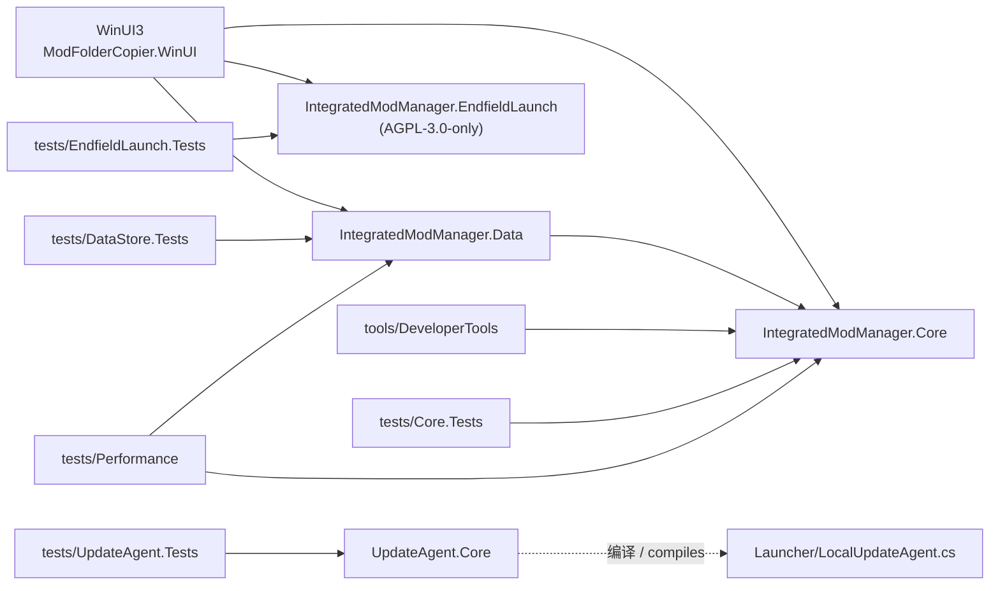
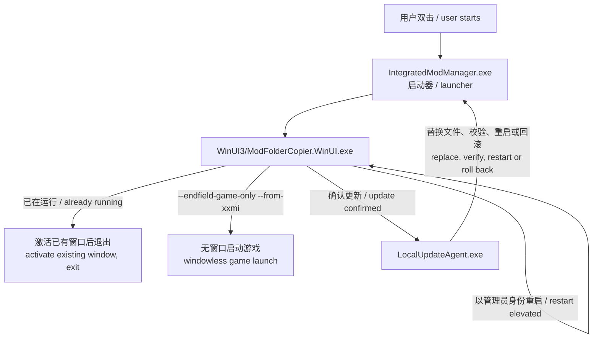
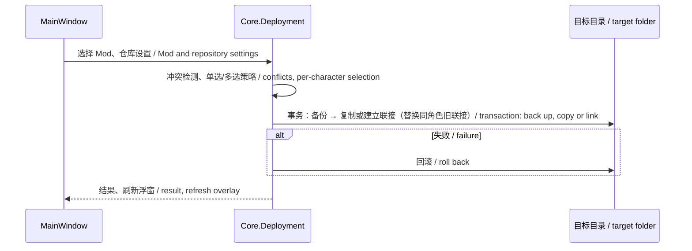

# 软件结构 / Software Structure

本文说明 Integrated Mod Manager 由哪些部分组成、各部分如何协作、数据存放在哪里，以及代码如何构建、测试和发布。适用于 4.5.2 之后的 `main`。

This document describes how Integrated Mod Manager is put together: its parts, how they work together, where data lives, and how the code is built, tested and released. It reflects `main` after 4.5.2.

相关文档 / Related: [测试与构建 / Testing](./TESTING.md) · [组合包格式 / Combination bundles](./Combination-Bundles.md) · [用户手册 / User guide](../guides/zh-CN/用户手册.md) · [许可证 / Licensing](../LICENSING.md)

## 1. 技术栈 / Technology

| 部分 / Part | 技术 / Technology |
| --- | --- |
| 主程序 / Application | C# 12、.NET 8、WinUI 3（Windows App SDK 1.7，自包含 / self-contained），`net8.0-windows10.0.19041.0` |
| 核心库与数据 / Core and data | .NET 8 类库 / class libraries；SQLite（`Microsoft.Data.Sqlite` 8.0） |
| 启动器与更新器 / Launcher and updater | .NET Framework 4.x，由 `csc.exe` 编译的单文件程序 / single-file programs compiled with `csc.exe` |
| 测试 / Tests | xUnit、coverlet 覆盖率 / coverage、Roslyn（文案检查 / UI text checks） |
| 构建与 CI / Build and CI | MSBuild、PowerShell 脚本 / scripts、GitHub Actions（`windows-latest`） |

`Directory.Build.props` 统一设置 `LangVersion=12`、可空引用和隐式 using；`.editorconfig` 的规则由 `scripts/check-code-style.ps1` 在 CI 中检查。
`Directory.Build.props` pins `LangVersion=12`, nullable references and implicit usings for every project; `scripts/check-code-style.ps1` enforces `.editorconfig` in CI.

## 2. 仓库目录 / Repository layout

```text
src/
  IntegratedModManager.Core/              界面无关的逻辑 / UI-free logic
  IntegratedModManager.Data/              SQLite 缓存与索引 / SQLite caches and index
  IntegratedModManager.EndfieldLaunch/    内置终末地启动（AGPL-3.0-only）/ integrated Endfield launch
  IntegratedModManager.UpdateAgent.Core/  把更新器编译成可测试的程序集 / updater as a testable assembly
  Launcher/                               WinUILauncher.cs、LocalUpdateAgent.cs
  WinUI3/                                 主程序 ModFolderCopier.WinUI / the WinUI application
tests/
  Core.Tests/  DataStore.Tests/  UpdateAgent.Tests/  EndfieldLaunch.Tests/
  Performance/                            性能基准 / benchmarks
  TestData/                               合成测试数据 / synthetic fixtures
tools/DeveloperTools/                     独立发布的开发者工具 / standalone developer tools
scripts/                                  构建、测试、打包与测试夹具脚本 / build, test, packaging and fixture scripts
docs/                                     手册、发布说明、验证记录、开发文档 / manuals, releases, verification, development
.github/                                  CI、Issue/PR 模板、贡献与安全说明 / CI, templates, contributing, security
```

打开 [`IntegratedModManager.sln`](../../IntegratedModManager.sln) 可一次加载全部项目。Open the solution to load every project.

## 3. 项目与依赖 / Projects and dependencies



| 项目 / Project | 职责 / Responsibility |
| --- | --- |
| `IntegratedModManager.Core` | 不依赖控件的全部业务逻辑：解压、部署、预设、在线数据、快捷键、更新等，几乎全部有单元测试。All business logic that needs no controls; nearly all of it is unit tested. |
| `IntegratedModManager.Data` | `AppDataStore` 管理 SQLite 数据库；在线元数据缓存与仓库索引的适配器。SQLite store plus adapters for online metadata and the repository index. |
| `IntegratedModManager.EndfieldLaunch` | 以官方签名的 `Games.exe` 为父进程启动终末地、与 XXMI/EFMI 集成、保存启动设置与恢复点。唯一的 AGPL 组件。Launches Endfield under the signed `Games.exe`, integrates with XXMI/EFMI, stores launch settings and restore points. The only AGPL component. |
| `IntegratedModManager.UpdateAgent.Core` | 不含自己的源码，只把 `src/Launcher/LocalUpdateAgent.cs` 编译成程序集供测试使用。Has no sources of its own; compiles the updater source for tests. |
| `WinUI3` | 主程序：窗口、页面、置顶浮窗、按键发送、本地化文案。依赖 Core、Data、EndfieldLaunch。The application: window, pages, overlay, key input, localized text. |

## 4. 运行时结构 / Runtime layout

### 4.1 安装包 / Package

```text
IntegratedModManager.exe        启动器（.NET Framework）/ launcher
ModFolderCopier.exe             兼容入口（v3.8.5 起的原位更新）/ compatibility entry for in-place updates from v3.8.5
LocalUpdateAgent.exe            更新器（.NET Framework）/ updater
LICENSE, LICENSE-AGPL-3.0.txt, LICENSING.md, README.md, 开始使用.md, PACKAGE-INFO.json, 验证状态.md
docs/                           手册、发布说明、截图、验证记录 / manuals, release notes, screenshots, verification
WinUI3/
  ModFolderCopier.WinUI.exe     主程序 / the application
  *.dll                         .NET、Windows App SDK、核心库 / runtime, Windows App SDK, project libraries
  Tools/                        7-Zip（7z.exe、7z.dll、许可证 / license）
  licenses/                     MIT、AGPL、NOTICE、LICENSING
  config.ini, beta-shell.json, cache/, backups/, snapshots/, diagnostics/   用户数据（运行后生成）/ user data, created at run time
```

安装包目录结构在多个版本间保持不变，旧版本的更新器依赖它。`scripts/release-file-policy.ps1` 规定哪些文件进入安装包，并排除用户数据。
The package layout stays the same across releases because older updaters depend on it. `scripts/release-file-policy.ps1` decides which files ship and excludes user data.

### 4.2 进程与入口 / Processes and entry points



- `Program.cs` 替换了 XAML 生成的入口：先处理终末地启动命令（不创建窗口、不占用单实例），再检查单实例，同一目录的第二次启动会激活已有窗口。
  `Program.cs` replaces the XAML entry point: it handles Endfield launch commands first (no window, no single-instance key), then enforces one instance per install folder.
- 更新器在主程序退出后替换文件，检查安装后的版本，失败时从 `backups/updates` 回滚；`config.ini`、`beta-shell.json`、`cache/`、`backups/`、`snapshots/`、`diagnostics/` 不会被覆盖。
  The updater replaces files after the app exits, checks the installed version, and rolls back from `backups/updates` on failure; user data folders are preserved.
- `--restart-after <pid>` 让以管理员身份重启的新进程等待旧进程退出。
  `--restart-after <pid>` makes an elevated restart wait for the previous process.

## 5. 主程序内部 / Inside the application

### 5.1 MainWindow

`MainWindow` 是 partial 类：`MainWindow.xaml.cs` 只保留字段、常量和构造函数，每个功能一个 `MainWindow.<功能>.cs` 文件。
`MainWindow` is a partial class: `MainWindow.xaml.cs` holds fields, constants and the constructor; each feature has its own `MainWindow.<Feature>.cs`.

| 分组 / Group | 文件 / Files |
| --- | --- |
| 外壳与通用 / Shell | `Shell`, `PageLayout`, `Localization`, `Settings`, `Configuration`, `Dialogs`, `Tray`, `SingleInstance`, `UiActionGuard`, `UiDiagnostics`, `BuiltInData`, `WhatsNew` |
| 仓库与本地库 / Repositories | `Dashboard`, `Repositories`, `LocalLibrary`, `RepositoryWorkspace`, `RefinedWorkspace`, `RepositoryPerformance`, `LocalTags`, `ExistingModImport`, `CharacterAvatars`, `CharacterSelection` |
| 安装、部署与预设 / Install and presets | `Archives`, `InstallTransactions`, `IniConflicts`, `ConfigurationProfiles`, `CombinationPresets`, `CombinationBundles`, `PersistentSlots`, `PersistentVariants` |
| 在线浏览 / Online | `OnlineFeed`, `OnlineCharacters`, `OnlineCards`, `OnlineDetails`, `OnlineImageCache`, `OnlineImages`, `OnlineBrowse`, `OnlineState`, `OnlineLibrary`, `BrowseSessions`, `AuthorWorkspace` |
| 下载与更新 / Downloads and updates | `OnlineDownloadFlow`, `OnlineDownloads`, `OnlineInstall`, `DownloadTasks`, `DownloadRecovery`, `BatchDownloads`, `Updates`, `ModUpdates` |
| 快捷键与浮窗 / Shortcuts and overlay | `ShortcutBindings`, `ShortcutPanel`, `ShortcutPresets`, `ShortcutCapture`, `HotReload`, `CharacterFollow`, `ProductivityFeatures` |
| 终末地 / Endfield | `EndfieldBridge` |

### 5.2 其他界面类 / Other UI classes

| 文件 / File | 作用 / Role |
| --- | --- |
| `Program.cs`, `App.xaml(.cs)` | 入口、单实例、全局异常记录。Entry point, single instance, unhandled-exception logging. |
| `UiText.cs` + `Strings/zh-CN.json`, `Strings/en-US.json` | 界面文案（嵌入资源）。UI text as embedded resources. |
| `ShortcutOverlayWindow.cs` | 不抢焦点的置顶浮窗（`WS_EX_NOACTIVATE`）；命名预设时临时允许键盘输入。Non-activating always-on-top overlay; takes keyboard input only while naming a preset. |
| `ShortcutInputService.cs`, `ShortcutProcessSecurity.cs`, `ShortcutPanelHotkey.cs` | 用 `SendInput` 向游戏窗口发送按键、检查进程权限、注册全局快捷键。Sends keys with `SendInput`, checks process integrity, registers the global hotkey. |
| `CharacterScreenCapture.cs` | 跟随出场角色时截取 HUD 区域。Captures the HUD region to follow the active character. |
| `Online*Adapter.cs` | 在线页状态与图片加载的适配层。Adapters for online page state and image loading. |
| `UiCrashDiagnostics.cs` | 界面崩溃的本地诊断。Local diagnostics for UI crashes. |
| `Models/` | 窗口使用的记录与配置类型，每个类型一个文件（如 `BetaShellConfig`、`WorkspaceRepository`、`ModPersistentSlot`）。Records and configuration types used by the window, one per file. |
| `Controls/` | XAML 控件：通用页头 `PageHeader`、在线卡片 `OnlineModTile`。XAML controls: the shared `PageHeader` and the online `OnlineModTile`. |
| `ViewModels/` | 可绑定的 ViewModel（如 `OnlineModTileViewModel`），写法见 5.3。Bindable view models such as `OnlineModTileViewModel`; see 5.3. |

### 5.3 页面、控件与 ViewModel / Pages, controls and view models

界面按页面逐个迁移到“控件 + ViewModel + Core 布局策略”，每次只迁移一个页面，部署和数据逻辑不跟着改。
Pages move one at a time to "control + view model + Core layout policy"; deployment and data logic stay as they are.

- **控件**放在 `src/WinUI3/Controls`，是 XAML `UserControl`，用 `x:Bind` 绑定。通用控件（如 `PageHeader`）用依赖属性对外暴露；页面控件只绑定自己的 ViewModel。
  **Controls** live in `src/WinUI3/Controls` as XAML `UserControl`s bound with `x:Bind`. Shared controls such as `PageHeader` expose dependency properties; page controls bind only to their own view model.
- 每个页面用 `PageHeader`：一行标题，说明放在 ⓘ 提示里，右侧放操作按钮（`Actions`）。不要再写两行的大标题横幅。
  Every page uses `PageHeader`: a one-line title, the description in the ⓘ tooltip and actions on the right (`Actions`). No two-line banner headers.
- **ViewModel** 放在 `src/WinUI3/ViewModels`，命名 `<名称>ViewModel`，`public sealed partial class`，继承 CommunityToolkit.Mvvm 的 `ObservableObject`。
  **View models** live in `src/WinUI3/ViewModels`, are named `<Name>ViewModel`, and are `public sealed partial class`es deriving from CommunityToolkit.Mvvm's `ObservableObject`.
  - 属性写成字段加 `SetProperty`。不用字段上的 `[ObservableProperty]`（MVVMTK0045，WinRT/AOT 不安全）；partial 属性需要预览版语言，也不用。
    Properties are a field plus `SetProperty`. No field-based `[ObservableProperty]` (MVVMTK0045, not WinRT/AOT-safe); partial properties need a preview language version, so not those either.
  - 操作用 `[RelayCommand]`；能否执行由 `CanExecute = nameof(...)` 的属性决定，该属性变化时调用 `XxxCommand.NotifyCanExecuteChanged()`。
    Actions are `[RelayCommand]`s; availability comes from a `CanExecute = nameof(...)` property that calls `XxxCommand.NotifyCanExecuteChanged()` when it changes.
  - ViewModel 不引用控件、不调用 `T()`。需要窗口做的事（打开对话框、部署、下载）通过构造函数传入 `Func<Task>` 或接口；显示用的文本由窗口本地化后赋值，或者由 ViewModel 暴露状态、在 XAML 里转换。
    View models reference no controls and do not call `T()`. Work only the window can do (dialogs, deployment, downloads) comes in through constructor `Func<Task>`s or interfaces; display text is localized by the window and assigned, or the view model exposes state that XAML converts.
  - 判断逻辑尽量放在 Core，ViewModel 只组合结果。参考 `OnlineModTileViewModel`。
    Decisions belong in Core where possible; the view model only combines results. See `OnlineModTileViewModel`.
- **布局**：页面在自己的 `SizeChanged` 里重新排版（`MainWindow.PageLayout.cs` 的 `AttachPageLayout`），用页面自身宽度而不是窗口宽度。窗口的 `SizeChanged` 触发时页面还没重新测量，读到的是旧宽度。断点和列数写成 `Core/Layout` 里的策略并补测试（如 `DashboardLayoutPolicy`）。
  **Layout**: a page lays itself out in its own `SizeChanged` (`AttachPageLayout` in `MainWindow.PageLayout.cs`) from its own width, not the window's; when the window's `SizeChanged` fires the pages still report their previous size. Breakpoints and column counts are policies in `Core/Layout` with tests (for example `DashboardLayoutPolicy`).
- 用名字（`x:Name`）找控件，不用 `Children[n]` 这样的位置序号；调整 XAML 顺序不应让布局失效。
  Find elements by `x:Name`, never by position such as `Children[n]`; reordering XAML must not break a layout.

## 6. Core 模块 / Core modules

命名空间与目录一致，例如 `Presets` 目录下是 `IntegratedModManager.Core.Presets`。Namespaces follow folders.

| 目录 / Folder | 内容 / Contents |
| --- | --- |
| `Archives` | `ArchiveExtractor`（ZIP、7-Zip、Bandizip、Windows tar）、RAR5 与 7-Zip 清单校验、错误分类、导入布局。Extraction, RAR5 and 7-Zip listing checks, error kinds, import layout. |
| `Configuration` | `config.ini` 读写（`LegacyConfigFile`）、原子写入与损坏恢复（`ConfigurationFileStore`）。config.ini format, atomic writes and recovery. |
| `Deployment` | 部署布局与按角色单选/多选（`ModDeploymentLayout`、`CharacterSelectionPolicy`）、目录联接、安装事务与回滚、文件与 INI 冲突检测、组合部署、旧库整理导入、角色文件夹规划。Layout and per-character selection, junctions, transactions and rollback, file and INI conflicts, combination deployment, library import. |
| `Presets` | 组合预设与恢复预览、组合包、持久参数引擎（含写入 Mod 默认值）、变体文件导入、整份 `d3dx_user.ini` 快照、热重载（`LoaderHotReload`）、保存前刷新加载器状态（`LoaderStateCapture`）。Presets, restore preview, bundles, persistent state engine, variant import, snapshots, hot reload, flush-before-capture. |
| `Online` | GameBanana 列表与元数据解析、下载数、角色目录匹配、下载调度与会话、下载日志、浏览与预览策略、请求冷却。GameBanana parsing, character catalog matching, download scheduling and sessions, journal, browse policies, cooldown. |
| `Shortcuts` | INI 按键扫描与缓存（`ModShortcutScanner`、`ModShortcutScanCache`）、按键计划、描述格式化、游戏窗口识别、权限策略。Key binding scanning and cache, key plans, descriptions, game window detection, privilege policy. |
| `Updates` | 版本与发布策略（`ApplicationReleasePolicy`）、更新包与校验文件、Mod 更新替换与恢复。Release policy, update packages and checksums, Mod update replacement. |
| `Repository` | 仓库扫描、角色文件夹头像（`CharacterFolderAvatars`）、工作区策略、批量集合、性能记录。Repository scanning, character avatars, workspace policies, performance. |
| `Endfield` | 桥接迁移与资格判断、干员目录解析、内置干员表 `endfield-characters.json`（嵌入资源）。Bridge integration, operator catalog, embedded operator list. |
| `Layout` | 与控件无关的窗口、弹窗、仪表板、在线页和设置页布局策略（如最大化还原到 80%、页面断点和列数）。Control-free layout policies, such as restoring to 80% of the work area and page breakpoints and column counts. |
| `Infrastructure` | 路径安全（`PathSafety`）、不跟随链接的目录操作（`SafeDirectoryTree`）、错误标记（`ErrorTags`）、恢复用 JSON、日志轮换、单实例策略。Path safety, link-safe tree operations, error tags, recovery JSON, log rotation, single instance. |

## 7. 数据与状态 / Data and state

| 位置 / Location | 内容 / Contents | 写入方 / Written by |
| --- | --- | --- |
| `WinUI3/config.ini` | 主题、语言、快捷键说明、Mod 链接、在线安装来源（值为 Base64）。Theme, language, shortcut notes, Mod links, install origins (Base64 values). | `ConfigurationFileStore` |
| `WinUI3/beta-shell.json` | 仓库与路径、界面状态、在线偏好、组合预设 `ConfigurationProfiles`、状态槽位 `ModPersistentSlots`、浮窗设置。Repositories, UI state, online preferences, presets, state slots, overlay settings. | `ConfigurationFileStore` |
| `WinUI3/cache/app-index.db` | SQLite：在线分页、角色目录、详情、指标、收藏、仓库索引。SQLite: online pages, characters, details, metrics, favorites, repository index. | `AppDataStore` |
| `WinUI3/cache/online-images` | 在线图片缓存，可重新生成。Re-creatable image cache. | 在线页 / Online page |
| `WinUI3/snapshots/user-ini` | 整份 `d3dx_user.ini` 快照。Whole `d3dx_user.ini` snapshots. | `UserIniSnapshots` |
| `WinUI3/backups`, `backups/` | 配置备份、安装事务备份、软件更新备份、终末地启动设置与恢复点。Configuration, install transaction, update and Endfield launch backups. | Core、更新器、启动组件 / Core, updater, launch component |
| `WinUI3/diagnostics` | 快捷键发送记录、界面操作记录、崩溃诊断。Shortcut send log, UI action trail, crash diagnostics. | 主程序 / Application |
| 加载器的 `d3dx_user.ini` / the loader's `d3dx_user.ini` | 加载器保存的 `global persist` 值；只在用户操作时读写，写入前备份。Loader-saved persistent values; read or written only on user actions, backed up first. | `ModPersistentPresetEngine`、`LoaderHotReload` |
| Mod 文件夹 / Mod folders | `.imm_avatar.*` 头像、写入默认值时的 `.imm-persist-*.bak`。Avatars and default-write backups. | `CharacterFolderAvatars`、`ModPersistentPresetEngine` |

配置写入采用临时文件替换和轮换备份。外部网络只访问 GameBanana、Wiki 和 GitHub Releases（更新检查与下载）。
Configuration is written atomically with rotated backups. Network access is limited to GameBanana, Wiki sources and GitHub Releases.

## 8. 关键流程 / Key flows

### 8.1 部署 Mod / Deploying a Mod



### 8.2 在线下载 / Online download

在线页解析 GameBanana 列表（`GameBananaListingParser`）→ 用户确认文件与角色文件夹 → `OnlineDownloadScheduler` 按并发数排队 → 下载与校验 → `ArchiveExtractor` 解压 → 安装到角色文件夹并记录来源，`DownloadTaskJournal` 记录任务以便中断后重试。
The Online page parses GameBanana listings, the user confirms the file and folder, the scheduler queues the task, then the archive is downloaded, extracted, installed and its origin recorded; the task journal allows retry after interruption.

### 8.3 状态参数 / Persistent state

- **保存槽位或组合**：读取 `d3dx_user.ini` 中该 Mod 声明的数值型 `global persist` 键（`ModPersistentPresetEngine`），缺少的值不会用默认值代替。浮窗保存会先发送 F10，由 `LoaderStateCapture` 等待文件稳定后再读取。
  **Capture:** read the Mod's declared numeric `global persist` keys from `d3dx_user.ini`; missing values are never filled with defaults. Overlay saves first send F10 and wait for a stable file (`LoaderStateCapture`).
- **恢复**：游戏退出时直接写入（先备份）；游戏运行时由 `LoaderHotReload` 写入后在发送 F10 的几秒内把文件设为只读，让加载器读取新值。
  **Restore:** written directly (with a backup) when the game is closed; while it runs, `LoaderHotReload` writes, keeps the file read-only around F10, then restores its attributes.

### 8.4 软件更新 / App update

`UpdateReleaseAssetSelector` 选出 GitHub `releases/latest` 中的 ZIP → 下载并按 `.sha256` 校验 → 启动 `LocalUpdateAgent.exe` → 主程序退出 → 更新器备份、替换、检查版本 → 启动新版，或失败时回滚。
Pick the ZIP from GitHub `releases/latest`, download and verify against `.sha256`, start the updater, exit, then the updater backs up, replaces, checks the version and starts the new build or rolls back.

## 9. 构建、测试与发布 / Build, test and release

| 步骤 / Step | 入口 / Entry |
| --- | --- |
| 本地构建 / Local build | `scripts\build_winui.bat`（输出到 `dist/` / outputs to `dist/`） |
| 代码风格 / Code style | `scripts\check-code-style.ps1` |
| 完整验证 / Full verification | `scripts\test-all.ps1`：四个测试套件与覆盖率门槛、WinUI x64 Release 构建、启动器与更新器编译、组装 `ReleaseSource` 与验证包。Four suites with coverage gates, WinUI x64 Release build, launcher/updater compile, staged release source and verification package. |
| 正式版打包 / Stable package | `scripts\package-stable-release.ps1 -ForGitHubRelease -CiUrl …`：要求干净源码和对应 CI，写入 `PACKAGE-INFO.json`（版本、源码提交、运行程序集哈希、测试结果）。Requires clean source and its CI run; writes `PACKAGE-INFO.json`. |
| 预览包 / Preview package | `scripts\package-prerelease.ps1`（关闭软件自身更新 / self-update off） |
| 测试夹具 / Fixtures | `scripts\new-*-fixture.ps1`、`scripts\fake-3dmigoto-loader.ps1`（模拟加载器 / simulated loader） |
| CI | `.github/workflows/build-and-test.yml`：每次推送和 PR 运行代码风格检查、`test-all.ps1` 和开发者工具打包，上传测试结果与验证包。Runs style check, test-all and the developer tools package on every push and PR. |

发布前还会用上一版公开安装包自带的更新器做隔离升级与回退测试，并在发布后重新下载公开附件核对 SHA-256。验证记录在 [`docs/verification`](../verification/)。
Before each release, the previous public package's own updater upgrades an isolated copy and rolls it back; after publishing, the public assets are downloaded again and their SHA-256 checked. Records are in `docs/verification`.

## 10. 约定 / Conventions

- 不需要控件的逻辑放进 Core 并写单元测试；窗口只负责调用、显示和本地化。
  Logic that needs no controls goes into Core with unit tests; the window calls it, displays results and localizes them.
- 界面文案放在 `Strings/zh-CN.json` 和 `en-US.json`，代码用 `T("功能.名称", 值…)` 读取，两个文件的键与参数个数由 `UiTextResourceTests` 检查；`L(中, 英)` 只用于运行时才拼出的文本。
  UI text lives in the two JSON files and is read with `T("Feature.Name", values…)`; `UiTextResourceTests` checks keys and placeholder counts. `L(zh, en)` is only for text built at run time.
- Core 用 `ErrorTags` 给异常附加错误类型，界面按类型映射提示文字，不匹配异常消息。
  Core tags exceptions with a kind through `ErrorTags`; the UI maps kinds to messages instead of matching text.
- 路径包含判断统一用 `PathSafety`；目录遍历、复制、删除用不跟随链接的 `SafeDirectoryTree`。
  Path containment uses `PathSafety`; tree walks, copies and deletes use the link-safe `SafeDirectoryTree`.
- 写入用户文件前先备份，失败时还原；不修改游戏文件，不读写游戏内存。
  Back up user files before writing and restore on failure; never modify game files or game memory.
- PowerShell 脚本含中文时保存为带 BOM 的 UTF-8，Windows PowerShell 5.1 才能正确读取。
  PowerShell scripts containing Chinese are saved as UTF-8 with BOM so Windows PowerShell 5.1 reads them correctly.

## 11. 许可证边界 / Licensing boundary

仓库中的文件按 MIT 授权，`src/IntegratedModManager.EndfieldLaunch/` 除外，它是 AGPL-3.0-only（源自 EndfieldBridge、endfield-nolauncher 和 Better-Endfield）。由于主程序包含该组件，v4.3.0 起的发布包整体按 AGPL-3.0-only 分发。详见 [LICENSING.md](../LICENSING.md)。
Repository files are MIT except `src/IntegratedModManager.EndfieldLaunch/`, which is AGPL-3.0-only. Because the application includes it, release packages from v4.3.0 on are distributed as a whole under AGPL-3.0-only. See LICENSING.md.
