# 软件结构 / Software Structure

本文说明 Integrated Mod Manager 由哪些部分组成、各部分如何协作、数据存放在哪里，以及代码如何构建、测试和发布。适用于 4.8.2（`main`，2026-11-16）。

This document describes how Integrated Mod Manager is put together: its parts, how they work together, where data lives, and how the code is built, tested and released. It reflects 4.8.2 (`main`, 2026-11-16).

相关文档 / Related: [测试与构建 / Testing](./TESTING.md) · [组合包格式 / Combination bundles](./Combination-Bundles.md) · [界面外观 / UI design](./UI-Fluent-Design-Plan.md) · [用户手册 / User guide](../guides/zh-CN/用户手册.md) · [许可证 / Licensing](../LICENSING.md)

图中的标签只用英文和代码里的名字，说明放在图的上方。The diagram labels use English and code names only; each diagram is explained above it.

## 目录 / Contents

1. [技术栈 / Technology](#1-技术栈--technology)
2. [仓库目录 / Repository layout](#2-仓库目录--repository-layout)
3. [项目与依赖 / Projects and dependencies](#3-项目与依赖--projects-and-dependencies)
4. [运行时结构 / Runtime layout](#4-运行时结构--runtime-layout)
5. [主程序内部 / Inside the application](#5-主程序内部--inside-the-application)
6. [Core 模块 / Core modules](#6-core-模块--core-modules)
7. [数据与状态 / Data and state](#7-数据与状态--data-and-state)
8. [关键流程 / Key flows](#8-关键流程--key-flows)
9. [构建、测试与发布 / Build, test and release](#9-构建测试与发布--build-test-and-release)
10. [约定 / Conventions](#10-约定--conventions)
11. [许可证边界 / Licensing boundary](#11-许可证边界--licensing-boundary)

## 1. 技术栈 / Technology

| 部分 / Part | 技术 / Technology |
| --- | --- |
| 主程序 / Application | C# 12、.NET 8、WinUI 3（Windows App SDK 1.7，自包含 / self-contained），`net8.0-windows10.0.19041.0`；CommunityToolkit.Mvvm 与 WinUI 设置控件 / settings controls；WebView2（在线页里的 GameBanana 网页 / the GameBanana page in Online） |
| 核心库与数据 / Core and data | .NET 8 类库 / class libraries；SQLite（`Microsoft.Data.Sqlite` 8.0） |
| 启动器 / Launcher | .NET Framework 4.x，由 `csc.exe` 编译的单文件程序 / a single-file program compiled with `csc.exe` |
| 更新器 / Updater | .NET 8，依赖框架的单文件程序（`dotnet publish`），只需要主程序同样需要的 .NET 8 运行时 / a framework-dependent .NET 8 single file needing only the runtime the app needs |
| 测试 / Tests | xUnit、coverlet 覆盖率 / coverage、Roslyn（文案检查 / UI text checks）、FlaUI（界面自动化 / UI automation） |
| 构建与 CI / Build and CI | MSBuild、PowerShell 脚本 / scripts、GitHub Actions（`windows-latest`）、CodeQL、Dependabot |

`Directory.Build.props` 统一设置 `LangVersion=12`、可空引用和隐式 using；`.editorconfig` 的规则由 `scripts/check-code-style.ps1` 在 CI 中检查。
`Directory.Build.props` pins `LangVersion=12`, nullable references and implicit usings for every project; `scripts/check-code-style.ps1` enforces `.editorconfig` in CI.

## 2. 仓库目录 / Repository layout

```text
src/
  IntegratedModManager.Core/              界面无关的逻辑 / UI-free logic
  IntegratedModManager.Data/              SQLite 缓存与索引 / SQLite caches and index
  IntegratedModManager.EndfieldLaunch/    内置终末地启动（AGPL-3.0-only）/ integrated Endfield launch
  IntegratedModManager.UpdateAgent.Core/  把更新器编译成可测试的程序集 / updater as a testable assembly
  Launcher/                               WinUILauncher.cs；LocalUpdateAgent.cs、.csproj（更新器 / updater）
  WinUI3/                                 主程序 ModFolderCopier.WinUI / the WinUI application
tests/
  Core.Tests/  DataStore.Tests/  UpdateAgent.Tests/  EndfieldLaunch.Tests/   单元测试 / unit tests
  Online.Tests/                           真实网站检查（每日 CI）/ live-site checks, daily in CI
  UI.Tests/                               界面自动化（FlaUI，CI 中运行）/ UI automation, run in CI
  Performance/                            性能基准 / benchmarks
  TestData/                               合成测试数据与在线样例 / synthetic fixtures and online samples
tools/
  DeveloperTools/                         开发者工具，4.8.2 之后随发布单独提供 / Developer Tools, a separate release asset after 4.8.2
  online-fixtures/                        生成在线样例 / generates the online samples
  ui-baseline/                            截图基线脚本 / screenshot baseline script
scripts/                                  构建、测试、打包与测试夹具脚本 / build, test, packaging and fixture scripts
docs/                                     手册、发布说明、验证记录、开发文档 / manuals, releases, verification, development
.github/                                  工作流、Issue/PR 模板、贡献与安全说明 / workflows, templates, contributing, security
```

打开 [`IntegratedModManager.sln`](../../IntegratedModManager.sln) 可一次加载全部项目。Open the solution to load every project.

## 3. 项目与依赖 / Projects and dependencies

### 3.1 发布的项目 / Shipped projects

图：箭头表示“引用”。主程序引用 Core、Data 和 EndfieldLaunch；Data 引用 Core。启动器和更新器各自是独立的可执行文件，不引用其他项目。
Diagram: an arrow means "references". The app references Core, Data and EndfieldLaunch; Data references Core. The launcher and the updater are separate executables with no project references.

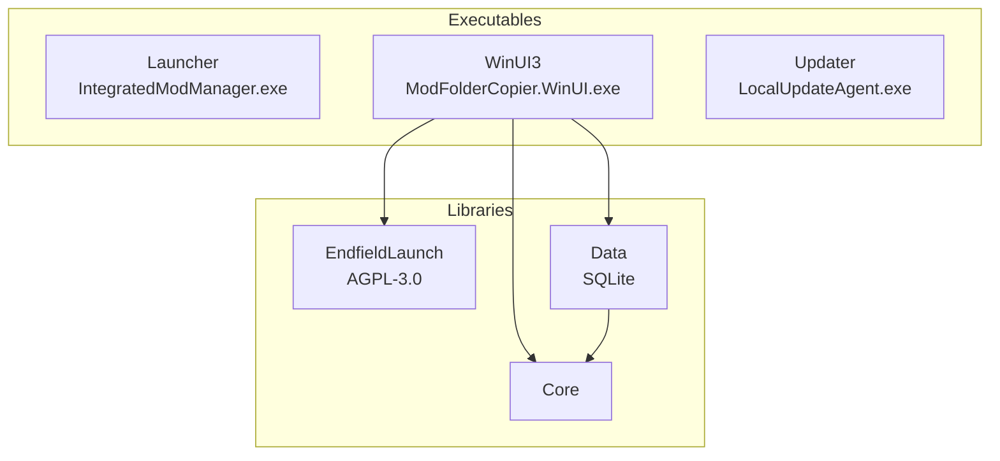

| 项目 / Project | 职责 / Responsibility |
| --- | --- |
| `IntegratedModManager.Core` | 不依赖控件的全部业务逻辑：解压、部署、预设、在线数据、快捷键、更新、布局策略等，几乎全部有单元测试。All business logic that needs no controls; nearly all of it is unit tested. |
| `IntegratedModManager.Data` | `AppDataStore` 管理 SQLite 数据库；在线元数据缓存与仓库索引的适配器。SQLite store plus adapters for online metadata and the repository index. |
| `IntegratedModManager.EndfieldLaunch` | 以官方签名的 `Games.exe` 为父进程启动终末地、与 XXMI/EFMI 集成、保存启动设置与恢复点。唯一的 AGPL 组件。Launches Endfield under the signed `Games.exe`, integrates with XXMI/EFMI, stores launch settings and restore points. The only AGPL component. |
| `Launcher/WinUILauncher.cs` | 启动器：找到并启动 `WinUI3/ModFolderCopier.WinUI.exe`；找不到程序文件或 Windows 拦截启动时，用中文或英文说明怎么处理。The launcher: finds and starts the app, and explains in Chinese or English what to do when the program file is missing or Windows blocks the start. |
| `Launcher/LocalUpdateAgent.csproj` | 把更新器发布成单个 `LocalUpdateAgent.exe`（.NET 8，不再被机器学习扫描引擎误报）。Publishes the updater as one `LocalUpdateAgent.exe` on .NET 8. |
| `IntegratedModManager.UpdateAgent.Core` | 不含自己的源码，只把 `src/Launcher/LocalUpdateAgent.cs` 编译成程序集供测试使用。Has no sources of its own; compiles the updater source for tests. |
| `tools/DeveloperTools` | 开发者工具：独立的 WinUI 3 程序，引用 Core，版本与主程序相同，作为单独的附件发布，解压到安装目录的 `DeveloperTools` 文件夹（`DeveloperToolsLocation`）。只读查看主程序的数据：状态记录（`StateRecordAudit`）、日志（`LogReader`）、缓存（`CacheInventory`）、Mod 按键、翻译（`LanguageFileComparer`）、诊断（`DiagnosticSummary`），逻辑都在 Core 的 `DeveloperTools` 目录并有测试。The Developer Tools: a standalone WinUI 3 app on Core with the app's version, released as a separate asset that unpacks into the install's `DeveloperTools` folder; read-only views of the app's data, with their logic in Core's `DeveloperTools` folder and tested there. |
| `WinUI3` | 主程序：窗口、六个页面、服务层、置顶浮窗、按键发送、本地化文案。The application: window, six pages, services, overlay, key input, localized text. |

### 3.2 测试与工具 / Tests and tools

图：每个测试项目指向它测试的项目。`UI.Tests` 不引用项目，而是启动构建好的程序；`UpdateAgent.Core` 编译更新器的源文件。
Diagram: each test project points at what it tests. `UI.Tests` references no project; it starts the built app. `UpdateAgent.Core` compiles the updater's source file.

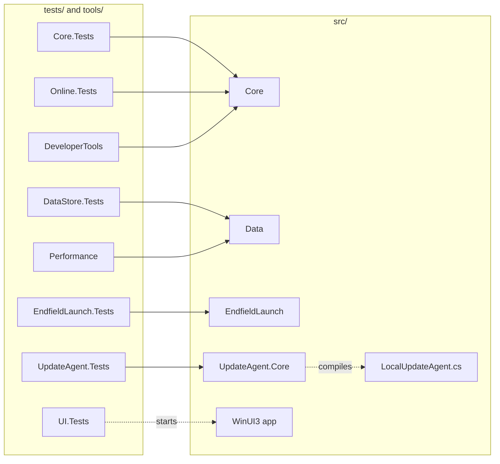

`Core.Tests` 还把主程序里几个不依赖控件的文件（如 `BetaShellConfig`、`ShortcutPageViewModel`、`SettingsViewModel`、在线状态适配器）一起编译来测试；公共依赖在 `tests/TestDependencies.props`。
`Core.Tests` also compiles a few control-free files of the app (such as `BetaShellConfig`, `ShortcutPageViewModel`, `SettingsViewModel` and the online state adapters); shared test dependencies are in `tests/TestDependencies.props`.

## 4. 运行时结构 / Runtime layout

### 4.1 安装包 / Package

```text
IntegratedModManager.exe        启动器（.NET Framework）/ launcher
ModFolderCopier.exe             兼容入口（v3.8.5 起的原位更新）/ compatibility entry for in-place updates from v3.8.5
LocalUpdateAgent.exe            更新器（.NET 8 单文件）/ updater (.NET 8 single file)
LICENSE, LICENSE-AGPL-3.0.txt, LICENSING.md, README.md, 开始使用.md, PACKAGE-INFO.json, 验证状态.md
docs/                           手册、发布说明、截图、验证记录 / manuals, release notes, screenshots, verification
WinUI3/
  ModFolderCopier.WinUI.exe     主程序 / the application
  *.dll                         .NET、Windows App SDK、项目库 / runtime, Windows App SDK, project libraries
  Tools/                        7-Zip（7z.exe、7z.dll、许可证 / license）
  licenses/                     MIT、AGPL、NOTICE、LICENSING
  config.ini, beta-shell.json, cache/, backups/, snapshots/, diagnostics/   用户数据（运行后生成）/ user data, created at run time
```

安装包目录结构在多个版本间保持不变，旧版本的更新器依赖它。`scripts/release-file-policy.ps1` 规定哪些文件进入安装包，并排除用户数据。
The package layout stays the same across releases because older updaters depend on it. `scripts/release-file-policy.ps1` decides which files ship and excludes user data.

### 4.2 进程 / Processes

图：用户启动启动器，启动器启动主程序。主程序在需要时启动其他进程：解压用 7-Zip，在线页里的 GameBanana 网页由 WebView2 运行，确认更新后启动更新器，终末地由启动组件经 `Games.exe` 启动。按键用 `SendInput` 发给选中的游戏窗口。
Diagram: the user starts the launcher, which starts the app. The app starts other processes when needed: 7-Zip for archives, WebView2 for the GameBanana page in Online, the updater after an update is confirmed, and Endfield through `Games.exe`. Keys go to the chosen game window with `SendInput`.

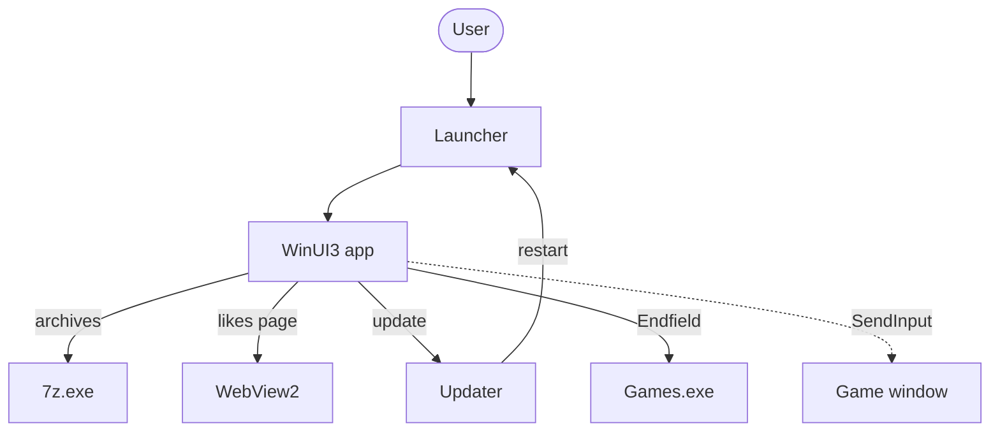

- `Program.cs` 替换了 XAML 生成的入口：先处理终末地启动命令（`--endfield-game-only --from-xxmi`，不创建窗口、不占用单实例），再检查单实例；同一目录的第二次启动会激活已有窗口后退出。
  `Program.cs` replaces the XAML entry point: it handles Endfield launch commands first (no window, no single-instance key), then enforces one instance per install folder; a second start activates the existing window and exits.
- `--restart-after <pid>` 让以管理员身份重启的新进程等待旧进程退出（终末地需要管理员权限才能接收按键）。
  `--restart-after <pid>` makes an elevated restart wait for the previous process (Endfield only accepts keys from an elevated sender).
- WebView2 使用自己的配置文件夹 `WinUI3/cache/gamebanana-webview2`，和用户的浏览器分开；设置页可以删除它。
  WebView2 uses its own profile folder, `WinUI3/cache/gamebanana-webview2`, separate from the user's browser; Settings can delete it.

## 5. 主程序内部 / Inside the application

### 5.1 窗口与页面 / Window and pages

图：`MainWindow` 是外壳：标题栏（带搜索框）、`NavigationView` 和页面宿主 `PageContentHost`。六个页面由宿主显示，全局消息用底部的 `InfoBar`，对话框都经 `DialogService` 显示，置顶浮窗是单独的窗口。
Diagram: `MainWindow` is the shell: a title bar with search, a `NavigationView` and the page host `PageContentHost`. The host shows the six pages; app-wide messages use the `InfoBar` at the bottom; every dialog goes through `DialogService`; the overlay is a window of its own.

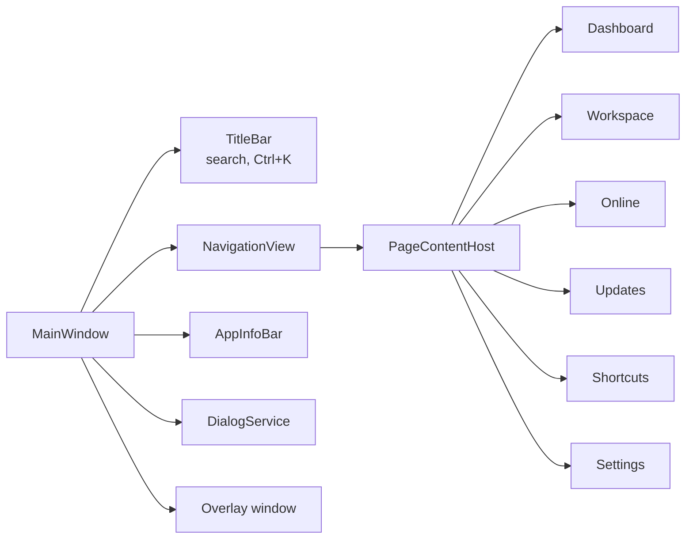

| 页面 / Page | 文件 / Files | 创建时机 / Created |
| --- | --- | --- |
| 仪表盘 / Dashboard | `Pages/DashboardPage.xaml(.cs)` | 第一次显示 / first shown |
| Mod 工作区 / Workspace | `Pages/WorkspacePage.xaml(.cs)`、`Pages/Workspace/*` | 随窗口 / with the window |
| 在线 / Online | `Pages/OnlinePage.xaml(.cs)`、`Pages/Online/*` | 随窗口 / with the window |
| 更新 / Updates | `Pages/UpdatesPage.xaml(.cs)` | 第一次显示 / first shown |
| 快捷键 / Shortcuts | `Pages/ShortcutsPage.xaml(.cs)` | 第一次显示 / first shown |
| 设置 / Settings | `Pages/SettingsPage.xaml(.cs)` | 第一次显示 / first shown |

**页面宿主 / Page hosting.** 页面第一次显示时加入 `PageContentHost`，之后一直留在窗口里；切换只改哪一页可见（`MainWindow.Shell.cs` 的 `ShowPage`），所以滚动位置、选中项和进行中的加载都保留。4.8.1 及以前每次切换都把页面移出再放回，整页重新加载和排版（#135）。唯一的例外：仪表盘的入门提示（`TeachingTip`）打开时，页面只是折叠的话提示不会关，所以这时仪表盘仍从宿主移出。
A page joins `PageContentHost` the first time it is shown and then stays; a switch only changes which page is visible (`ShowPage` in `MainWindow.Shell.cs`), so scroll positions, selections and loading work are kept. Up to 4.8.1 every switch took the page out and put it back, reloading and laying out all of it (#135). The one exception: a collapsed page does not close the Dashboard's getting-started `TeachingTip`, so while it is open the Dashboard still leaves the host.

图：一个页面在宿主里的状态。
Diagram: the states of a page in the host.

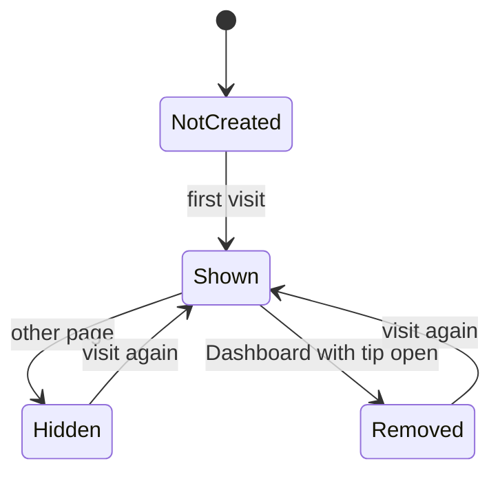

页面里依赖“是否在屏幕上”的逻辑看 `IsLoaded && Visibility == Visible`，而不是只看 `IsLoaded`（仪表盘的提示和路径展开、快捷键页的按键渲染）。
Code that depends on "is the page on screen" checks `IsLoaded && Visibility == Visible`, not `IsLoaded` alone (the Dashboard's tip and paths, the Shortcuts page's bindings).

### 5.2 服务与页面接口 / Services and page interfaces

图：页面通过 `AppServices` 共享状态和服务，只在需要窗口的地方通过接口回调窗口。在线页和工作区页的接口由窗口实现（`MainWindow.OnlineHost.cs`、`MainWindow.WorkspaceHost.cs`）；浮窗通过 `IShortcutOverlayActions` 请求窗口做事，窗口通过 `IShortcutOverlay` 控制浮窗。
Diagram: pages share state and services through `AppServices` and call back into the window only through interfaces. The window implements the Online and Workspace interfaces (`MainWindow.OnlineHost.cs`, `MainWindow.WorkspaceHost.cs`); the overlay asks the window through `IShortcutOverlayActions`, and the window drives the overlay through `IShortcutOverlay`.

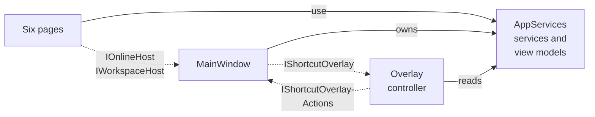

| 服务 / Service（`Services/`） | 作用 / Role |
| --- | --- |
| `AppServices` | 窗口创建一次，所有页面共用：下面的服务和共享的 ViewModel（设置、更新、仪表盘、路径、快捷键）。Created once by the window and shared by every page. |
| `LanguageService`、`AppearanceService` | 界面语言与 `T()`/`M()` 文案查找；主题和密度，变化时通知页面。UI language and text lookup; theme and density, announced to pages. |
| `ShellConfigService` | `beta-shell.json` 和 `config.ini` 的位置、读写与备份。Where the two settings files live and how they are read, written and backed up. |
| `RepositoryService` | 已配置的仓库和当前仓库。The configured repositories and the current one. |
| `DialogService` | 显示所有对话框：设置 `XamlRoot`、主题和默认样式，同一时间只开一个。Shows every dialog: XamlRoot, theme, default style, one at a time. |
| `StatusService` | 全局通知，由窗口显示在 `InfoBar`。App-wide notifications shown in the InfoBar. |
| `DeploymentService`、`DownloadService`、`LaunchService` | 部署备份位置；下载任务（新建、进度、清除）及其记录；启动加载器或启动器。Deployment backups; download tasks (creating, progress, clearing) and their record; starting the loader or launcher. |
| `OnlineDownloadService` | 在线 Mod 的下载和安装：刷新文件、选择位置、重复检查、下载、解压、安装记录、重试；没有在线页也能运行，在线页存在时显示进度（`IOnlineDownloadView`）。Downloading and installing online Mods, with or without the Online page; the page shows progress while it exists. |
| `ModTrackingService` | 追踪的在线 Mod、更新检查结果、检查更新和替换为新版本。Tracked online Mods, update checks and replacing a Mod with its newer version. |
| `InstallService` | 安装流程：安装事务（备份、提交、撤销、按存储上限清理）、安装前的文件和 INI 冲突检查、断开链接清理、压缩包（格式、解压、导入为一个 Mod 文件夹）、复制归属记录（#107）。规则在 Core（`ModInstallTransactions`、`ModFileConflictDetector`、`ModIniConflictDetector`、`ArchiveImportLayout`、`CopyDeploymentLedger`、`InstallBackupPruning`）。The install pipeline: install transactions (backup, commit, undo, pruning by the storage limit), file and INI conflict checks before an install, broken link cleanup, archives (formats, extraction, import as one Mod folder) and the copy ownership records (#107); the rules are in Core. |
| `OnlineState`、`OnlineSourceService`、`OnlineCategoryService`、`CharacterCatalogService`、`ImageService` | 在线页的状态、仓库的在线来源、游戏分类（缓存一天）、角色目录、在线图片缓存。Online page state, a repository's online source, categories (kept a day), character catalogs, the image cache. |
| `GameBananaWebSession` | 点赞用的 GameBanana 网页的登录：保存位置、关闭网页、删除登录。The sign-in of the GameBanana page used for likes: where it lives, closing the page, deleting it. |
| `EndfieldBridgeService` | 终末地仓库的内置启动：是否适用、XXMI 位置、启动设置。The integrated Endfield launch. |
| `IShortcutOverlay` | 窗口控制浮窗的接口（打开、隐藏、切换、刷新）。How the window drives the overlay. |

### 5.3 MainWindow 的 partial 文件 / MainWindow partial files

`MainWindow.xaml.cs` 只保留字段、常量和构造函数；页面专属的代码已在阶段 J 移进 `Pages/`，窗口里留下的是外壳、页面宿主接口和跨页面的功能。
`MainWindow.xaml.cs` holds fields, constants and the constructor; page-specific code moved into `Pages/` in stage J, and the window keeps the shell, the page host interfaces and cross-page features.

| 分组 / Group | `MainWindow.<名称>.cs` |
| --- | --- |
| 外壳 / Shell | `Shell`, `TitleBarSearch`, `CommandPalette`, `Localization`, `Configuration`, `Dialogs`, `AppearanceEvents`, `Tray`, `SingleInstance`, `UiActionGuard`, `UiDiagnostics`, `BuiltInData`, `WhatsNew`, `FirstRun` |
| 页面宿主 / Page hosts | `DashboardHost`, `WorkspaceHost`, `OnlineHost`, `UpdatesHost`, `ShortcutsHost`, `SettingsHost` |
| 仓库与重命名 / Repositories and renames | `Repositories`, `RepositoryPerformance`, `CharacterRename`（角色改名时迁移窗口仍持有的引用 / migrates the references the window still holds when a character is renamed） |
| 预设与状态 / Presets and state | `ConfigurationProfiles`, `CombinationPresets`, `CombinationBundles`, `PresetShare`, `PresetPreviews`, `PersistentSlots`, `PersistentVariants`, `DefaultSlots`, `SlotCapture`, `HotReload` |
| 更新与下载 / Updates and downloads | `Updates`（应用更新和检查间隔 / app updates and check intervals）, `DownloadTasks`（导航里的任务列表 / the task list in the navigation） |
| 快捷键与浮窗 / Shortcuts and overlay | `ShortcutPanel`, `ShortcutPresets`, `ShortcutCapture`, `ShortcutBindingRules`, `CharacterFollow`, `ProductivityFeatures` |
| 终末地与 XXMI / Endfield and XXMI | `EndfieldBridge` |

### 5.4 浮窗 / Overlay

图：浮窗是不抢焦点的置顶窗口（`ShortcutOverlayWindow`，`WS_EX_NOACTIVATE`），内容由 `ShortcutOverlayController` 搭建。按钮的动作经 `IShortcutOverlayActions` 交给窗口原有的代码（发送按键、F10、保存预设、切换槽位）；位置和贴边的计算在 Core 的 `OverlayLayoutPolicy`。
Diagram: the overlay is a non-activating always-on-top window (`ShortcutOverlayWindow`, `WS_EX_NOACTIVATE`) whose content `ShortcutOverlayController` builds. Its actions go through `IShortcutOverlayActions` to the window's existing code (send keys, F10, save presets, switch slots); placement and snapping are computed by `OverlayLayoutPolicy` in Core.

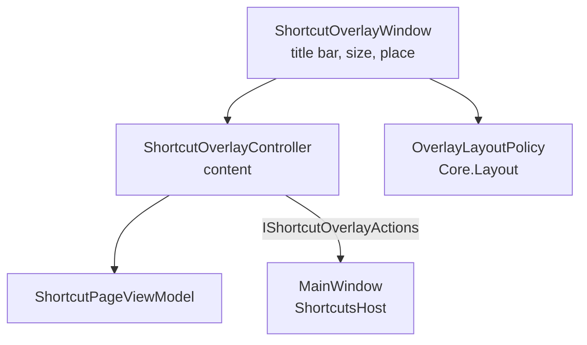

- 窗口：自己画的标题栏是拖动区域；高度跟随内容；可调大小；按显示器（设备名加分辨率）以 DIP 记住位置，保存在 `beta-shell.json` 的 `OverlayPlacements`；拖到工作区边缘 16 DIP 内贴边；跟随应用主题。
  Window: its own title bar is the drag region; the height follows the content; it can be resized; its place is remembered per display in DIP (`OverlayPlacements` in `beta-shell.json`); it snaps within 16 DIP of an edge; it follows the app theme.
- 内容：标题栏（状态圆点、Mod 名称、状态图标、⋯ 菜单、关闭）、Mod 和目标窗口、发送开关、状态槽位、键帽、“保存预设”下拉按钮。需要用户处理的失败由 `ShortcutPageViewModel.ReportError` 标记，显示成红色 `InfoBar`。
  Content: title bar (status dot, Mod name, status icon, ⋯ menu, close), Mod and target window, send switch, state slots, key caps, the Save preset drop-down. Failures the user must act on are marked by `ShortcutPageViewModel.ReportError` and shown as a red InfoBar.

### 5.5 其他界面类 / Other UI classes

| 文件 / File | 作用 / Role |
| --- | --- |
| `Program.cs`, `App.xaml(.cs)` | 入口、单实例、全局异常记录。Entry point, single instance, unhandled-exception logging. |
| `UiText.cs`、`UiMessage.cs` + `Strings/*.json` | 界面文案，每种语言一个文件（嵌入资源）。UI text, one embedded file per language. |
| `Themes/Tokens.xaml`、`Styles/Controls.xaml`、`Styles/Pages.xaml` | 设计令牌（画刷、间距、圆角）和共用控件样式。Design tokens and shared control styles. |
| `Dialogs/` | 每个对话框一个类，由 `DialogService` 显示。One class per dialog, shown by `DialogService`. |
| `ShortcutInputService.cs`, `ShortcutProcessSecurity.cs`, `ShortcutPanelHotkey.cs` | 用 `SendInput` 发送按键、检查进程权限、注册全局快捷键。Sends keys with `SendInput`, checks process integrity, registers the global hotkey. |
| `CharacterScreenCapture.cs` | 跟随出场角色时截取 HUD 区域。Captures the HUD region to follow the active character. |
| `Online*Adapter.cs` | 在线页状态与图片加载的适配层（与 Core 测试共用）。Adapters for online page state and image loading, also compiled into Core tests. |
| `UiCrashDiagnostics.cs` | 界面崩溃的本地诊断。Local diagnostics for UI crashes. |
| `Models/` | 窗口使用的记录与配置类型，每个类型一个文件（如 `BetaShellConfig`、`WorkspaceRepository`、`ModPersistentSlot`）。Records and configuration types, one per file. |
| `Controls/` | XAML 控件：`PageHeader`、`EmptyState`、`KeyVisual`（键帽）、`OnlineModRow`、`OnlineModTile`、`PaneSplitter`；`DelegateElementFactory` 让代码构建的 `ItemsRepeater` 只创建可见行。XAML controls; `DelegateElementFactory` lets code-built repeaters create only visible rows. |
| `ViewModels/` | 可绑定的 ViewModel：设置、仪表盘、仓库卡片、路径、工作区（角色列表、Mod 列表、详情）、在线页与卡片、更新、快捷键。Bindable view models for each page. |

### 5.6 写法 / How pages are written

- **控件**放在 `src/WinUI3/Controls`，是 XAML `UserControl`，用 `x:Bind` 绑定。通用控件用依赖属性对外暴露；页面控件只绑定自己的 ViewModel。
  **Controls** are XAML `UserControl`s in `src/WinUI3/Controls`, bound with `x:Bind`. Shared controls expose dependency properties; page controls bind only to their own view model.
- 每个页面用 `PageHeader`：一行标题，说明放在 ⓘ 提示里，右侧放操作按钮（`Actions`）。
  Every page uses `PageHeader`: a one-line title, the description in the ⓘ tooltip and actions on the right.
- **ViewModel** 放在 `src/WinUI3/ViewModels`，命名 `<名称>ViewModel`，`public sealed partial class`，继承 CommunityToolkit.Mvvm 的 `ObservableObject`。属性写成字段加 `SetProperty`（不用字段上的 `[ObservableProperty]`，MVVMTK0045）；操作用 `[RelayCommand]`。ViewModel 不引用控件、不调用 `T()`；需要窗口做的事通过构造函数传入 `Func<Task>` 或接口。
  **View models** live in `src/WinUI3/ViewModels`, named `<Name>ViewModel`, `public sealed partial class`es deriving from `ObservableObject`. Properties are a field plus `SetProperty` (no field-based `[ObservableProperty]`, MVVMTK0045); actions are `[RelayCommand]`s. View models reference no controls and do not call `T()`; work only the window can do comes in through constructor `Func<Task>`s or interfaces.
- **布局**：页面在自己的 `SizeChanged` 里按自身宽度排版；断点和列数写成 `Core/Layout` 里的策略并补测试（如 `DashboardLayoutPolicy`、`SettingsLayoutPolicy`）。
  **Layout**: a page lays itself out in its own `SizeChanged` from its own width; breakpoints and column counts are policies in `Core/Layout` with tests.
- 用名字（`x:Name`）找控件，不用 `Children[n]`；代码里创建的控件设置 `AutomationProperties.AutomationId`，界面测试才不依赖语言。
  Find elements by `x:Name`, never by position; give controls built in code an `AutomationProperties.AutomationId` so UI tests do not depend on the language.

## 6. Core 模块 / Core modules

图：Core 的目录按功能分组。`Infrastructure` 提供路径安全、不跟随链接的目录操作和错误标记，被其他模块共用；`Layout` 只放与控件无关的布局计算。
Diagram: Core's folders grouped by purpose. `Infrastructure` (path safety, link-safe tree operations, error tags) is shared by the others; `Layout` holds only control-free layout calculations.

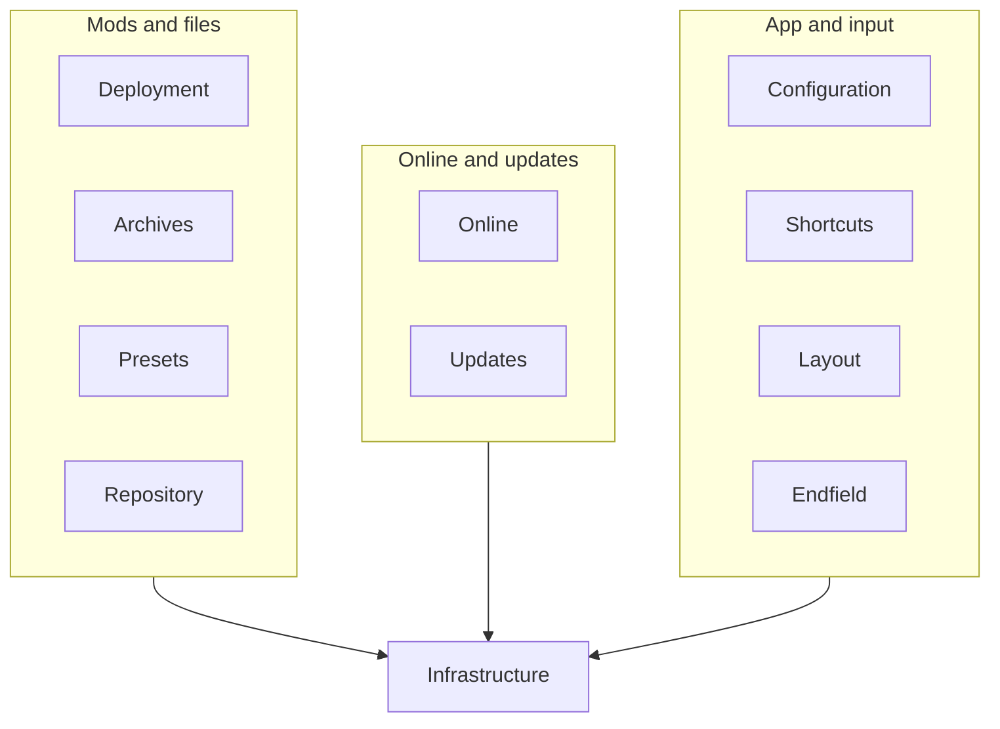

| 目录 / Folder | 内容 / Contents |
| --- | --- |
| `Archives` | `ArchiveExtractor`（ZIP、7-Zip、Bandizip、Windows tar）、RAR5 与 7-Zip 清单校验、错误分类、导入布局。Extraction, listing checks, error kinds, import layout. |
| `Configuration` | `config.ini` 读写、原子写入与损坏恢复（`ConfigurationFileStore`）、主题偏好、“新功能”何时显示（`WhatsNewPolicy`）。config.ini, atomic writes and recovery, theme preference, when What's New shows. |
| `Deployment` | 部署布局与按角色单选/多选、目录联接、安装事务与回滚、复制记录（`CopyDeploymentLedger`）、文件与 INI 冲突检测、组合部署、旧库整理导入、角色文件夹规划。Layout and selection, junctions, transactions, copy records, conflicts, combination deployment, library import. |
| `Presets` | 组合预设与恢复预览、组合包、持久参数引擎、变体导入、`d3dx_user.ini` 快照、热重载（`LoaderHotReload`）、保存前刷新加载器状态（`LoaderStateCapture`）、方案分享、默认槽位、菜单状态变量、预设图片、加载器自动保存间隔。Presets, bundles, persistent state, snapshots, hot reload, flush-before-capture, sharing, Default slots, preset pictures. |
| `Online` | 所有在线请求与解析（GameBanana 列表、分类和下载数，角色目录，翻译，图片）、`OnlineHttpClientFactory`（含测试样例模式 `IMM_ONLINE_FIXTURES`）、下载调度与日志（`OnlineDownloadScheduler`、`DownloadTaskJournal`）、浏览与排序策略、请求冷却，以及内嵌 GameBanana 网页能打开的地址（`GameBananaWeb`）。Every online request and its parsing, the HTTP client factory with sample mode, download scheduling and journal, browse and sort policies, cooldown, and which addresses the embedded GameBanana page may open. |
| `Shortcuts` | INI 按键扫描与缓存、按键计划、描述格式化、游戏窗口识别、权限策略。Key binding scanning and cache, key plans, descriptions, game window detection, privilege policy. |
| `Updates` | 版本与发布策略（`ApplicationReleasePolicy`）、读取最新版本、下载与 SHA-256 校验（`ApplicationUpdateClient`）、Mod 更新替换与恢复、更新页列表的状态、筛选、搜索与排序。Release policy, latest release, download and checksum, Mod update replacement, Updates list policies. |
| `Repository` | 仓库扫描、仪表盘计数与路径状态、角色文件夹头像、命令面板搜索、工作区策略、通过 XXMI 启动、批量集合、性能记录。Scanning, dashboard counts and path status, avatars, command palette search, workspace policies, XXMI launch, batch collections. |
| `Endfield` | 桥接迁移与资格判断、干员目录解析、内置干员表（嵌入资源）。Bridge integration, operator catalog, embedded operator list. |
| `Layout` | 窗口、弹窗和页面布局策略：仪表盘、在线、设置（`SettingsLayoutPolicy`）、快捷键、更新、浮窗（`OverlayLayoutPolicy`）。Window, dialog and page layout policies, including the overlay's placement. |
| `DeveloperTools` | 开发者工具和主程序共用的只读检查：安装位置（`DeveloperToolsLocation`）、复制记录与槽位检查（`StateRecordAudit`）、日志解析（`LogReader`）、缓存清单与清除规则（`CacheInventory`）、语言文件比较（`LanguageFileComparer`）、诊断统计（`DiagnosticSummary`）。Read-only checks shared by the Developer Tools and the app. |
| `Infrastructure` | 路径安全（`PathSafety`）、不跟随链接的目录操作（`SafeDirectoryTree`）、错误标记（`ErrorTags`）、恢复用 JSON、日志轮换、单实例策略。Path safety, link-safe tree operations, error tags, recovery JSON, log rotation, single instance. |

## 7. 数据与状态 / Data and state

图：谁写哪些文件。设置和仓库在 `beta-shell.json`；SQLite 数据库是可重建的缓存；加载器的 `d3dx_user.ini` 和目标 Mods 文件夹属于用户，只在用户操作时写入，写入前备份。
Diagram: who writes which files. Settings and repositories are in `beta-shell.json`; the SQLite database is a re-creatable cache; the loader's `d3dx_user.ini` and the target Mods folder belong to the user and are written only on user actions, with a backup first.

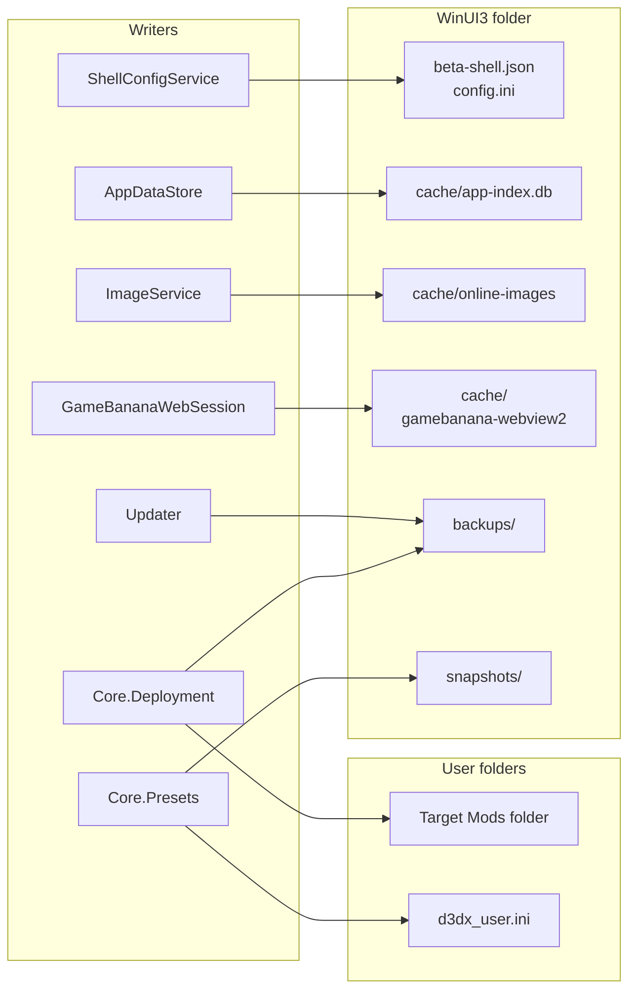

| 位置 / Location | 内容 / Contents | 写入方 / Written by |
| --- | --- | --- |
| `WinUI3/config.ini` | 主题、语言、快捷键说明、Mod 链接、在线安装来源（值为 Base64）。Theme, language, shortcut notes, Mod links, install origins (Base64 values). | `ShellConfigService` |
| `WinUI3/beta-shell.json` | 仓库与路径（`Repositories`）、当前页面与界面状态、在线偏好、组合预设（`ConfigurationProfiles`）、状态槽位（`ModPersistentSlots`）、复制记录（`CopyDeployments`）、浮窗设置与位置（`OverlayPlacements`）、已看过的“新功能”。Repositories, UI state, online preferences, presets, state slots, copy records, overlay settings and places, the What's New marker. | `ShellConfigService` |
| `WinUI3/cache/app-index.db` | SQLite：在线分页、角色目录、详情、指标、收藏、仓库索引。Online pages, characters, details, metrics, favorites, repository index. | `AppDataStore` |
| `WinUI3/cache/online-images` | 在线图片缓存，可重新生成。Re-creatable image cache. | `ImageService` |
| `WinUI3/cache/gamebanana-webview2` | 点赞用的 GameBanana 网页的 WebView2 配置文件（含登录）。The WebView2 profile of the GameBanana page, including its sign-in. | WebView2；`GameBananaWebSession` 删除 / deletes |
| `WinUI3/snapshots/user-ini`、`snapshots/preset-previews` | 整份 `d3dx_user.ini` 快照；状态槽位与组合预设的图片（不进诊断报告）。Whole `d3dx_user.ini` snapshots; preset pictures (never in diagnostics). | `Core.Presets` |
| `WinUI3/backups` | 配置备份、安装事务备份、软件更新备份（`backups/updates`）、终末地启动设置与恢复点。Configuration, install, update and Endfield launch backups. | Core、更新器、启动组件 / Core, updater, launch component |
| `WinUI3/diagnostics` | 快捷键发送记录、界面操作记录、崩溃诊断。Shortcut send log, UI action trail, crash diagnostics. | 主程序 / Application |
| 加载器的 `d3dx_user.ini` / the loader's `d3dx_user.ini` | 加载器保存的 `global persist` 值；只在用户操作时读写，写入前备份。Loader-saved persistent values; read or written only on user actions, backed up first. | `ModPersistentPresetEngine`、`LoaderHotReload` |
| 目标 Mods 文件夹 / target Mods folder | 部署的 Mod（复制或目录联接）。Deployed Mods (copies or junctions). | `Core.Deployment` |
| Mod 文件夹 / Mod folders | `.imm_avatar.*` 头像、写入默认值时的 `.imm-persist-*.bak`。Avatars and default-write backups. | `CharacterFolderAvatars`、`ModPersistentPresetEngine` |

配置写入采用临时文件替换和轮换备份。外部网络只访问 GameBanana、米游社与 HoYoWiki、终末地官网、Google 翻译接口和 GitHub Releases；请求都在 Core 的客户端里，只有点赞用的 GameBanana 网页由 WebView2 直接加载。
Configuration is written atomically with rotated backups. Network access is limited to GameBanana, the miHoYo wiki and HoYoWiki, the Endfield site, the Google translate endpoint and GitHub Releases; every request is made by a Core client, except the GameBanana page for likes, which WebView2 loads itself.

## 8. 关键流程 / Key flows

### 8.1 部署 Mod / Deploying a Mod

图：启用一个 Mod。Core 先检查冲突和同角色的选择规则，再在事务里备份、复制或建立联接；复制会留下复制记录，之后据此判断目标里的文件夹是不是本程序复制的。失败时回滚。
Diagram: enabling a Mod. Core checks conflicts and the per-character rule, then backs up and copies or links inside a transaction; a copy leaves a copy record, used later to tell whether a target folder was copied by the app. A failure rolls back.

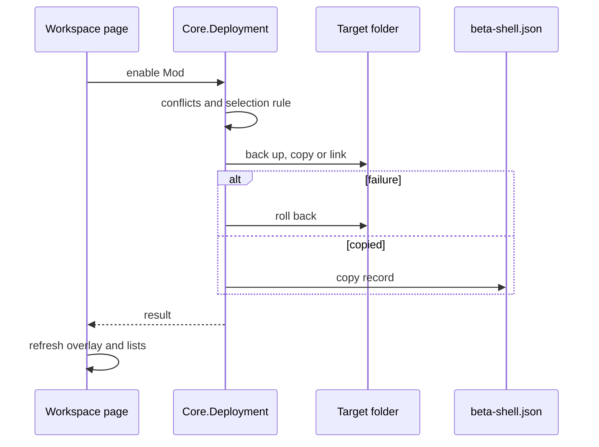

### 8.2 在线下载与安装 / Online download and install

图：在线页确认文件和目标文件夹后交给调度器排队；下载完成后解压、安装到角色或分类文件夹并记录来源。任务日志让中断的下载可以重试。
Diagram: once the file and destination are confirmed, the Online page queues the task; after the download the archive is extracted, installed into the character or category folder, and its origin recorded. The task journal lets an interrupted download be retried.

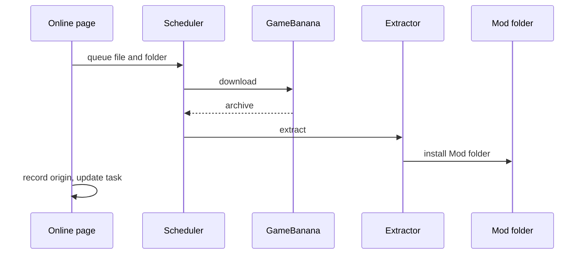

### 8.3 浮窗保存预设 / Overlay preset save

图：保存前先发 F10，让加载器把内存里的值写进 `d3dx_user.ini`；等文件变化并且两次读取相同后再读取。5 秒内没有变化时由用户决定读取现有文件还是取消。
Diagram: before saving, F10 makes the loader write its values to `d3dx_user.ini`; the app waits for the file to change and read the same twice. If nothing changes within five seconds, the user chooses between the existing file and cancelling.

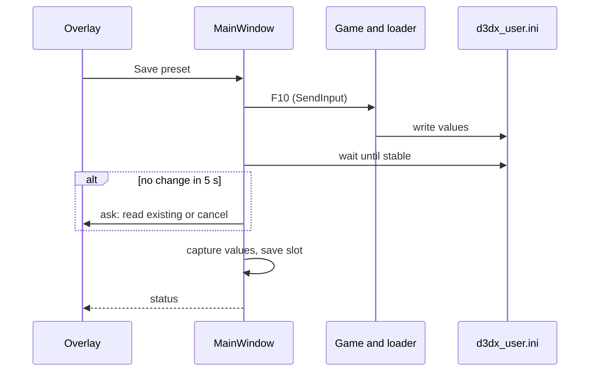

### 8.4 浮窗切换状态槽位 / Overlay slot switch

图：热切换（实验）。写入前备份；发送 F10 的前后几秒把文件设为只读，防止加载器用内存里的旧值覆盖它。
Diagram: hot switching (experimental). The file is backed up first and kept read-only for a few seconds around F10, so the loader cannot overwrite it with its old in-memory values.

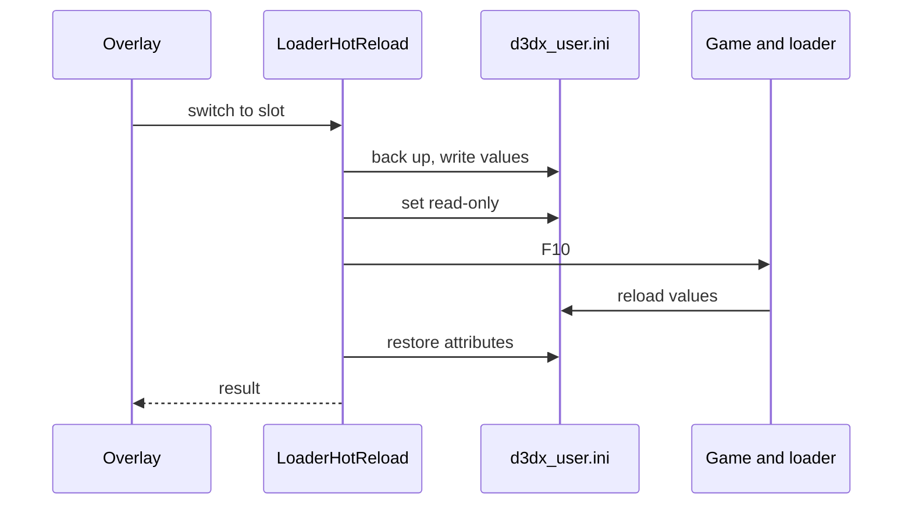

### 8.5 软件更新与回滚 / App update and rollback

图：主程序下载并校验更新包后启动更新器并退出；更新器备份、替换、检查版本，成功就启动新版，失败就从备份恢复。
Diagram: the app downloads and verifies the package, starts the updater and exits; the updater backs up, replaces and checks the version, then starts the new build or restores the backup.

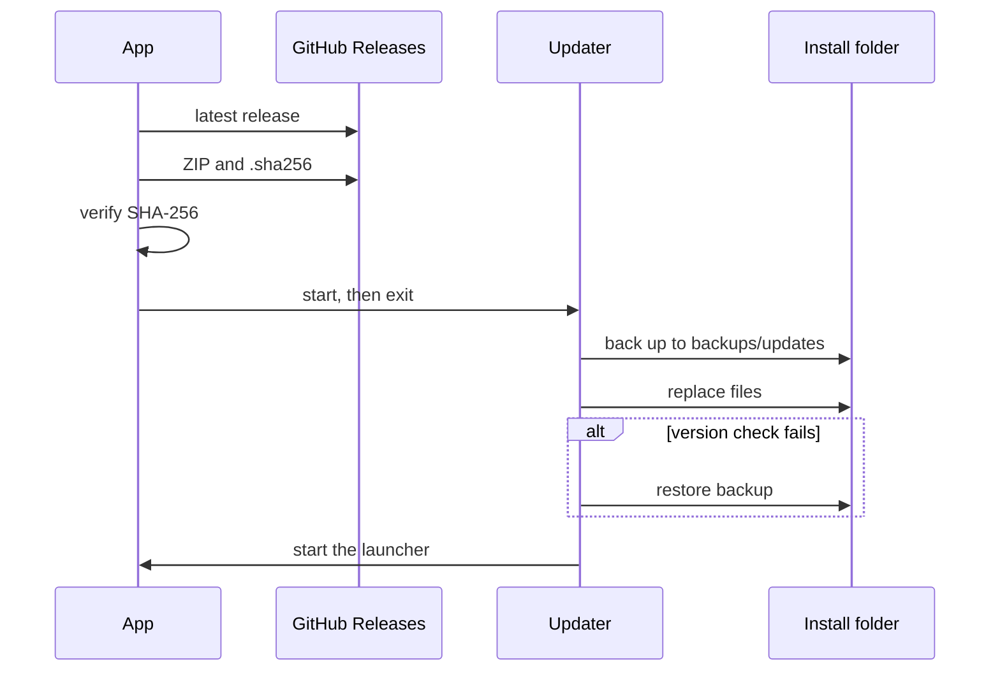

用户数据（`config.ini`、`beta-shell.json`、`cache/`、`backups/`、`snapshots/`、`diagnostics/`）不会被覆盖。User data folders are never overwritten.

## 9. 构建、测试与发布 / Build, test and release

| 步骤 / Step | 入口 / Entry |
| --- | --- |
| 本地构建 / Local build | `scripts\build_winui.bat`（输出到 `dist/` / outputs to `dist/`） |
| 代码风格 / Code style | `scripts\check-code-style.ps1` |
| 完整验证 / Full verification | `scripts\test-all.ps1`：四个单元测试套件与覆盖率门槛、WinUI x64 Release 构建、启动器与更新器编译、组装 `ReleaseSource` 与验证包。Four unit suites with coverage gates, WinUI x64 Release build, launcher and updater, staged release source and verification package. |
| 界面测试 / UI tests | `scripts\test-ui.ps1 -Application <ReleaseSource>`：在 `test-all.ps1` 之后启动构建好的程序，用 FlaUI 检查首次安装、各页面、对话框、浮窗等；CI 在 `test-all` 之后运行。Starts the built app and checks it with FlaUI; CI runs it after test-all. |
| 正式版打包 / Stable package | `scripts\package-stable-release.ps1`：写入 `PACKAGE-INFO.json`（版本、源码提交、程序集哈希、测试结果）；`-ForGitHubRelease` 要求干净源码和对应 CI。Writes `PACKAGE-INFO.json`; `-ForGitHubRelease` requires clean source and its CI run. |
| 发布说明 / Release notes | `scripts\new-release-notes.ps1`：从 `docs/releases/v<版本>.md` 生成 Release 正文，相对链接指向该标签。Builds the release body from `docs/releases/v<version>.md`. |
| 升级演练 / Upgrade rehearsal | `scripts\test-preview-upgrade.ps1`：用上一版公开安装包自带的更新器升级隔离副本，再回滚（路径用绝对路径）。The previous public package's updater upgrades an isolated copy and rolls it back. |
| 测试夹具 / Fixtures | `scripts\new-*-fixture.ps1`、`scripts\fake-3dmigoto-loader.ps1`（模拟加载器）、`tools/online-fixtures`（在线样例）、`tools/ui-baseline`（截图基线）。Fixture scripts, a simulated loader, online samples, screenshot baselines. |

### 9.1 工作流 / Workflows

| 工作流 / Workflow | 何时 / When | 做什么 / What |
| --- | --- | --- |
| `build-and-test.yml` | 每次推送和 PR / every push and PR | 代码风格、`test-all`、界面测试、各语言文案统计、开发者工具打包，上传验证包。Style, test-all, UI tests, UI text report, developer tools, verified package. |
| `release.yml` | 推送 `vX.Y.Z` 标签；修改发布脚本的 PR / a version tag; PRs touching release scripts | 见下图；PR 只演练，不建 Release。See below; a PR only rehearses. |
| `discord-release.yml` | Release 发布时 / a release is published | 把中英文发布说明发到 Discord。Posts the bilingual notes to Discord. |
| `online-sources.yml` | 每天 / daily | `tests/Online.Tests` 用 Core 客户端检查真实网站是否变了。Checks the live sites with the Core clients. |
| `codeql.yml` | PR、`main`、每周 / PRs, `main`, weekly | CodeQL 安全分析。Security analysis. |

图：发布流程。推送标签后 `release.yml` 在干净的 Windows 机器上测试、打包、演练升级与回滚、运行界面测试，然后建一个草稿 Release 并重新下载核对哈希；维护者检查后手动发布，发布会触发 `discord-release.yml`。
Diagram: the release pipeline. After a tag is pushed, `release.yml` tests, packages, rehearses the upgrade and rollback and runs the UI tests on a clean Windows runner, then creates a draft release and re-downloads it to check the hash; the maintainer reviews and publishes it, which triggers `discord-release.yml`.

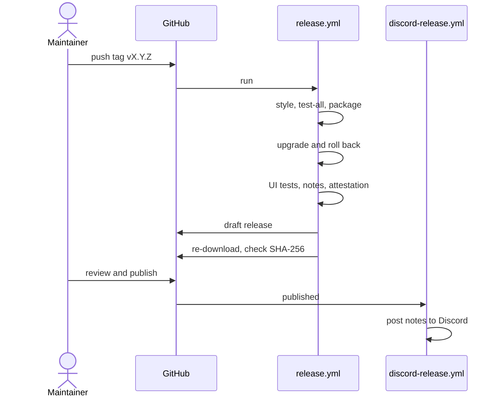

验证记录在 [`docs/verification`](../verification/)。Records are in `docs/verification`.

## 10. 约定 / Conventions

- 不需要控件的逻辑放进 Core 并写单元测试；窗口和页面只负责调用、显示和本地化。
  Logic that needs no controls goes into Core with unit tests; the window and pages call it, display results and localize them.
- 界面文案放在 `Strings/<语言>.json`，代码用 `T("功能.名称", 值…)` 读取；要保存下来、切换语言后重新显示的状态用 `M("功能.名称", 值…)` 生成 `UiMessage`。`UiTextResourceTests` 检查键与参数个数。键只新增不改名，不用的键在同一分支删除；新文字同时写中文、英文和俄语。
  UI text lives in `Strings/<language>.json` and is read with `T(...)`; a status kept across a language switch is a `UiMessage` from `M(...)`. `UiTextResourceTests` checks keys and placeholders. Keys are added, never renamed; unused keys are removed in the same branch; new text goes into Chinese, English and Russian.
- **添加一种语言**：复制 `en-US.json` 为 `<代码>.json`，翻译，并把 `Language.Name` 改成该语言自己的名称；它会自动出现在“设置 → 语言”里，没翻译的键显示英文。
  **Adding a language:** copy `en-US.json` to `<code>.json`, translate it and set `Language.Name`; it appears in Settings → Language, and missing keys show English.
- Core 用 `ErrorTags` 给异常附加错误类型，界面按类型映射提示文字，不匹配异常消息。
  Core tags exceptions with a kind through `ErrorTags`; the UI maps kinds to messages instead of matching text.
- 路径包含判断统一用 `PathSafety`；目录遍历、复制、删除用不跟随链接的 `SafeDirectoryTree`。
  Path containment uses `PathSafety`; tree walks, copies and deletes use the link-safe `SafeDirectoryTree`.
- 写入用户文件前先备份，失败时还原；不修改游戏文件，不读写游戏内存。
  Back up user files before writing and restore on failure; never modify game files or game memory.
- PowerShell 脚本含中文时保存为带 BOM 的 UTF-8，Windows PowerShell 5.1 才能正确读取。
  PowerShell scripts containing Chinese are saved as UTF-8 with BOM so Windows PowerShell 5.1 reads them correctly.
- 文档里的 Mermaid 图：短节点名、短标签，长标签用 `<br/>` 换行，标签只用一种语言；优先 `flowchart TB` 和子图；只用 flowchart、sequenceDiagram、stateDiagram-v2 的基本写法，GitHub 才能完整显示。
  Mermaid diagrams in the docs: short node ids and labels, `<br/>` for line breaks, one language per label; prefer `flowchart TB` and subgraphs; use only basic flowchart, sequenceDiagram and stateDiagram-v2 so GitHub renders them in full.

## 11. 许可证边界 / Licensing boundary

仓库中的文件按 MIT 授权，`src/IntegratedModManager.EndfieldLaunch/` 除外，它是 AGPL-3.0-only（源自 EndfieldBridge、endfield-nolauncher 和 Better-Endfield）。由于主程序包含该组件，v4.3.0 起的发布包整体按 AGPL-3.0-only 分发。详见 [LICENSING.md](../LICENSING.md)。
Repository files are MIT except `src/IntegratedModManager.EndfieldLaunch/`, which is AGPL-3.0-only. Because the application includes it, release packages from v4.3.0 on are distributed as a whole under AGPL-3.0-only. See LICENSING.md.
