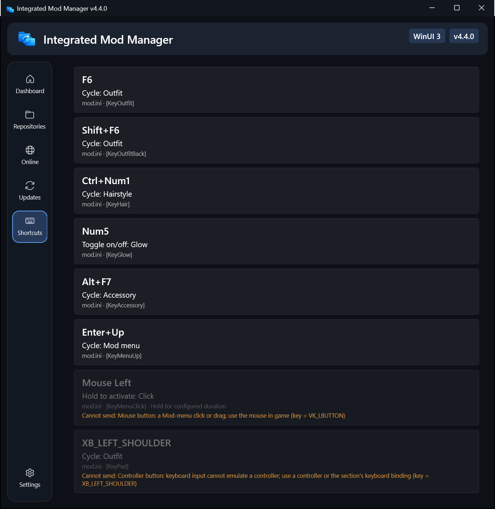
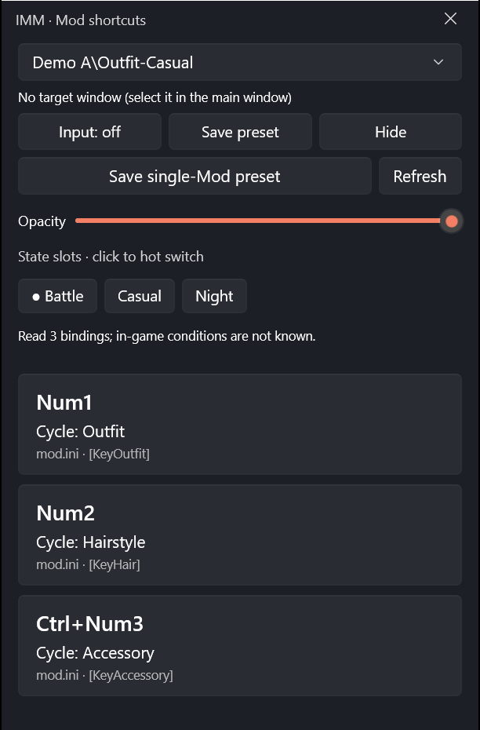

# Mod 快捷键面板与置顶浮窗

[English](Mod-Shortcut-Panel.en.md)

4.4 新增“快捷键”模块：读取 Mod INI 里的 `[Key…]` 绑定，点一下就向游戏发送对应按键，不用记快捷键，也不需要实体小键盘。置顶浮窗可以在游戏画面上方使用，并支持跟随当前出场角色切换 Mod。

## 开始使用

1. 在左侧导航打开“快捷键”，选择当前仓库中的 Mod。面板会列出每个绑定的按键、动作说明、来源节和条件。
2. 选择目标游戏窗口，开启“允许向所选窗口发送按键”。游戏已经在运行时，管理器会自动选中游戏窗口（终末地 `Endfield.exe`，以及原神、星穹铁道、绝区零；优先选当前仓库对应的游戏）。打开浮窗或在浮窗里开启发送时，也会重新识别一次，所以先开管理器、后开游戏也没关系。为了安全，发送开关仍然需要你手动打开。
3. 点击按键按钮即可发送。Num5 发送的是数字小键盘 5，与数字行的 5 不同。

**终末地需要以管理员身份运行管理器。** `Endfield.exe` 始终以管理员权限运行，Windows 会静默丢弃普通权限程序发给它的模拟按键。管理器会在发送前识别这种情况并提示，点击“以管理员身份重启管理器”（会弹出一次 UAC）即可。以管理员身份运行时，Windows 不允许从资源管理器拖放文件到管理器，导入 Mod 请使用选择文件按钮。

## 置顶浮窗

- 点击“独立置顶面板”打开，或用全局快捷键 **Ctrl + Alt + K**（默认）显示或隐藏；快捷键可在模块内更换或禁用。
- 浮窗不抢焦点，点击按钮后游戏仍保持前台。可以拖动、调整大小。
- 背景不透明度可调（10%–100%），只影响背景，文字和按钮始终清晰；字体颜色可自定义。
- 浮窗内可用的操作：
  - **切换 Mod**：只列出已启用（已部署到加载器 Mods 目录）的 Mod。
  - **发送开／关**：暂停或恢复发送。
  - **刷新**：重读已部署的 Mod、当前按键与状态槽位。启用、停用、切换链接或恢复组合成功后也会自动刷新；当前 Mod 被替换时选择新 Mod，没有替代项时清空旧按键。
  - 保存前不能发送 F10（未选窗口、发送未开启、权限不足）时，可以取消去设置，或明确选择“只读取现有文件”；后者可能包含旧参数。
  - **保存预设**：把当前启用的 Mod 组合和 `d3dx_user.ini` 中的参数保存为组合预设。保存前发送 F10，等待参数文件变化且两次读取相同后再捕获；5 秒超时则不保存。F10 会短暂重载画面。
  - **保存单 Mod 预设**：点击此按钮，在浮窗中输入名称并保存。仅捕获点击时选中的 Mod，保存为该 Mod 的状态槽位；空名称和此 Mod 内的同名名称不能保存。取消不会创建预设。命名时浮窗临时获取键盘焦点，结束后把焦点交还游戏窗口。命名后先发送 F10 并等待加载器写入，5 秒超时不保存。保存期间不更改文件属性；有热应用正在进行时先等它结束。未部署、缺少参数或保存失败时会在浮窗中提示。
  - **状态槽位热切换（实验，默认关闭）**：
    - 在模块里打开“在置顶浮窗中热切换状态槽位”后，浮窗会列出当前 Mod 的状态槽位，带 ● 的是当前槽位。
    - 点击一个槽位，会把它的值写入 `d3dx_user.ini`，再向选定的游戏窗口发送 **F10**。
    - 发送 F10 的几秒内，管理器会把 `d3dx_user.ini` 暂时设为只读，防止加载器重新加载时用内存里的旧值覆盖文件。
    - 需要先选择游戏窗口并开启发送。写入前会备份文件，结果显示在浮窗状态行。
- 主窗口恢复状态槽位或整份 `d3dx_user.ini` 快照时，也可以勾选“游戏正在运行：写入后发送 F10 热重载”，不用退出游戏。
- 热应用依赖加载器在 F10 时重新读取 `d3dx_user.ini`（3DMigoto/XXMI 的默认行为）。如果 F10 没有送达，写入的值会在退出游戏时被加载器覆盖，状态行会提示。
- 恢复组合预设、仓库设置、在线下载等需要退出游戏或需要大量确认的操作仍在主窗口进行。

浮窗适用于窗口化和无边框全屏；独占全屏是否显示取决于游戏。

## 跟随当前出场角色

1. 选择目标游戏窗口，点击“框选识别区域”，拖框选出**只随当前出场角色变化**的头像或名称，不要选择始终显示整个队伍的列表。
2. 在游戏中切到某个角色，在管理器中选择该角色的 Mod，点击“保存当前角色参考图”。对每个需要跟随的角色重复此步骤。
3. 开启“自动切换角色快捷键”。程序约每 700 毫秒比对一次，连续 3 次匹配才切换；匹配度低、难以区分或游戏不在前台时不切换。

手动选择 Mod 会暂停跟随。参考图只保存在程序目录 `character-references` 中，按仓库区分，只保存裁剪后的 24×24 像素特征，不保存完整截图，也不上传。分辨率、HUD 比例或界面变化后可能需要重新校准。

## 为什么有些快捷键选不了

无法发送的绑定会显示原因和原始写法，也可以开启“隐藏无法发送的绑定”。

| 原因 | 例子 | 解决办法 |
| --- | --- | --- |
| 鼠标按键 | `VK_LBUTTON`、`VK_XBUTTON1` | 通常是 Mod 内置菜单的点击或拖动，需要鼠标指在游戏画面上，面板无法代替。直接用鼠标操作。 |
| 手柄按键 | `XB_LEFT_THUMB`、`XB_DPAD_UP` | 键盘模拟无法产生手柄输入。同一节通常还有键盘绑定，面板会列出可发送的那一条。 |
| 系统组合键 | `alt F4`、`WIN` 键 | 为防止误关游戏或触发系统功能而禁用。确需使用请在 Mod INI 中改成其他按键。 |
| 无法识别 / 条件矛盾 | 拼写错误、同一键既要求按下又要求不按 | 检查并修正 Mod INI 中的 `key =` 写法。 |

## 支持范围

- 按 3DMigoto 规则解析：最后一个键触发，前面的键需按住（如 `VK_RETURN VK_UP`）；`no_` 可排除任意键。支持字母、数字、F1–F24、数字小键盘、导航键、常用标点键和 Ctrl/Alt/Shift 组合。
- 读取启用的 INI，跳过 `DISABLED` 文件和子目录；只读，不修改 Mod INI。
- 默认使用扫描码发送，也可切换为虚拟键模式；单次按压时间默认 200 毫秒，可调为 100–2000 毫秒；长按类绑定使用单独的持续时间。扫描码模式下小键盘数字需要开启 Num Lock，可用模块中的“切换 Num Lock”按钮。
- 发送前校验目标进程和窗口，检查是否有其他键被按住，完成、失焦或关闭时释放本次按下的键。只有用户点击才会发送，角色识别不会自动执行快捷键。
- 同一个键可能触发多个 Mod；面板无法绕过加载器的按键冲突。INI 条件只做展示，不假定在游戏中成立。

## 排查

- 游戏没有反应：确认目标是游戏本体并已开启发送；查看是否提示权限不足；分别试扫描码和虚拟键模式；可把按压时长调到 500 毫秒。
- 每次点击会在 `WinUI3/diagnostics/shortcut-input.jsonl` 写一条本地诊断（输入模式、按键、Windows 接收数量、前台窗口、权限检查），不会上传。Windows 接收了输入不代表游戏一定执行了 Mod 动作。
