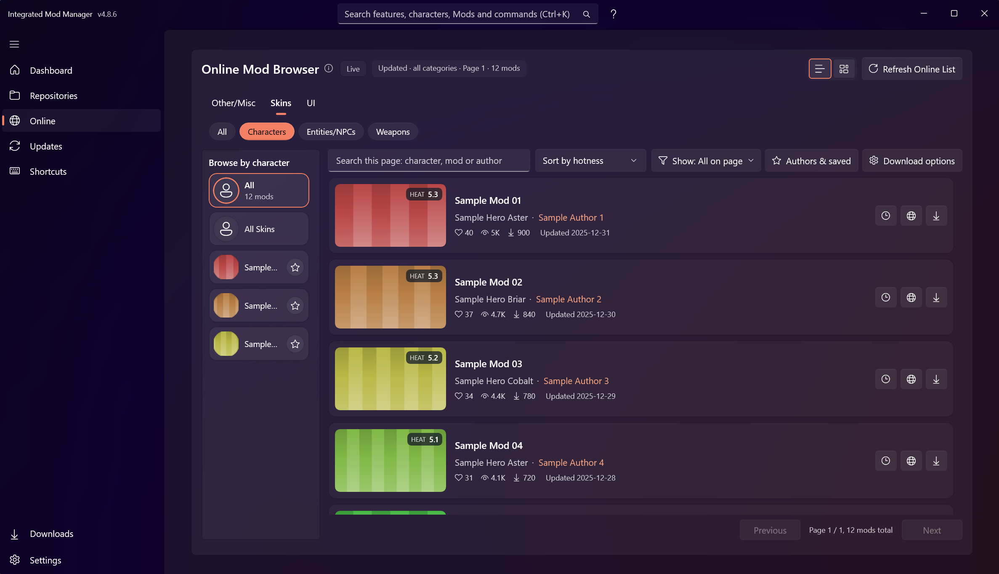
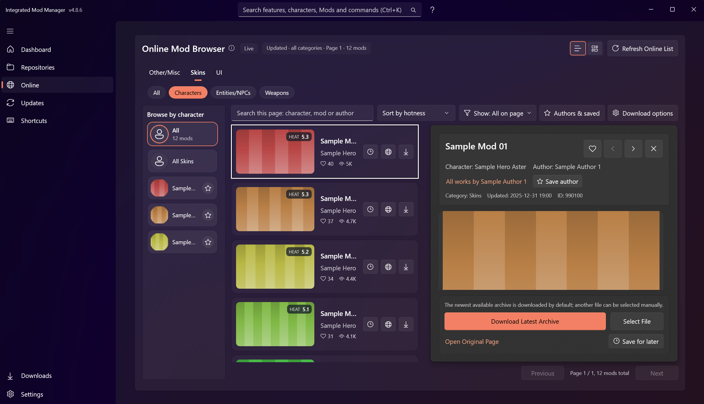

# Browse and Download

> For 4.8.6. [中文](../zh-CN/浏览与下载.md) · [User guide](./User-Guide.md)

The Online page browses GameBanana Mods by character; downloads are extracted and installed into the repository with their source recorded, so updates can be tracked. This page also covers the download task center, importing an old library, and local tags.

## Online source

Each repository can set its target game, skin category ID, source site and Wiki address in Settings. Presets cover Endfield, Zenless Zone Zero, Genshin Impact and Honkai: Star Rail; other games can use their own category. Any category name containing `Skins` is accepted. The character catalog (avatars, localized names, order) is cached separately from the Mod list and refreshes in the background after a day.

Online data comes from external sites; a proxy may be needed if loading is slow or fails. During HTTP 429 rate limiting, cached data is shown and you can refresh later.

## Browsing

- **Characters:** browse by character with avatars and names in the app language; the star button pins a favorite character (stored per repository). **All** shows the whole category.
- **Search and sort:** search matches character and Mod names; sort by heat, downloads, likes, views or update time. Heat is capped at 10 and uses log-weighted downloads, likes and views.
- **Layout:** the top row holds the title, states and view switch, then the categories, then a row with search, sort, the **Show** filter, **Authors & saved** and **Download options**; paging sits at the bottom. In a narrow window, **Authors & saved** and **Download options** show only their icons. List and grid use one card style: the list for details, the grid for images. Every button has a tooltip.
- **Categories:** the tabs at the top switch GameBanana's top-level categories, with a row of subcategory chips below, **All** first. When the row doesn't fit, ‹ › arrows appear and the mouse wheel scrolls it. In a narrow window the top-level categories fold into **Category: X ▾** in the toolbar.
- **Authors:** click an author to browse their work across pages in the current category. Under the author in the details are **Save author** and **All works by …**; right-clicking a card also saves the author. `author:name` searches only the current page.
- **Page filters:** the **Show: All on page ▾** button shows only the items on this page that are **Installed on page** or **Saved on page**, and turns to the accent colour while it filters.
- **Active filters (4.8.4):** whenever something narrows the list, a row under the search box shows the match count on the page, then one chip for each filter (a category other than the default, character, author, search, the Show filter, and any sort other than hotness). The ✕ on a chip removes only that filter; **Clear all** goes back to the default list, including the category and the sort. The row is hidden when nothing is filtered. The sort box shows a dot when it isn't sorting by hotness.
- **Browsing position:** author, character, page, search, sort, layout and scroll position are kept per repository and restored after restarting, without downloading anything. Changing a filter or page starts at the top.

## Details and images

Click a card (or press `Enter` on it) to open a drawer on the right with author, character, category, update date, images, description and actions. The cards re-flow beside the drawer and the one you're viewing stays in view; the drawer's previous and next buttons move between the Mods on the page, and `Esc` closes it. Click the main image for the full-size viewer; use Left/Right and `Esc` to close. Descriptions can be translated automatically (experimental) and may be inaccurate.

**Like on GameBanana (4.8.2):** the heart button in the drawer opens the Mod's own GameBanana page inside the manager, below the Online navigation, where you can sign in and like or unlike it. The sign-in is GameBanana's own page (user name, password, an optional two-factor code and its security check); the manager never sees or fills it in. Only that Mod's page and GameBanana's own pages open there; **Back to Mod** returns to the Mod, and if the page cannot load you can open the original page in your browser. The sign-in is saved only on this computer, in the manager's own browser data (`cache\gamebanana-webview2`), and is separate from your browser. To remove it, use Settings → **Clear GameBanana sign-in**.

The app tries to detect Patreon, subscriptions, payment, like-to-unlock, delayed free releases and dependencies and shows a hint; the author's page is authoritative. It never bypasses logins, captchas, payments, subscriptions or permissions.

## Download and install

1. Click **Download** on a card or in Details. When an item has several files, the newest usable archive is chosen by default; you can pick another.
2. Confirm the destination character folder; if the character has no folder yet, you can create one after confirming. With **Remember confirmed download folders per repository and character** on, confirmed locations are reused (and asked again if a folder no longer exists).
3. The archive is extracted and installed, its source link and preview are recorded, and it is marked installed.

- **Duplicate hints:** you are told when the same file is already installed, when another variant of the same item is installed, or when an old record can't be matched.
- **Save for later:** click the clock on a card or **Save for later** at the bottom of the details (or right-click a card; stored per repository, up to 100 items); in the **Authors and saved Mods** panel select several, review files, folders and duplicates once, then queue them.
- **Concurrency:** **Concurrent download tasks** can be 1–4 (default 2), set in **Download options** on the Online page.

## Download task center

Running tasks appear under **Downloads** at the foot of the navigation; click it to watch progress, cancel, or clear finished entries. **Download history** on the Updates page lists every result with **All / Completed / Failed / Canceled** filters, and completed tasks open their output folder. **Retry** a failed task with its original repository, folder and file; you are told if the folder no longer exists or the file has been removed from the site. Tasks unfinished at exit are marked interrupted; after restarting, confirm the folder to download again. Nothing resumes automatically, and partial downloads are not continued.

## Importing an old library

**Organized import**, next to the view buttons on the Repository page, copies old Mod folders into the current repository:

1. Choose the old library and a target character folder. Direct subfolders of the old library that contain an INI become candidate Mods.
2. Preview, then copy. The Mod's inner structure is kept and the originals are untouched. An existing folder with the same name stops the import; nothing is merged or overwritten.
3. **Undo organized import** removes unmodified imported copies; copies that were changed, gained files or can't be accessed are kept and reported.

Characters are never guessed. After an unexpected exit, use **Check interrupted import** in the import menu.

## Local tags and filters

**Tags**, next to the repository search box, adds, removes or replaces tags in bulk; right-click a Mod to edit its tags. **Filters** filters by tag and can save a character, search and tag combination. Each Mod can have up to 16 tags, and tags are never written into Mod files.

## Update tracking

Online installs are tracked. The Updates page checks manually or on a schedule, filters by **Updates / Check failed / Up to date** with a search box, tells you when a new version exists, and can **Download and replace** (old files are backed up first and the preview is kept). Deleting a tracking record never deletes the local Mod.
