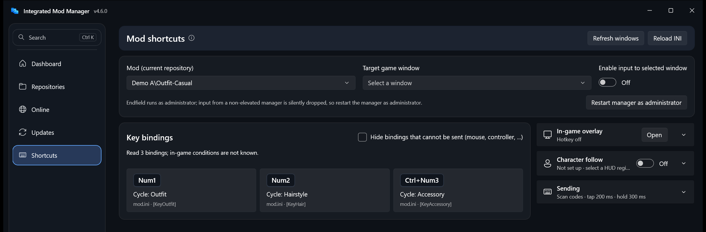

# Shortcut Panel and Overlay

> For 4.6.0. [中文](../zh-CN/快捷键与浮窗.md) · [User guide](./User-Guide.md)

The Shortcuts page reads the `[Key…]` bindings in a Mod's INI files and sends the matching key to the game when you click a button, so you don't have to remember shortcuts or own a numeric keypad. The always-on-top overlay works over the game: switch Mods, save presets, hot-switch state slots, and follow the character currently on the field.

## Getting started

The toolbar at the top holds the Mod picker, the target game window and the sending switch. Below it, the key bindings are on the left, each key drawn as a key cap with its action, source section and conditions. On the right are three collapsible modules: **In-game overlay**, **Character follow** and **Sending**. A collapsed module shows its current state in the header; the overlay's **Open** button and the character follow switch sit in the header row.

1. Open Shortcuts in the left navigation and pick a Mod from the current repository in the toolbar.
2. Pick the target game window in the toolbar and turn on sending. When the game is already running, the manager selects its window automatically (Endfield `Endfield.exe`, plus Genshin Impact, Star Rail and Zenless Zone Zero; the current repository's game comes first). Opening the overlay, or turning input on from it, looks again, so the game may start after the manager. Turning input on stays a manual step.
3. Click a key button to send it. Num5 sends numeric keypad 5, which is different from 5 on the number row.

**Endfield requires running the manager as administrator.** `Endfield.exe` always runs elevated, and Windows silently drops simulated keys sent to it from a non-elevated program. The manager detects this before sending and shows a notice; click "Restart manager as administrator" (one UAC prompt). While elevated, Windows blocks drag-and-drop from File Explorer into the manager, so use the file picker to import Mods.

## Overlay

- Click **Open** in the header of the **In-game overlay** module, or use the global hotkey **Ctrl + Alt + K** (default). The hotkey can be changed or disabled in the same module.
- The overlay never takes focus, so the game stays in the foreground after you click. Drag it and resize it as needed.
- Background opacity is adjustable (10%–100%) and affects only the background; text and buttons stay fully opaque. The font colour can be customised.
- Available in the overlay:
  - **Switch Mod**: lists only enabled Mods (deployed to the loader's Mods folder).
  - **Sending on/off**: pause or resume sending.
  - **Refresh**: rereads deployed Mods, the current bindings and state slots. Successful enable, disable, link switch or combination restore also refreshes the overlay; a replaced current Mod follows its replacement, and a disabled one with no replacement has its old buttons cleared.
  - **Save preset**: saves the enabled Mods and the values in `d3dx_user.ini` as a combination preset. It sends F10 first and waits for a changed, stable loader file (two matching reads); if the file does not change within five seconds, the overlay asks whether to save from the existing file (usually nothing changed since the loader last saved) or cancel. F10 briefly reloads the scene. Without a `d3dx_user.ini`, only the Mod combination is saved.
  - **Save single-Mod preset**: click this button and enter a name in the overlay. Only the Mod selected when you clicked is saved, as one of its state slots; blank names and names that Mod already uses are rejected, and Cancel saves nothing. The overlay takes keyboard focus while you type, then gives it back to the game. After naming it, saving sends F10 and waits for a changed, stable loader file; without a change within five seconds you choose between the existing file and cancelling, as above. Saving never changes file attributes and waits for an active hot apply to finish. Undeployed Mods, missing values and save failures are reported in the overlay.
  - If F10 can't be sent before saving (no window chosen, input off, or not enough permission), you can cancel to set it up, or explicitly read the existing file, which may hold old values.
  - **Hot switching state slots (experimental, off by default)**:
    - Turn on "Switch state slots in the overlay" in the **In-game overlay** module, and the overlay lists the current Mod's state slots; ● marks the current one.
    - Clicking a slot writes its values into `d3dx_user.ini` and sends **F10** to the chosen game window.
    - For a few seconds around F10 the manager keeps `d3dx_user.ini` read-only, so the loader's reload cannot overwrite it with the old in-memory values.
    - It needs the game window chosen and sending on. The file is backed up before writing, and the result appears in the overlay status line.
- When restoring a state slot or a whole `d3dx_user.ini` snapshot in the main window, you can also check "The game is running: send F10 to the game window after writing (experimental)" instead of closing the game.
- Hot apply relies on the loader re-reading `d3dx_user.ini` on F10 (the 3DMigoto/XXMI default). If F10 does not arrive, the loader overwrites the written values when the game exits; the status line says so.
- More on [state slots](./State-Slots.md) and [combination presets](./Combination-Presets.md).
- Restoring combination presets, repository settings, online downloads and other actions that need the game closed or several confirmations stay in the main window.

The overlay supports windowed and borderless full-screen modes; whether it shows over exclusive full screen depends on the game.

## Following the active character

1. Pick the game window and click "Select HUD region". Drag a box around the portrait or name that **changes only with the active character**, not a list that always shows the whole team.
2. Switch to a character in the game, select that character's Mod in the manager and click "Save character reference". Repeat for each character you want to follow.
3. Turn on the switch in the **Character follow** module header. The manager compares about every 700 ms and switches only after 3 consecutive matches; it doesn't switch on low or ambiguous matches or when the game isn't in the foreground.

Selecting a Mod by hand pauses following. References are stored only in the app's `character-references` folder, per repository, as cropped 24×24 pixel features. Full screenshots are never saved or uploaded. Recalibrate after changing resolution, HUD scale or the game's UI.

## Why some bindings can't be clicked

Bindings that can't be sent show the reason and the original text. You can also hide them with "Hide bindings that cannot be sent".

| Reason | Example | What to do |
| --- | --- | --- |
| Mouse buttons | `VK_LBUTTON`, `VK_XBUTTON1` | Usually clicks or drags in a Mod's own menu that need the pointer on the game screen. Use the mouse directly. |
| Controller buttons | `XB_LEFT_THUMB`, `XB_DPAD_UP` | Keyboard simulation can't produce controller input. The same section usually has a keyboard binding, which the panel lists. |
| System combinations | `alt F4`, `WIN` key | Disabled to avoid closing the game or triggering system features. Change the key in the Mod's INI if you need it. |
| Unrecognised or contradictory | Typos, a key both required and excluded | Check the `key =` line in the Mod's INI. |

## Supported keys

- Parsed with 3DMigoto rules: the last key triggers and earlier keys must be held (for example `VK_RETURN VK_UP`); `no_` can exclude any key. Letters, digits, F1–F24, the numeric keypad, navigation keys, common punctuation keys and Ctrl/Alt/Shift combinations are supported.
- Reads enabled INI files and skips `DISABLED` files and folders. Read-only; Mod INI files are never changed.
- Set in the **Sending** module: sends scan codes by default, with a virtual-key mode as an alternative. Tap duration is 200 ms by default and can be set from 100 to 2000 ms; hold-type bindings use a separate duration. In scan-code mode the keypad digits need Num Lock on; use Toggle Num Lock on the page.
- Before sending, the target process and window are checked, and the manager makes sure no other key is held. Keys pressed by the panel are released when it finishes, loses focus or closes. Keys are sent only when you click; character detection never triggers a shortcut by itself.
- One key may trigger several Mods; the panel can't work around key conflicts in the loader. INI conditions are shown for reference and are not assumed to hold in the game.

## Troubleshooting

- The game doesn't react: make sure the target is the game itself and sending is on; look for a permission notice; try both scan-code and virtual-key modes; try a 500 ms press.
- Each click writes a local diagnostic line to `WinUI3/diagnostics/shortcut-input.jsonl` (input mode, key, count accepted by Windows, foreground window, permission check). Nothing is uploaded. Windows accepting the input doesn't guarantee the game ran the Mod action.
