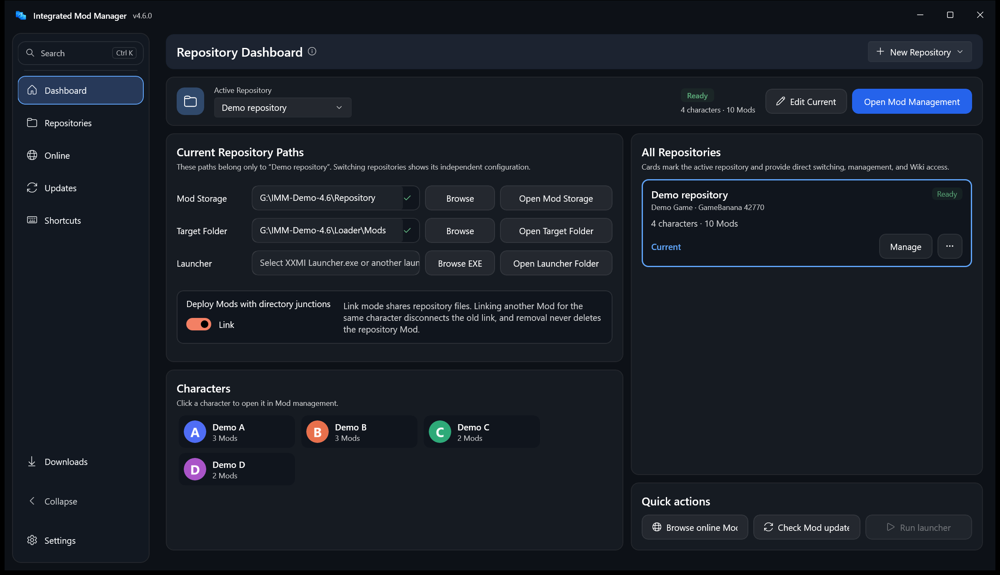
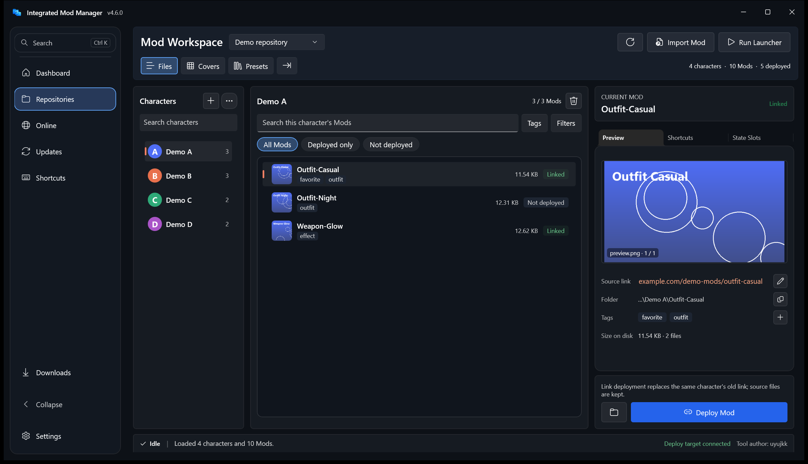
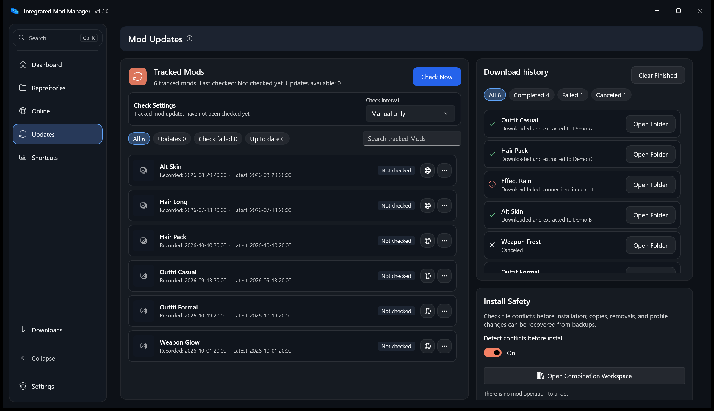
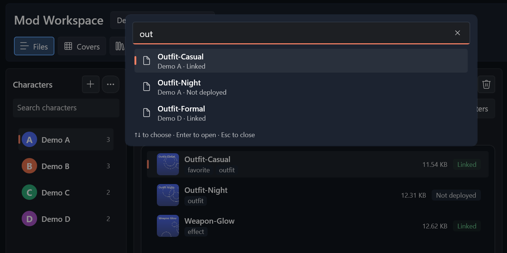

# Integrated Mod Manager User Guide

> For 4.6.1 on Windows 10/11 x64. Tool author: uyujkk.
>
> This is an unofficial fan-made tool. It is not affiliated with, authorized, endorsed, or sponsored by XXMI, any game publisher, or related developers.

[中文](../zh-CN/用户手册.md) · [Quick Start](./Quick-Start.md) · [Documentation index](../../README.md) · [Changelog](../../releases/CHANGELOG.md) · [Latest release](https://github.com/uyujkk/Integrated_Mod_Manager/releases/latest)

**Topic guides:** [Shortcut panel and overlay](./Shortcut-Panel.md) · [State slots](./State-Slots.md) · [Combination presets](./Combination-Presets.md) · [Browse and download](./Browse-and-Download.md) · [Endfield launch](./Endfield-Launch.md)

## 1. What the app does

Integrated Mod Manager organizes locally stored Mods into independent repositories and copies or links a selected complete Mod folder into the directory read by a game or Mod loader. It also provides character avatars, archive import, previews and source links, a shortcut panel and always-on-top overlay, single-Mod state slots, combination presets, online browsing and downloading, update tracking, conflict checks, transactional rollback, an integrated Endfield launch, app updates, and diagnostics.

The left navigation contains, from top to bottom:

| Entry | Purpose |
| --- | --- |
| Search | Opens the command palette (`Ctrl+K`): search the pages and the current repository's characters and Mods, or run Import Mod and Refresh repository |
| Dashboard | The current repository's status and counts, paths, a character overview, repository cards and quick actions; create or switch repositories; Endfield launch method |
| Repositories | Characters, the Mod list and details; Files, Covers and combination presets; deployment, previews, shortcut notes and state slots |
| Online | Browse GameBanana by character; a details drawer shows images, requirements and installed status, then download |
| Updates | Tracked Mods, download history, install safety and install backups; the entry shows how many updates there are |
| Shortcuts | Click to send a Mod's keys, open the always-on-top overlay, follow the active character |
| Downloads | At the foot of the navigation: the running count and progress; click to open the task list |
| Settings | Language, theme, density, motion, repository online categories, app updates and diagnostics |



On wide windows, **Collapse** at the foot of the navigation turns it into an icon rail, and the choice is saved; narrow windows use the rail automatically.

## 2. Installation, startup and upgrades

### 2.1 Requirements

- Windows 10 version 1809 or later (Windows 11 recommended), 64-bit (x64).
- The .NET 8 x64 runtime. The Windows App SDK is bundled; regular users do not need Visual Studio or the .NET SDK.
- Network access for online Mods, translation, update checks and GitHub reports.

### 2.2 Install and run

1. Download `Integrated_Mod_Manager-vX.X.X.zip` and its `.sha256` from [GitHub Releases](https://github.com/uyujkk/Integrated_Mod_Manager/releases/latest).
2. Fully extract it to a short, writable folder. Do not run it from inside the archive.
3. Keep `IntegratedModManager.exe`, `LocalUpdateAgent.exe`, the compatibility entry `ModFolderCopier.exe` and the `WinUI3` folder together.
4. Run `IntegratedModManager.exe`.

The executable is not commercially code-signed, so SmartScreen may report an unknown publisher. Download only from this project's Releases page and do not disable Microsoft Defender to run it.

### 2.3 Upgrading

- 4.x stable releases can update in the app (section 10), or you can extract the new release to a new folder. To migrate by hand, close both versions, then copy `WinUI3/config.ini` and `WinUI3/beta-shell.json`.
- Back up the app folder, the target Mods folder and the loader's active `d3dx_user.ini` first.
- Do not let two managers write to the same target folder.
- Upgrade notes for 4.0, 4.1 and 4.1.1 are kept in the [archive](../archive/).

## 3. Repositories and folder model

Each repository stores its own name, Mod storage folder, target folder, optional launcher, online source and category IDs, Wiki address and notes. Use separate repositories for different games, loaders or test setups.

```text
Mod Storage Folder
├─ Character or category A       <- first level
│  ├─ Mod A1                     <- second level, the deployment unit
│  └─ Mod A2
└─ Character or category B
   └─ Mod B1
```

- The first level is a category, usually a character; the second level is a complete Mod folder.
- The target folder is usually the `Mods` directory read by XXMI or the game.
- On a dashboard repository card, click **Switch to this repository**, or **Manage** to open its Mods; the card's **More actions** edit the repository, open the game Wiki or delete it (the last repository can't be deleted). The current-repository strip at the top also switches, edits and opens folders.
- The **New repository** menu offers game presets (Endfield, Zenless Zone Zero, Genshin Impact, Honkai: Star Rail) or a blank repository.

## 4. Local Mod management

### 4.1 First setup

1. Create a repository on the Dashboard, or edit the default one.
2. Set **Mod Storage Folder** to the root of the two-level library and **Target Folder** to the directory read by the game or loader. The Dashboard path boxes show whether each path exists.
3. Optionally turn on directory-link deployment (4.4) and choose an external launcher.
4. Open the Repositories page and select a character and a Mod.

While a repository isn't set up, the Repositories page shows a **Get started** card with three steps: choose the game, set the Mod repository folder, set the deploy target. Each step has its own button; the card disappears once all are done.

### 4.2 Character list and avatars

- Search characters by name; each item shows its Mod count. **New** above the list creates a character folder, and **More** opens the same menu as right-clicking a character: open folder, rename, allow several enabled Mods, avatar.
- Each character shows an avatar, taken from, in order:
  1. an `.imm_avatar.*` or `avatar.*` image in the character folder;
  2. a character you bound the folder to;
  3. the catalog character whose Chinese name, English name or alias equals the folder name (case, width and spaces are ignored).
- The catalog is shared with the Online page: the official operator list for Endfield (the built-in list fills gaps), the wiki plus GameBanana character categories for other games. A catalog older than a day refreshes in the background, so new characters appear within a day.
- Select a character and use **Avatar** in the More or right-click menu to choose an image (copied into the folder; the old one is kept as `.imm_avatar.previous.*`), bind the folder to a character, restore the previous avatar, or remove the custom one.
- Clicking a character in the Dashboard's character overview opens its Mods on the Repositories page.

### 4.3 Deploying and removing



- Switch between Files, Covers and Presets at the top; switching views never deploys Mods.
- Each Mod row shows a thumbnail, the name, tags, the number of key bindings, size and deploy state. **All Mods / Deployed only / Not deployed** above the list filter by deploy state; the search box filters by name.
- Single-click only selects a Mod and refreshes its preview, information, shortcuts and deployment state. Wide windows show details inline; narrow windows use Details. When a search or filter hides the selected Mod, the first visible Mod is selected instead.
- Double-click a Mod or use the deployment button at the bottom of Details to toggle it: a missing target folder is deployed, an existing same-named folder is removed. When deploying replaces another Mod of the same character, the hint at the bottom of Details names it.
- Right-click a Mod to deploy or remove it, open its folder, edit tags or delete it. Deleting removes the source Mod from the library after a confirmation.
- When the character has no Mods yet, the list says why and offers Import, **Find online** and **Adopt an existing Mod folder**.
- Deploy, remove and profile changes create transactional backups and roll back on failure. The status bar shows whether the deploy target is connected.

### 4.4 Directory links and several Mods per character

- With **Deploy Mods with directory junctions** on, the loader and library share one copy of each Mod.
- By default each character keeps one enabled Mod: enabling another replaces the links of its other Mods.
- Select a character and check **Allow several enabled Mods** in the More or right-click menu to keep several enabled for it.
- The repository editor can make several Mods the default, with individual characters turned back to one.
- Copy mode never removes sibling copies automatically. Restoring a combination preset asks first when it enables several Mods of a single-selection character.

### 4.5 Archive import

Supported: `.zip .zipx .7z .rar .cab .tar .tar.gz .tar.bz2 .tar.xz .tar.zst .gz .tgz .bz2 .xz .zst`. Select a character and use **Import**, or **Import Mod** in the `Ctrl+K` command palette, or drag an archive onto the Mod area (when running as administrator Windows blocks drag-and-drop; use the file picker).

- ZIP uses the built-in extractor; 7Z, RAR, ZIPX and CAB prefer bundled or installed 7-Zip; TAR formats use Windows `tar.exe`.
- Without 7-Zip, an installed Bandizip console tool `bz.exe` can be used (looked up in the app's `Tools` folder, the app folder, registered installations, standard folders and `PATH`). Windows `tar.exe` first checks every entry for unsafe paths, links and special files and stops if the check fails or is unsupported; RAR5 also gets a header check that rejects redirections, multi-volume archives, encrypted headers and self-extracting archives. A failed 7-Zip extraction is never retried with Bandizip.
- Each `tar.exe` or `bz.exe` call is limited to 10 minutes.
- Encrypted, damaged or incomplete multi-volume archives may fail.

### 4.6 Previews and Mod information

The app looks for `preview.*`, `cover.*`, `thumbnail.*` and `image.*`, then the first image in the Mod folder (PNG, JPG, BMP, GIF, WebP). The **Preview** tab in Details shows it at 16:9; drag an image onto the preview area to set it. Previews are kept when a Mod is updated.

The information table below the preview shows:

- **Source:** the source link, opened in the default browser; the pencil button edits it.
- **Location:** the Mod's path inside the repository, with a copy button.
- **Tags:** local tags, with an edit button; see [Browse and download](./Browse-and-Download.md#local-tags-and-filters).
- **Size:** the Mod folder's size and file count.

### 4.7 Shortcut notes

- The Shortcuts tab in Details reads `[Key…]` sections from the Mod's INI files and formats action descriptions in the app language; you can edit the list without a row limit. Automatic scanning keeps up to 512 bindings.
- These are notes. To send keys by clicking, use the Shortcuts page on the left; see [Shortcut panel and overlay](./Shortcut-Panel.md).

### 4.8 External launcher

Choose a launcher executable and use **Run Launcher**; its folder is used as the working directory, which suits XXMI Launcher and similar tools. Endfield repositories can use the integrated launch instead; see [Endfield launch](./Endfield-Launch.md).

## 5. Single-Mod state slots

Select a Mod and open the **State Slots** tab to save the Mod's current `global persist` values as named slots, several per Mod. You can also write a slot as the Mod's defaults, import a variant file, snapshot the whole `d3dx_user.ini`, and hot-apply while the game runs (experimental). See [State slots](./State-Slots.md).

## 6. Shortcut page and overlay

The Shortcuts page lists a Mod's INI key bindings and sends them to the game window with a click. The always-on-top overlay (Ctrl + Alt + K) works over the game: switch enabled Mods, save a combination or single-Mod preset (F10 is sent first), refresh, hot-switch state slots, and follow the active character. Endfield needs the manager to run as administrator. See [Shortcut panel and overlay](./Shortcut-Panel.md).

## 7. Combination presets and bundles

Open **Presets** at the top of Repositories to save the enabled Mod set, optionally with `d3dx_user.ini` values; restoring brings back the set first, then the values. Bundles export a preset with its Mod files for installation in another repository. See [Combination presets](./Combination-Presets.md).

## 8. Online browsing and downloads

The Online page browses GameBanana by character, with favorite characters and authors, download-later lists, batch downloads, search and sorting, a details drawer and a full-size gallery. Downloads are extracted and installed automatically and their source is recorded; the download history is on the Updates page, and running tasks also open from **Downloads** at the foot of the navigation. See [Browse and download](./Browse-and-Download.md).

The app never bypasses logins, captchas, payments, subscriptions, permission checks or author restrictions; requirement hints are best-effort and the author's page is authoritative.

## 9. Updates page: Mod updates, safety and tasks

On wide windows the Updates page fills the window in two or three columns and doesn't scroll as a whole: tracked Mods, download history, and install safety with install backups. Each list scrolls inside its card and only builds the rows on screen, so it stays smooth with many entries. Below about 900 px the cards stack and the page scrolls.



### 9.1 Tracked Mod updates

Online installs record the remote ID, source link, preview and update time. Check manually or every day, three days or week (the check settings are one row at the top of the card).

- Each row shows a thumbnail, the title, the recorded and latest dates, and a status: update available, check failed, not checked or up to date. Updates come first.
- **All / Updates / Check failed / Up to date** above the list filter by status and show counts; the search box filters by name.
- Each row has its actions on the right: **Download and replace** when there is an update (the old files are backed up first), open page, and More (for example delete the tracking record). Deleting a tracking record never deletes local files.

### 9.2 Conflict detection

Before installing or applying a profile, target paths and INI conflicts are checked. Review conflicts so different Mods don't overwrite the same files or keys. Broken directory links are detected and can be cleaned up.

### 9.3 Backups and rollback

- Deploy, remove and profile changes create transactional backups and roll back on failure; the latest change can be undone by hand.
- The backup list shows time, affected Mods and size, with a Restore action. Set a 0.5–100 GB cap in the **Install Backups** card on the Updates page; older backups are pruned beyond it.
- Parameter writes keep their own backups (`d3dx_user.ini.imm-persist-*.bak`, `.imm-snapshot-*.bak`) beside the parameter file. Undoing a deployment does not undo parameters.

### 9.4 Download history and tasks

**Download history** rows show an outcome icon, the title and the last status, with **All / Completed / Failed / Canceled** filters. Completed tasks open their output folder; failed ones can be retried. Running tasks also appear under **Downloads** at the foot of the navigation, where you can cancel them or clear finished entries.

## 10. App updates

- In Settings → **Project Links and App Version**, turn on **Check for app updates at startup**, pick an **App update interval**, or click **Check App Updates**. A new release always asks first; nothing is installed silently.
- After confirmation the app downloads the Release ZIP, shows progress, verifies it, and the separate updater replaces the files and restarts. Repositories, paths, UI settings, Mod notes, presets, slots and SQLite data are kept.
- Old files are backed up, and a failed start rolls back. The updater supports paths longer than 260 characters.
- You can also place a correctly named newer ZIP in the app folder and restart; the app detects it and asks.
- Use the `.zip.sha256` that matches the exact ZIP file name.
- Local preview builds don't check for or install app updates. To move from a preview back to a stable build, quit the manager, extract the stable ZIP over its folder (configuration, repositories and backups are kept), then check the update settings above. Previews before 4.6.0 saved both settings as off, so turn them on once; from 4.6.0 on, previews leave them unchanged.

## 11. Settings, data and privacy

### 11.1 Interface and accessibility

On wide windows Settings shows two columns. **Appearance and Language** has the language (Chinese / English), theme (Follow system / Light / Dark), density (comfortable / compact), reduced motion and minimize to tray. High contrast, Tab navigation, screen-reader names and display scaling are supported as well. Restoring a maximized window shrinks it to 80% of the work area, centered.

### 11.2 Local data

Most data is under `WinUI3`:

| File or folder | Contents |
| --- | --- |
| `config.ini` | Theme, language, shortcut notes, Mod links and online install sources |
| `beta-shell.json` | Repositories, current page, online categories, update options, `ConfigurationProfiles` presets and `ModPersistentSlots` state slots |
| SQLite database (`cache/app-index.db`) | Online pages, characters, details, metrics, favorites, versions and file index |
| `cache/online-images` | Re-creatable online image cache |
| `snapshots/user-ini` | Whole `d3dx_user.ini` snapshots |
| `backups` | Configuration, install transaction, app update and Endfield launch backups |
| `diagnostics` | Local diagnostics such as the shortcut send log |

Configuration writes are atomic with rotated backups; a damaged main configuration is recovered from the latest valid backup when possible. The loader's `d3dx_user.ini` may be outside the app folder; select the active file and back it up separately.

### 11.3 Diagnostic report

**Export Diagnostic Report** in Settings → **Diagnostics and Issue Report** collects the app version, a system summary, error logs and a sanitized configuration summary, excluding private paths and credentials. The GitHub option opens a pre-filled issue; nothing is submitted automatically, so review it first. The same card lists the feedback QQ group 1041384622, with a button to copy the number: report problems and share tips there, and Arknights and Arknights: Endfield players are welcome for everyday game chat and joining offline events such as Ambience Synesthesia.

## 12. Keyboard



| Key | Action |
| --- | --- |
| `Ctrl+K` | Open the command palette; arrow keys choose, `Enter` opens, `Esc` closes |
| `Alt+1` – `Alt+5` | Dashboard, Repositories, Online, Updates, Settings |
| `Ctrl+F` | Focus search (online search on the Online page, character search elsewhere) |
| `Ctrl+U` | Open the Updates page |
| `F5` | Refresh the current page (reload the online list, or refresh the repository) |
| `Ctrl + Alt + K` | Show or hide the overlay (can be changed or disabled) |
| `Enter` | Run the selected item's main action |
| `Esc` | Close the online details drawer, the image viewer or the command palette |
| `Left` / `Right` | Change image in the full-size viewer |

## 13. Troubleshooting

- **Online data is empty or fails to load:** check the category ID and that GameBanana is reachable; HTTP 429 means rate limiting, so wait before refreshing. A proxy may be needed if pages load slowly.
- **Downloads temporarily show zero:** some list endpoints omit download counts; the app fills them from details and may show cached data or zero first.
- **RAR, 7Z or ZIPX extraction fails:** make sure `WinUI3/Tools/7z.exe` and `7z.dll` weren't removed or quarantined, and check for encryption, damage or missing volumes.
- **A deployed Mod shows as not deployed again:** deployment is a toggle; a second activation removes an existing same-named folder.
- **No preview appears:** name the image `preview.png` or `cover.jpg`, or drag it onto the preview area.
- **The game ignores shortcut keys:** Endfield needs the manager to run as administrator; see [Shortcut panel troubleshooting](./Shortcut-Panel.md#troubleshooting).
- **An app update fails:** make sure the folder is writable, the ZIP is complete and the app isn't running inside an archive. The updater rolls back; if needed, extract the new release to a new folder and migrate your backed-up configuration.

## 14. Safety and usage boundaries

- The tool contains no game files or Mod content. Third-party Mods and loaders may lead to account penalties or bans.
- It does not bypass payments, subscriptions, logins, permission checks, author restrictions or platform rules.
- Detection, translation and automatic extraction are aids; the original author page is authoritative. Inspect and scan unknown Mods first.
- Review screenshots, configuration and diagnostics for personal paths, accounts or credentials before sharing.

**Feature status (4.6.1):** directory-link deployment, loader state restore and combination presets are verified, stable features; variant file import still needs a real exported file; F10 hot apply and online auto-translation remain experimental.

Source code, issues and full release history: <https://github.com/uyujkk/Integrated_Mod_Manager>
