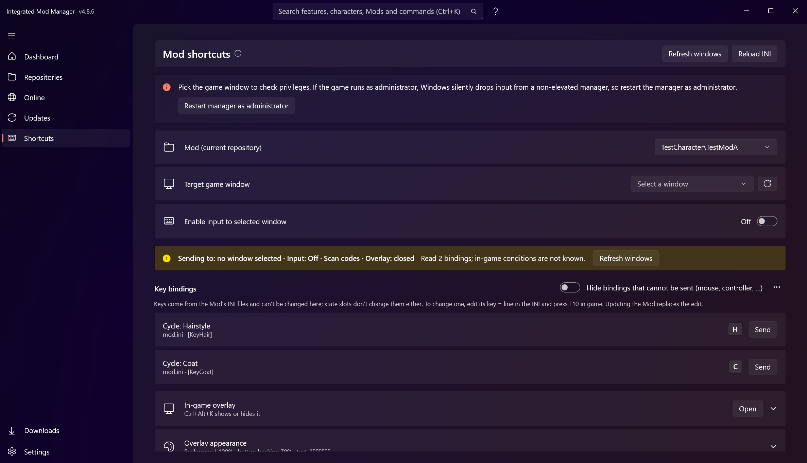
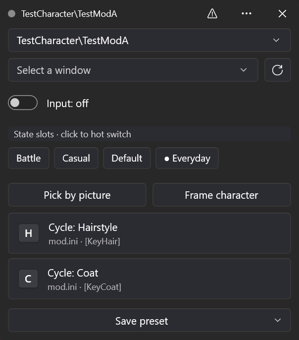

# 快捷键面板与置顶浮窗

> 适用于 4.8.6（浮窗布局自 4.8.2 起）。[English](../en/Shortcut-Panel.md) · [用户手册](./用户手册.md)

“快捷键”模块读取 Mod INI 里的 `[Key…]` 绑定，点一下就向游戏发送对应按键，不用记快捷键，也不需要实体小键盘。置顶浮窗可以在游戏画面上方使用：切换 Mod、保存预设、热切换状态槽位，并能跟随当前出场角色。

## 开始使用

页面是一列卡片。上面是 Mod、目标游戏窗口和输入开关，接着是状态栏和这个 Mod 的按键绑定，每个绑定以键帽样式显示按键，并附动作说明、来源节和条件。再往下是可以展开的卡片：“游戏内浮窗”“浮窗外观”“状态槽位与预设”“角色跟随”“发送方式”；收起时标题行显示当前状态，浮窗的“打开”按钮在“游戏内浮窗”的标题行上。

1. 在左侧导航打开“快捷键”，选择当前仓库中的 Mod。
2. 选择目标游戏窗口，开启输入。游戏已经在运行时，管理器会自动选中游戏窗口（终末地 `Endfield.exe`，以及原神、星穹铁道、绝区零；优先选当前仓库对应的游戏）。打开浮窗或在浮窗里开启发送时，也会重新识别一次，所以先开管理器、后开游戏也没关系。为了安全，发送开关仍然需要你手动打开。
3. 点击按键按钮即可发送。Num5 发送的是数字小键盘 5，与数字行的 5 不同。

**终末地需要以管理员身份运行管理器。** `Endfield.exe` 始终以管理员权限运行，Windows 会静默丢弃普通权限程序发给它的模拟按键。管理器会在发送前识别这种情况并提示，点击“以管理员身份重启管理器”（会弹出一次 UAC）即可。以管理员身份运行时，Windows 不允许从资源管理器拖放文件到管理器，导入 Mod 请使用选择文件按钮。

## 置顶浮窗

- 点击“游戏内浮窗”标题行的“打开”，或用全局快捷键 **Ctrl + Alt + K**（默认）显示或隐藏；快捷键可在同一张卡片里更换或禁用。**✕** 隐藏浮窗，提示里写明快捷键。
- 浮窗不抢焦点，点击按钮后游戏仍保持前台。
- **布局（4.8.2）：**
  - **标题栏**：拖动它移动浮窗。左边的圆点表示状态：绿色是正在向所选窗口发送，琥珀色是选了窗口但发送已关闭，灰色是还没选窗口。接着是当前 Mod 的名称、最近一次读取或发送结果的图标（没选窗口时是警告图标；指向它或用键盘聚焦它可以看到全文，点击可以固定显示）、**⋯** 菜单和 **✕**。
  - **上部**：Mod（和快捷键页是同一个 Mod）、目标窗口和刷新按钮，以及“发送”开关，开启时为绿色。没在游戏里启用的 Mod 会标“未启用”：按键会显示但不能发送，浮窗会说明怎么启用。紧凑模式下隐藏窗口和开关。
  - **中部**：状态槽位，然后是键帽样式的按键，点一下就发送；内容多时可以滚动。
  - **底部**：“保存预设 ▾”，里面是“保存组合预设”和“保存单 Mod 预设”。需要你处理的失败（预设没保存、槽位切换或按键发送失败）会在它上方完整显示，直到下一次结果出现。
  - **⋯ 菜单**：紧凑模式、紧凑模式下按键的字号（12–20）、鼠标穿透、背景不透明度和“重新读取 INI”。
- **大小和位置**：高度跟着内容走，最高到你拖出来的高度；拖动边缘或角可以调整大小（最小 300 × 120）。按显示器记住大小和位置，下次在那台显示器上恢复；那台显示器不在了，就回到主显示器上的默认位置。靠近屏幕边缘时会贴边。
- 浮窗跟随应用的浅色或深色主题，使用和主窗口一样的控件。
- 背景不透明度可调（10%–100%），只影响背景，文字始终不透明。按钮和标签有各自的底板，可以单独设置（0%–100%，默认 70%），所以浮窗调得很透明时，文字下面仍有底色。背景不透明度低于 60% 时，按钮文字以外的文字还会加一层细阴影。默认文字颜色跟随主题，也可以另选颜色；深色文字会改用浅色底板和阴影。
- 可选，默认关闭：“在浮窗保存预设时截图”会随预设保存一张游戏画面的小图。之后浮窗的状态槽位会显示这张图，鼠标悬停时放大，恢复确认框也会显示保存时的样子。截图可能包含 UID、昵称和聊天内容；图片只保存在本机，不会放进诊断报告。独占全屏的游戏通常只能截到黑屏，黑屏不会保存。开启槽位切换后，先点一个槽位，再点“框选角色”：浮窗会变成一个空的取景框，移动并调整大小框住角色后点“截取”，图片就归这个槽位。取景框可以勾选“锁定大小”，也可以“设为默认区域”：设好后，保存单 Mod 预设时自动截取这个区域，可在快捷键页清除。点“图片切换”时，浮窗会移到屏幕中央，横向列出当前 Mod 各槽位的图片，选一张就切换到对应槽位。另有开关可以让浮窗槽位只显示文字。
- 保存状态槽位时，Mod 菜单的开关、页码和位置默认不保存，主窗口会列出这些变量让你选择保留。快捷键页还能调整加载器的自动保存间隔，修改前会备份 d3dx.ini。
- “浮窗外观”里的“清晰”“平衡”“极简”一键设置背景、底板和紧凑布局。浮窗 ⋯ 菜单里的“紧凑”只保留 Mod、状态槽位和按键。同一菜单里的“鼠标穿透”让浮窗只显示、不响应鼠标，按显示/隐藏浮窗的快捷键恢复；没有开启这个快捷键时不能使用。在主窗口选中状态槽位或组合预设后，可用“设置预览图”从游戏截取、选择本地图片或清除。
- “自动对比度”（默认关闭，需要 Windows 10 2004 或更高版本）：背景不透明度低于 60% 时，浮窗每 1.5 秒看一次身后的画面，自动换用深色或浅色文字。保存的仍是你选的颜色；判断亮度时会排除浮窗本身。
- 浮窗内可用的操作：
  - **切换 Mod**：列出已启用（已部署到加载器 Mods 目录）的 Mod；快捷键页选中的 Mod 即使没启用也会显示，并标明“未启用”。
  - **目标窗口与发送**：在浮窗里选择窗口（刷新按钮重新列出窗口），用开关暂停或恢复发送。
  - **重新读取 INI**（⋯ 菜单）：重读已部署的 Mod、当前按键与状态槽位。启用、停用、切换链接或恢复组合成功后也会自动刷新；当前 Mod 被替换时选择新 Mod，没有替代项时清空旧按键。
  - **保存预设 ▾ → 保存组合预设**：把当前启用的 Mod 组合和 `d3dx_user.ini` 中的参数保存为组合预设。保存前发送 F10，等待参数文件变化且两次读取相同后再捕获；5 秒内文件没有变化时，浮窗会询问是读取现有文件保存（通常是参数自上次保存后没有改动），还是取消。F10 会短暂重载画面。没有设置 `d3dx_user.ini` 时只保存 Mod 组合。
  - **保存预设 ▾ → 保存单 Mod 预设**：在浮窗中输入名称并保存。仅捕获点击时选中的 Mod，保存为该 Mod 的状态槽位；空名称和此 Mod 内的同名名称不能保存。取消不会创建预设。命名时浮窗临时获取键盘焦点，结束后把焦点交还游戏窗口。命名后先发送 F10 并等待加载器写入，5 秒内没有变化时同样可以选择读取现有文件或取消。保存期间不更改文件属性；有热应用正在进行时先等它结束。未部署、缺少参数或保存失败时会在浮窗中提示。
  - 保存前不能发送 F10（未选窗口、发送未开启、权限不足）时，可以取消去设置，或明确选择“只读取现有文件”；后者可能包含旧参数。
  - **状态槽位热切换（实验，默认关闭）**：
    - 在“游戏内浮窗”模块里打开“在置顶浮窗中热切换状态槽位”后，浮窗会列出当前 Mod 的状态槽位，带 ● 的是当前槽位。
    - 点击一个槽位，会把它的值写入 `d3dx_user.ini`，再向选定的游戏窗口发送 **F10**。
    - 发送 F10 的几秒内，管理器会把 `d3dx_user.ini` 暂时设为只读，防止加载器重新加载时用内存里的旧值覆盖文件。
    - 需要先选择游戏窗口并开启发送。写入前会备份文件；结果在浮窗的状态图标里，失败时会完整显示。
- 主窗口恢复状态槽位或整份 `d3dx_user.ini` 快照时，也可以勾选“游戏正在运行：写入后向游戏窗口发送 F10 热重载（实验）”，不用退出游戏。
- 热应用依赖加载器在 F10 时重新读取 `d3dx_user.ini`（3DMigoto/XXMI 的默认行为）。如果 F10 没有送达，写入的值会在退出游戏时被加载器覆盖，状态行会提示。
- 状态槽位的详细说明见[状态槽位](./状态槽位.md)，组合预设见[组合预设](./组合预设.md)。
- 恢复组合预设、仓库设置、在线下载等需要退出游戏或需要大量确认的操作仍在主窗口进行。

浮窗适用于窗口化和无边框全屏；独占全屏是否显示取决于游戏。

## 跟随当前出场角色

1. 选择目标游戏窗口，点击“框选识别区域”，拖框选出**只随当前出场角色变化**的头像或名称，不要选择始终显示整个队伍的列表。
2. 在游戏中切到某个角色，在管理器中选择该角色的 Mod，点击“保存当前角色参考图”。对每个需要跟随的角色重复此步骤。
3. 打开“角色跟随”模块标题行的开关。程序约每 700 毫秒比对一次，连续 3 次匹配才切换；匹配度低、难以区分或游戏不在前台时不切换。

手动选择 Mod 会暂停跟随。参考图只保存在程序目录 `character-references` 中，按仓库区分，只保存裁剪后的 24×24 像素特征，不保存完整截图，也不上传。分辨率、HUD 比例或界面变化后可能需要重新校准。

## 为什么有些快捷键选不了

无法发送的绑定会显示原因和原始写法，也可以开启“隐藏无法发送的绑定”。

| 原因 | 例子 | 解决办法 |
| --- | --- | --- |
| 鼠标按键 | `VK_LBUTTON`、`VK_XBUTTON1` | 通常是 Mod 内置菜单的点击或拖动，需要鼠标指在游戏画面上，面板无法代替。直接用鼠标操作。 |
| 手柄按键 | `XB_LEFT_THUMB`、`XB_DPAD_UP` | 键盘模拟无法产生手柄输入。同一节通常还有键盘绑定，面板会列出可发送的那一条。 |
| 系统组合键 | `alt F4`、`WIN` 键 | 为防止误关游戏或触发系统功能而禁用。确需使用请在 Mod INI 中改成其他按键。 |
| 无法识别 / 条件矛盾 | 拼写错误、同一键既要求按下又要求不按 | 检查并修正 Mod INI 中的 `key =` 写法。 |

## 支持范围

- 按 3DMigoto 规则解析：最后一个键触发，前面的键需按住（如 `VK_RETURN VK_UP`）；`no_` 可排除任意键。支持字母、数字、F1–F24、数字小键盘、导航键、常用标点键和 Ctrl/Alt/Shift 组合。
- 读取启用的 INI，跳过 `DISABLED` 文件和子目录；只读，不修改 Mod INI。
- 要改 Mod 的按键，点“显示 INI 文件”，编辑 `key =` 行，然后在游戏里按 F10。复制模式下，已部署的副本也要改。更新 Mod 会覆盖这些修改。状态槽位只保存参数值，恢复时不会改变按键；浮窗快捷键（Ctrl + Alt + K）只负责显示和隐藏浮窗。
- “发送方式”模块里设置：默认使用扫描码发送，也可切换为虚拟键模式；单次按压时间默认 200 毫秒，可调为 100–2000 毫秒；长按类绑定使用单独的持续时间。扫描码模式下小键盘数字需要开启 Num Lock，可用模块中的“切换 Num Lock”按钮。
- 发送前校验目标进程和窗口，检查是否有其他键被按住，完成、失焦或关闭时释放本次按下的键。只有用户点击才会发送，角色识别不会自动执行快捷键。
- 同一个键可能触发多个 Mod；面板无法绕过加载器的按键冲突。INI 条件只做展示，不假定在游戏中成立。

## 排查

- 游戏没有反应：确认目标是游戏本体并已开启发送；查看是否提示权限不足；分别试扫描码和虚拟键模式；可把按压时长调到 500 毫秒。
- 每次点击会在 `WinUI3/diagnostics/shortcut-input.jsonl` 写一条本地诊断（输入模式、按键、Windows 接收数量、前台窗口、权限检查），不会上传。Windows 接收了输入不代表游戏一定执行了 Mod 动作。
