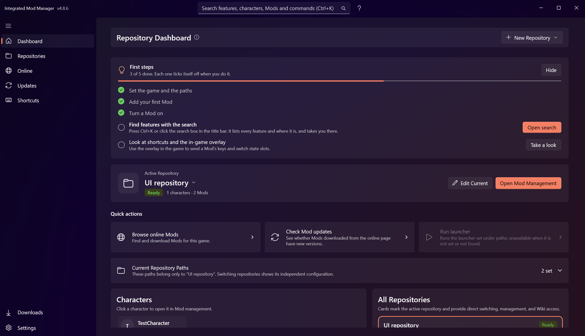

# 快速上手

> 适用于 4.8.7。[English](../en/Quick-Start.md) · [完整用户手册](./用户手册.md) · [文档索引](../../README.md)

## 安装与首次设置

1. 安装 .NET 8 x64 运行时，把发布包完整解压到一个较短的可写目录；不要在 ZIP 内运行。
2. 双击 `IntegratedModManager.exe`，保留 `WinUI3`、`LocalUpdateAgent.exe` 等文件的相对位置。第一次安装时会按系统语言选择界面语言，并询问要管理哪个游戏；选“稍后设置”可以跳过。
3. 在仪表板创建或选择仓库：“Mod 仓库”设为两层 Mod 目录的根目录，“目标文件夹”设为游戏或 XXMI 读取的 Mods 目录。
4. 可选：开启“使用目录联接部署 Mod”，选择外部启动器；终末地仓库可以设置内置启动。
5. 打开“仓库”页。仓库还没配好时，“开始使用”卡片会列出剩下的步骤。

第一次安装后，仪表板顶部有一张“上手清单”卡片：设置路径、添加第一个 Mod、启用一个 Mod、用搜索找功能、看看快捷键和浮窗。每项做完会自动打勾，旁边的按钮会带你到对应的位置；点“隐藏”关掉，以后可以在搜索里找“显示上手清单”再打开。它不会弹窗，也不会挡住页面。

推荐结构：`Mod 仓库\角色\具体 Mod\文件…`。第一层是角色或分类，第二层是实际部署的完整 Mod 文件夹。

## 主要功能

- **导航与搜索**：`Ctrl+K`（或点标题栏的搜索框）打开搜索。默认是“详细”显示：不输入文字时像 Windows 8 的开始屏幕一样铺满窗口，每个功能一块磁贴，按页面分组、左右滚动（滚轮也可以），常用功能是宽磁贴并直接写出位置（设置项不放磁贴，打字可以搜到），指向磁贴会显示它在哪里；第一次点一个功能会切到那一页，并用强调色框出它的位置；之后再点就直接使用它。打开时从左下角弹出，后面的页面模糊地透出来，Tab 在分组之间切换。输入文字可以搜功能、页面、当前仓库的角色和 Mod，功能也能用别的说法搜到（例如“回滚”“d3dx_user”）。在“设置 › 界面与语言 › 搜索显示方式”可以改成“简略”。标题栏的 ? 按钮打开当前页的使用说明。每页第一次打开时顶部会有一条提示，点 ✕ 后不再出现。导航可以收起成图标栏，下载进度显示在导航底部。
- **仓库与角色头像**：不同游戏分仓库管理；角色列表显示头像，可自定义或绑定到角色。
- **部署 Mod**：Mod 列表显示缩略图、标签、快捷键数量、大小和部署状态，可按部署状态筛选。双击 Mod 或使用详情底部的部署按钮；再次操作会移除。目录联接模式下默认每个角色只启用一个，可按角色打开多选。
- **导入**：ZIP、7Z、RAR、TAR 等压缩包，点击导入或拖到 Mod 区域。
- **预览与信息**：自动查找预览图，也可拖入图片；信息表显示并可编辑来源链接和标签，可复制位置，并显示大小。
- **状态槽位**：每个 Mod 都有“默认”槽位；把一个 Mod 的参数保存为多个命名槽位，可配图片，可写入 Mod 默认值、导入变体文件、保存整份 `d3dx_user.ini` 快照。[详细说明](./状态槽位.md)
- **快捷键与浮窗**：点击发送 Mod 的按键；置顶浮窗（Ctrl + Alt + K）可在游戏中切换 Mod、选择目标窗口、保存预设（先自动发送 F10）和热切换槽位；它跟随应用主题，高度跟着内容走，紧凑模式、鼠标穿透和不透明度在 ⋯ 菜单里。[详细说明](./快捷键与浮窗.md)
- **组合预设**：保存启用的 Mod 组合及参数，恢复时先恢复组合再回写参数；可导出组合包。[详细说明](./组合预设.md)
- **分享与批量操作**：把方案分享成不含 Mod 文件的小文件；Mod 列表上方的“批量”可以把多个 Mod 加入预设、复制或导出成组合包，也可以批量删除。
- **其他游戏**：原神、崩坏：星穹铁道、绝区零的仓库可以用“运行启动器”通过 XXMI 启动。
- **在线浏览下载**：按角色浏览 GameBanana，收藏角色和作者、稍后下载、批量下载，下载后自动安装，还可以在管理器里打开 Mod 的 GameBanana 页面点赞。[详细说明](./浏览与下载.md)
- **Mod 更新与安全**：追踪在线安装的 Mod 并提示更新，“更新”页可以按状态筛选和搜索；部署前检查冲突，失败自动回滚。
- **软件更新**：确认后自动下载、安装并重启，失败时回滚。
- **设置**：中文/English、主题（可跟随系统）、高对比度、界面密度、减少动效；可导出脱敏诊断报告。

## 常用操作

| 操作 | 方法 |
| --- | --- |
| 部署或移除 Mod | 双击 Mod，或使用详情底部的部署按钮 |
| 换头像、重命名、打开文件夹、允许多个 Mod | 选中角色，用 Mod 卡片标题旁的按钮（也可以右键角色） |
| 找某个功能在哪 | `Ctrl+K`，详细显示会列出全部功能和位置 |
| 保存状态槽位 | 选中 Mod → 右侧“状态槽位” |
| 保存或恢复组合 | 仓库顶部切换到“组合预设” |
| 分享方案 | 组合预设 → “分享方案”/“导入方案” |
| 同时处理多个 Mod | Mod 列表上方的“批量” |
| 在游戏中操作 | 按 Ctrl + Alt + K 打开置顶浮窗 |
| 导入压缩包 | 选中角色后点导入，或拖到 Mod 区域 |
| 搜索功能、页面、角色和 Mod | `Ctrl+K` |
| 设置预览图 | 选中 Mod 后把图片拖入预览区 |
| 刷新当前页 | `F5` |
| 切换页面 | `Alt+1` 至 `Alt+5` |
| 聚焦搜索 / 打开更新页 | `Ctrl+F` / `Ctrl+U` |

## 注意事项

- 终末地需要以管理员身份运行管理器，快捷键才能送达游戏；以管理员身份运行时无法拖放文件，请用选择文件按钮。
- 程序没有商业代码签名，SmartScreen 可能提示未知发布者。请只从官方 GitHub Releases 下载。
- 在线功能不会绕过登录、付费、订阅、权限或作者限制。
- 升级前备份程序目录和加载器实际使用的 `d3dx_user.ini`。撤销部署不会撤销参数。
- 第三方 Mod 与加载器可能导致账号处罚。分享配置、截图或诊断报告前，检查是否包含个人路径或账号信息。

项目地址：<https://github.com/uyujkk/Integrated_Mod_Manager>
