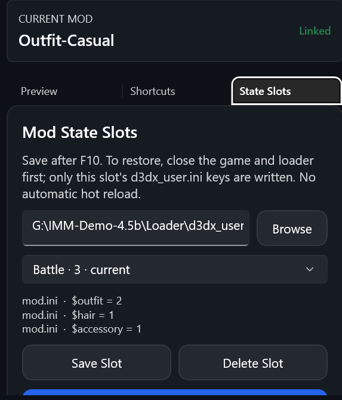

# 单 Mod 状态槽位

> 适用于 4.5 及之后的版本。[English](../en/State-Slots.md) · [用户手册](./用户手册.md)

很多 Mod 用 `global persist` 变量记录外观状态（例如服装、发型、配件），加载器把当前值保存在 `d3dx_user.ini` 里。状态槽位把**一个 Mod** 的这些值保存为命名的组合，可以随时切换回去。

## 保存槽位

1. 在游戏中把 Mod 调到想要的状态，按 **F10** 让加载器把参数写入 `d3dx_user.ini`。
2. 在管理器中选中这个 Mod，打开右侧“状态槽位”页。第一次使用时选择加载器实际使用的 `d3dx_user.ini`。
3. 点击“保存新槽位”并命名。

- 只保存这个 Mod 声明的数值型 `global persist` 参数，不涉及其他 Mod。
- 参数必须已经写进 `d3dx_user.ini`；缺少时不会用 Mod 的默认值代替。
- 每个 Mod 可以保存多个槽位；最近保存、更新或恢复的槽位标为“当前”。
- 也可以在游戏中用置顶浮窗的“保存单 Mod 预设”保存槽位，浮窗会先自动发送 F10，见[快捷键与浮窗](./快捷键与浮窗.md)。

## 恢复槽位

- **游戏已退出**：选中槽位，点击“恢复到加载器”。只写入这个槽位对应的键，其他 Mod 的参数保持不变；写入前备份文件。
- **游戏正在运行**：勾选“游戏正在运行：写入后向游戏窗口发送 F10 热重载（实验）”，见下文“热应用”。

## “更多…”菜单

- **用当前值更新所选槽位**：重新读取 `d3dx_user.ini`，覆盖所选槽位。
- **重命名所选槽位**。
- **把所选槽位写入 Mod 默认值**：把槽位的值写进 Mod 自己 ini 里的 `global persist $变量 = 值`，以后清空或删除 `d3dx_user.ini` 也不会丢。
  - 写入前每个文件都会在旁边备份为 `.imm-persist-*.bak`，写完读回核对，失败自动还原。
  - 复制模式下，已部署的副本会一起修改。
  - 更新这个 Mod 时新版本会覆盖这些修改，旧文件保留在更新备份里。
- **导入变体文件（待验证）**：读取 Mod 文件夹里其他工具导出的变体 JSON（没有时可以手动选择），每个变体导入为一个槽位，文件中标记的当前变体设为“当前”。对不上这个 Mod 声明的键会被跳过并计数。这项功能还没有用真实导出的文件验证，导入后请在游戏里确认效果。
- **整份 `d3dx_user.ini` 快照**：保存、恢复、打开快照文件夹。
  - 快照保存整个文件，按仓库存放在 `WinUI3/snapshots/user-ini/`，作为手动还原点。
  - 恢复会让**所有** Mod 的参数回到快照时的值。当前文件会先备份为 `.imm-snapshot-*.bak`；恢复前请完全关闭游戏，或使用热应用。

## 热应用（实验）

游戏运行时，加载器会在按 F10 和退出游戏时把内存里的值写回 `d3dx_user.ini`，所以直接改文件没有用。热应用的做法是：写入槽位的值后，在发送 F10 的几秒内把 `d3dx_user.ini` 暂时设为只读，让加载器读到刚写入的值，之后恢复文件原来的属性。

- 需要先在“快捷键”页选中游戏窗口并开启发送；终末地需要以管理员身份运行管理器。
- 在主窗口恢复槽位或快照时勾选“游戏正在运行：写入后向游戏窗口发送 F10 热重载（实验）”。
- 在“快捷键”页打开“在置顶浮窗中热切换状态槽位”后，浮窗会列出当前 Mod 的槽位，点一下即可切换。
- 依赖加载器在 F10 时先保存再读取 `d3dx_user.ini`（3DMigoto/XXMI 的默认行为）。如果 F10 没有送达，写入的值会在退出游戏时被覆盖，状态行会提示。

## 数据与备份

- 槽位保存在 `WinUI3/beta-shell.json` 的 `ModPersistentSlots` 中。重命名目录、修改命名空间或更换 Mod 版本后，可能需要重新保存。
- 参数写入的备份放在参数文件旁边：`d3dx_user.ini.imm-persist-*.bak`（槽位恢复）、`.imm-snapshot-*.bak`（快照恢复）。撤销部署不会撤销参数；不要用旧的整文件备份覆盖后来有效的修改。
- 文件写入成功不代表游戏画面一定正确，请在游戏里确认。

开发者测试方法（模拟加载器）见 [状态槽位与 F10 热应用测试](../../development/State-Slots-Hot-Apply-Testing.zh-CN.md)。
