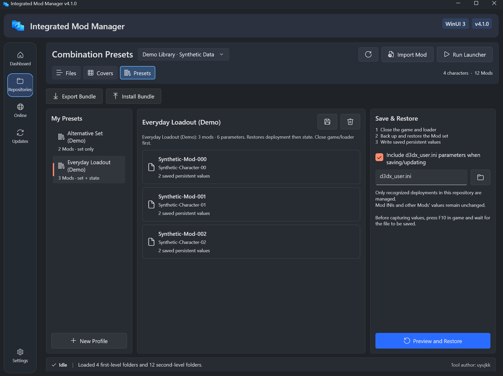

# 组合预设与组合包

> 适用于 4.7.0。[English](../en/Combination-Presets.md) · [用户手册](./用户手册.md)

组合预设保存当前仓库**启用了哪些 Mod**，还可以同时保存这些 Mod 在 `d3dx_user.ini` 中的参数。恢复时先恢复 Mod 组合，再回写参数。组合包把预设连同 Mod 文件一起导出，可以在另一个仓库安装。

只想保存或切换**一个 Mod** 的多套参数，请用[状态槽位](./状态槽位.md)。

## 保存组合

在仓库顶部切换到“组合预设”。

1. 在当前仓库部署需要的 Mod。
2. 需要保存参数时：在游戏中调整好状态，按 **F10** 让加载器写入参数。
3. 勾选“同时保存 d3dx_user.ini 参数”，选择加载器实际使用的文件。
4. 点击“新建方案”并命名；“更新方案”覆盖当前选中的方案。

只想保存启用组合时，取消参数选项。左侧列出当前仓库的预设，中间显示成员和参数数量。

Mod 列表上方的“批量”可以一次把多个 Mod 加入预设，也可以把选中的 Mod 导出成组合包（只含 Mod 文件）。选中的预设也可以设置图片：“设置预览图”可以从游戏截取、选择图片或清除。

**在游戏中保存**：置顶浮窗的“保存预设”会先向游戏窗口发送 F10，等加载器写入完成（连续两次读取一致）后再保存；5 秒内没有写入时，会询问是读取现有文件保存还是取消。没有设置 `d3dx_user.ini` 时只保存 Mod 组合。见[快捷键与浮窗](./快捷键与浮窗.md)。

## 恢复组合

1. 退出游戏和加载器。
2. 选择预设，点击“恢复组合”，检查将要安装、移除的 Mod 和参数变化。
3. 确认后，程序先恢复可识别的 Mod 部署，再写回匹配的数值型持久参数；其他 Mod 的参数保持不变。

- 目录联接模式下，如果某个只允许单选的角色在预设中有多个 Mod，会先询问是否继续。
- 未知目标目录、命名空间冲突、重复部署名或文件被同时修改时会停止，并保留现场。
- 恢复不改写 Mod 原始 INI，也不向游戏发送按键。

## 分享方案（不含 Mod 文件）

“分享方案”把所选预设写成一个小的 `.imm-share.json` 文件：用到的 Mod（按它们在仓库中的路径，例如 `角色/Mod`），以及预设保存过的参数。文件里没有 Mod 文件。

- “导入方案”会先显示这个仓库有其中多少个 Mod、缺少哪些，以及来自其他游戏时的提醒。缺少的 Mod 只会列出，不会下载。
- 导入后新建一个只含已有 Mod 的组合预设，并为其中有参数的每个 Mod 建一个同名状态槽位。已有同名槽位不会被替换。恢复预设之前不会部署任何 Mod。
- 路径、变量和数值都按不可信输入逐项检查。超过 4 MB 的文件会被拒绝，导出后会超过的方案也不会导出。

需要连同 Mod 文件一起给别人时，改用组合包。

## 组合包

“组合预设”中的“导出组合包”和“安装组合包”用于在仓库之间迁移：

- **导出**：打包所选预设**已保存的**参数和全部对应的 Mod 文件。要包含最新状态，先“更新方案”。
- **安装**：先预览，列出新安装、文件完全相同可复用、以及冲突的 Mod。内容不同的已有 Mod 不会被覆盖，也不会自动改名。
- 确认后保存为新预设，默认接着进入恢复确认；也可以取消勾选，只安装并保存。恢复前请退出游戏和加载器。
- 只支持本程序生成的组合包 ZIP，不会把普通 Mod 压缩包当成组合包。组合包不加密，分享前检查其中的私人文件和作者许可。

格式与测试细节见[组合包说明](../../development/Combination-Bundles.md)。

## 参数与备份边界

- 只支持可识别的数值型 `global persist` 参数；保存时参数必须已写入 `d3dx_user.ini`，不会用 Mod 的默认值代替。
- 只管理当前仓库可识别的部署。复制模式按唯一同名目录识别，无法区分手工创建的同名副本，请检查移除清单；目录联接会核对实际目标。
- 预设保存在 `WinUI3/beta-shell.json` 的 `ConfigurationProfiles` 中。重命名目录、修改命名空间或更换 Mod 版本后，可能需要重新保存。
- 写入参数前会在文件旁生成 `d3dx_user.ini.imm-persist-*.bak`；安装备份在“更新”页的“安装备份”卡片。撤销部署不会撤销参数，不要用旧的整文件备份覆盖后来的修改。
- 文件验证不等于游戏画面验证。本功能不保证兼容任意 Mod、加载器或游戏环境，也不保证账号安全。
